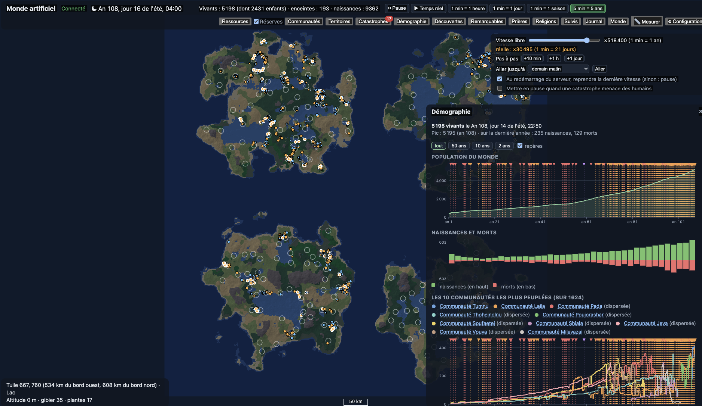

[Français](README.md) · **English**

# Artificial World

Simulation of a human community born from a founding myth. Client-server application: a .NET 10 server with a built-in HTTP server (Kestrel), and a web client opened in the browser.

Version 0.32.5 (shown in "Configuration"), author: MicG.



## Prerequisites

- .NET 10 SDK
- Node.js 22 or later (only to modify the web client)

## Run

```bash
cd src/Monde.Serveur
dotnet run
```

Then open http://localhost:5080: the page shows "Connected to the server" and the map of the continent with the starting humans.

At the top, the world date and the preset speeds: pause, real time, then fast-forward up to "5 min = 5 years". The "Time" panel, on the right just below the button bar (it follows its height, spanning several lines when the screen is narrow), gives full control; ▴ collapses it to the free speed only, and the browser remembers this choice:

- **Free speed**: a slider from slow motion (×0.1) to ×10,000,000. The world goes as fast as the machine allows; the speed actually reached is displayed next to it, in orange when the machine cannot keep up.
- **Step by step**: pauses, then advances by 10 minutes, one hour or one day.
- **Go to**: tomorrow morning, the next season, the next year, the next birth, the next death or a specific date. The world runs at maximum speed, then pauses and announces it. Changing speed or "Stop" cancels the goal.
- **Restart**: a checkbox chooses whether, when the server restarts, the world resumes paused (the default) or at its last speed.

To go faster, run the server in Release mode: `dotnet run -c Release` (watch the spelling: with `-c Realease`, the server runs without optimizations). The map darkens at night. The year has 4 seasons of 90 days, and the length of the day varies with the season.

The world is saved every 10 seconds and when the server stops (Ctrl+C), in a SQLite file:

- macOS: `~/Library/Application Support/MondeArtificiel/mondes/monde.db`
- Windows: `%LOCALAPPDATA%\MondeArtificiel\mondes\monde.db`
- Linux: `~/.local/share/MondeArtificiel/mondes/monde.db`

On restart, the world resumes at the saved date (paused, unless configured otherwise). To start over from scratch, use the "⚙ Configuration" button on the page (see below) then "Create this world"; the same window saves and restores a world. The old world is copied to `monde-avant-reinitialisation.db` alongside (only the latest copy is kept). The folder is changed with the `Monde:Dossier` setting. The [database manual](docs/manuel-base-de-donnees.md) details the files, backups, the size of the log and the copy for analysis.

The founders (33 couples by default, aged 14 to 40, number and location adjustable) appear on the map: orange dot for a woman, blue for a man, grey cross for a dead person. The "Alive" counter is at the top. Hovering over a human shows their name, age, what they are doing and their needs (hunger, thirst, fatigue, cold, health). Names are drawn at random for the observer; at the start humans have no language, then each community forges its own (see below), and names in its language are added.

Desire is an instinct that appears at puberty (humans do not know that it leads to a birth). They mate with their partner or with a human from another couple. Nothing is fixed in advance: each human has their own biology, partly inherited from their parents (age of puberty around 16, menopause around 49, individual fertility, 3% sterility), and the starting values come from studies of hunter-gatherers, cited in `Humains/Biologie.cs` and `Humains/Reproduction.cs`. The chance of conceiving depends on age, hunger, health and breastfeeding (almost nil in the first year; breastfeeding lasts until about age 3). Pregnancy lasts about 268 days, somewhat more or less for each woman; miscarriage, stillbirth, twins and death of the mother carry risks that vary with age, number of children, hunger and health.

Each person also has their own attachment to their children: strong in most, weak in a few. An attached parent will go to join a distant child and shares food and water with them; a mother with little attachment may neglect her baby when she is suffering. Babies stay in their mother's arms until age 2. Small children then stay very close to whoever looks after them, who leads them to water, food and shelter; they learn the places by watching, and leave alone only at their own age of autonomy, specific to each child, around 3 to 6 (Konner 2005; Crittenden et al. 2013). An orphan is taken in by the adult who loves them most (Hrdy 2009). Until age 14, children follow their own people; they leave and arrive with them in a community (“with her daughter X (3 years old)”), and real hostility hardly forms toward a child. Before puberty, the profile shows neither attraction nor orientation. On the map, a child is a small dot and a pregnant woman has a white outline.

Each human has their own **character** and **intelligence**, innate and partly passed on to their children (`Humains/Psyche.cs`): the five major traits of the Big Five model (openness, conscientiousness, extraversion, agreeableness, neuroticism), self-transcendence (spiritual or down-to-earth, after Cloninger), attachment to their children and endurance. Intelligence follows the IQ scale (mean 100, standard deviation 15): a general intelligence and verbal, spatial, manual, memory and artistic aptitudes; a few rare humans have an exceptional artistic talent. Charisma is deduced from character; the central figure of a group is not designated, it emerges.

These traits are not drawn separately: they are **linked to one another** as research shows (`Humains/Psyche.cs`, `Humains/Morale.cs`). To the five major traits (correlations from van der Linden et al. 2010) are added **honesty-humility** (Lee and Ashton 2005), **emotional empathy** (feeling what the other feels) and **cognitive empathy** (understanding them), **compassion**, **psychopathy** (continuous; about 1% of adults have the profile, two to three times more men; coldness, absence of remorse, charm that masks manipulation, noted in the secret garden), the **attachment style** (secure, avoidant or anxious, about 56/25/19%) and five **moral foundations** (care, fairness, loyalty, authority, purity; Graham et al. 2011). A community's morality is the average of that of its adults and changes with them. These traits have effects: food thefts (above all by the dishonest and psychopaths, when hunger presses), care for the sick, consolation of the bereaved, orphans taken in, fear spreading to neighbors, more or less intense grief and jealousy, betrayals, violence, exiles. Each is partly passed on to children according to its measured heritability. Character **matures** with age (more conscientious and calmer between 20 and 40, more agreeable toward old age; Roberts et al. 2006) and great **ordeals** (bereavement, war, exile, betrayal) leave a mark, deeper in the sensitive. Humans in a world created before version 0.17 receive these traits, drawn consistently with their existing character.

If no one is left alive, the simulation **pauses**: the log notes the last death (★), any "Go to" goal is cancelled and a banner offers to restore a backup or create a new world. Nature carries on if time is restarted.

**Memory** is individual: a human remembers waterholes, places where they ate and shelters where they slept (from 2 to 12 of each depending on their aptitude), and forgets them following the Ebbinghaus curve: quickly if they have little memory, slowly if they have a lot, and less and less with each return. A shelter they come back to every season may never be forgotten. When nothing is in sight, they return to a place they remember.

Humans weave **bonds** (familiarity, affection) with those they rub shoulders with: we become more attached to those who resemble us and when we are kind; the quarrelsome and the anxious clash, and crowds create friction. Friendships and hostilities are born and die out; people share their food with those they love, huddle against them for warmth, and move away from those they can no longer stand. Their **mood** varies (hunger, cold, company, births); the death of a loved one plunges their family, friends and community into mourning, for a longer or shorter time depending on each person's sensitivity. A sadness that lasts can turn into depression (the human neglects themselves, abandons their loved ones) and, rarely, into suicide.

**Communities** are not decreed: a community is born when at least 5 humans bound by friendship, including 3 adults, live together. It holds as long as at least 2 of its adults still live together; a member away for a time (hunting, fleeing, raid) remains a member, and a scattered group can be reborn under the same name if its elders find each other again. Thus foundings are rare (a few per year) and groups are lasting. Each human keeps the community where they were born. The "Communities" button lists them with their members, their date of birth, their central figure and the place where they live; choosing one outlines its members on the map.

**Nature is alive** (`Humains/Ecosysteme.cs`). Plants regrow according to the season (winter is lean) and the rains; if picked too much, they regrow more slowly. Game reproduces (logistic growth, about 35% per year at best), dies out locally if hunted too much and gradually comes back from neighboring lands. Each year, rainfall is drawn region by region (32 × 32 tiles): a drought hits a region about one year in ten and can last; the log notes it under the "Nature" heading.

Each human has **reserves** (fat, from 0 to 100) and their own **metabolism**, partly inherited. They spend more walking or hunting than sleeping, and more still when pregnant or breastfeeding. When hungry, they draw on their reserves; when they eat their fill, they rebuild them up to their usual level. Low reserves make people ill more often, dry up milk and block conception (Ellison): fertility thus follows available food, and a large population on exhausted lands has fewer children. Gathering yields according to the richness of the tile.

When a community lacks food (its members' reserves low or the lands around it exhausted), the **famine** is recorded and logged. The group heads for the richest lands that one of its members remembers, or tries its luck far away; most members follow, some stay, and a group can split. Between two communities, the relationship is deduced from the bonds between their members: allied, indifferent, hostile, or rival when they live on the same lands and food is short there. Hunger and rivalry degrade the bonds between the members of the two groups. The "Resources" button colors exhausted lands (yellow then red) and outlines regions in drought (orange) or heavily watered (blue); the "Communities" panel gives, for each one, the state of its lands, the hunger and reserves of its members, its destination and its neighbors.

**Every fact keeps its cause** (`Humains/Emotions.cs`, `Humains/Conflits.cs`). Any event in the log can cite the one that caused it: a pregnancy its mating, a bereavement the death mourned, a depression what triggered it, a departure the famine, a hostility between two groups the violence that gave rise to it. In the log and the profile, "why?" shows the originating event, then its own, and so on. Each person's mood also keeps its **reasons** (bereavement, hunger and thirst, cold, illness, loneliness, rejection, betrayal, anger, gloomy nature), written in plain language: “Vousaer sinks into deep sadness: he mourns his daughter Ana, he feels alone and anger gnaws at him.”

Uniting outside one's couple is neither forbidden nor without consequence. The partner may learn of it, by seeing them or through a friend; their **jealousy** depends on their temperament, their attachment and the custom of their community: indifference, or anger and **resentment** toward the unfaithful one and their accomplice. Anger drives them to confront the offender (a quarrel, sometimes blows, rarely fatal); resentment fades with time into **forgiveness**, or ends in a **separation**. A murder plunges the victim's relatives into mourning, gives them a thirst for vengeance and turns their community against the murderer's. Each community forges a **custom** about fidelity, from the temperament of its members and the affairs that marked it; where infidelity is frowned upon, the group disapproves of the unfaithful one, which can go as far as rejection. The log heading "Jealousy and conflicts" gathers these facts.

Each community has its **identity** and its **history**. At first, the observer names it after its central figure (“Community of …”); one day, a member gifted with speech proposes a **name** that the group adopts if it approves: it evokes their landscape (the river, the forest…), an ancestor, a respected figure, what they have been through, or simply “the humans”. It is an invention: the first group to name itself gives the idea to those who rub shoulders with it. A name can change (the group has left the river that named it, or no longer wants to bear the name of a hated member); the words that make it up are the group's **first words**, carried away in a split. Two allied communities may decide to **unite** (too small, a famine, a common enemy): the smaller joins the other and merges into it. A group's **lands** are those its members have covered during the year: the "Territories" button shows them on the map, today or at the start of any past season. In the communities panel, "Timeline" opens the log of what has happened to the group, and the card of a chosen community gives its successive names, its first words and its size over the seasons.

Communities can wage **war** (`Humains/Guerres.cs`). Nothing is decreed: a group prepares a **raid** against a hostile or rival group close enough (30 km at most) when it has reasons to strike (avenge its own, contest lands that no longer feed everyone) and feels clearly stronger; its figure, if conciliatory, holds its people back. War is **prepared**: the most ardent (anger, grudges, quarrelsome character) pushes the group to wage it; the log notes this **plan** (who is pushing, against whom, why, which allies they call on) and the Communities panel displays it. A few days or weeks later (from 2 days to 4 weeks: longer in a large group, shorter under the sway of a burning vengeance or driven by a charismatic instigator; the date is shown in the Communities panel), the group **debates** it: each man aged 16 to 50 decides for himself whether to follow (his ardor, his esteem for the instigator, the opinion of the group's figure if he respects them, the danger that the cautious weigh, his hunger), and the allies called on accept or refuse. The group **gives up** if almost no one follows, if the enemy is too strong for the assembled troop, if hunger has taken all strength from the warriors, or if the plan no longer has an object (peace made, enemy scattered); otherwise the volunteers set out, never the whole group. Among peoples without chiefs, no one is bound to follow whoever wants war (Boehm 1999; Glowacki and Wrangham 2013). No one yet knows how to make a **weapon**: they strike with fists, throw stones, bludgeon with a branch, depending on what the terrain offers (branches in forest, stones elsewhere) and whether they have had time to seize one; the branch kills most, fists rarely (real weapons will come with discoveries). The troop marches to the enemy camp, waits for dawn and attacks by surprise (as in most fights of stateless societies, according to Keeley 1996 and Wrangham and Glowacki 2012); depending on the surprise and the numbers, there are dead and wounded on both sides, then the troop returns home. The first blood opens a **war**: each death feeds the vengeance of the relatives, the group's **temperament** (from peaceful to warlike) is forged by what it lives through, no one goes over to the enemy while it lasts, and the threat welds the group together. Allied groups that have a common enemy seal a **pact**: their warriors count together and join the raids. A war ends in **peace** (when blood has not flowed for months and the figures are ready for it, all the faster when losses are heavy: grudges subside; the log gives the reasons), in the **defeat** of the weaker (too few in number, its last members join the victor; otherwise its figure chooses to **submit**, and the group delivers a share of its food each week until it becomes strong enough again to refuse, or to **flee** far away), or in the dispersal of one of the groups. A group that re-forms under another name keeps its wars. The Communities panel shows for each group its wars (raids, deaths on each side, outcome), its pacts, its submission or its vassals and its temperament; the log has a "Wars and alliances" filter. **Significant** events (war plan and giving up, allies' answers, raids, start and end of wars, pacts, submissions, catastrophes) are marked ★ in the log, which can show only them ("★ Significant only").

Each human has their **secret garden** (`Humains/Jardin.cs`, table `jardin`): their intentions (avenge a loved one, follow or refuse a war), their fears (hunger, a recurring catastrophe, an enemy raid), their hopes (a child to be born, better lands), their joys and sorrows (births, bereavements, the enemy struck down or the remorse of having killed), what they think of others and of themselves, their beliefs and their questions. After a catastrophe, minds inclined toward the invisible often see a hidden will in it (Guthrie 1993; Barrett 2000), while the curious wonder where it comes from. Each thing has its strength and its cause; it fades over the weeks, more slowly in those with a good memory, and beliefs last for years. The profile shows it by heading, with "why?" to trace back to the event that gave rise to it.

Nature has its **catastrophes** (`Nature/`), without the Entity having anything to do with them. Each continent receives, from its seed, a **geology**: old stable bedrock, rift or active coast (faults and volcanoes drawn on the map). **Earthquakes** follow the Gutenberg-Richter law (ten times fewer earthquakes with each degree of magnitude); they are felt more or less depending on distance (Mercalli scale), landslides kill in the mountains, a strong aftershock often follows, and a large earthquake under the sea raises a **giant wave** that drowns the low coasts. **Volcanoes** rumble for days or weeks before erupting (explosivity index from 1 to 7): lava flows, pyroclastic clouds, ash, and after a very large eruption a **volcanic winter** that cools the world and thins the harvests for years. Lightning starts **fires** that the wind drives, especially in summer and during droughts; **floods** overflow onto the banks, usually slowly (people move aside), sometimes all at once (flash flood); **storms** from the sea hit the coasts in summer and autumn; **cold waves** and **heat waves** weigh on the whole continent. The sky offers **eclipses**, **comets**, **fireballs** (sometimes a meteorite) and, very rarely, **auroras**; a destructive asteroid (10 megatons and more, like Tunguska in 1908) falls on a continent of this size only once in about ten million years, the large ones even more rarely (Brown et al. 2002). The world does not stop at the shores of the map: elsewhere on the planet, a large volcano explodes about once a century (index 6, like Pinatubo) and once a millennium (index 7, like Tambora), and its veil also cools this continent for one to three years (Newhall and Self 1982; Self et al. 1996; Oppenheimer 2003). **New diseases** pass from game to humans (like zoonoses); each has its contagiousness (R0), its duration, its lethality and its immunity, spreads among those who live together and becomes an **epidemic** when it affects several people at once. Frequencies and intensities come from real observations, cited in the code.

Each human reacts according to their character: the cautious flee earlier, sleepers sometimes wake too late; young children, the elderly and the weakened die more often. **Fear** weighs on mood and subsides in a few days, or in weeks for the most sensitive; before a phenomenon in the sky, contemplative minds marvel. Affected nature (burned land, ash, salt water, blown-over ground) turns green again at its own pace: a year and a half for a fern plain or a marsh, two or three years for tropical forest, eight for conifer forest, ten for desert and mountain, much more for land sterilized by lava or an impact (successions after the Yellowstone fires, Turner et al. 2003, and Mount St. Helens, del Moral and Wood 1993). As long as it has not turned green again, a finished catastrophe still has **aftermath**: those who die of hunger, thirst, cold, exhaustion or illness in the lands it devastated count among its dead (“in the lands devastated by the fire”), and on the day they have turned green again, the log gives its **full toll** (killed outright, wounded, dead from the aftermath). Only the damage that the catastrophe itself caused counts. An asteroid of 10,000 megatons or more plunges the world into **the long night**: dust and soot veil the sun, from −0.5 °C for six months to −26 °C for five years for an impact like Chicxulub (Toon et al. 1997; Brugger et al. 2017); those who then die of hunger or cold are attributed to it. All deaths, injuries and fears cite the catastrophe as cause; each affected community records it in its timeline with its dead. The "Catastrophes" button lists those under way and the history (a click shows the affected lands on the map), the diseases and the geology; an **alert** at the bottom of the screen announces each catastrophe that threatens humans (three at most, the most recent on top), a **badge** on the "Catastrophes" button counts unseen serious alerts, and the world can **pause** (checkbox in the "Time" panel, unchecked by default since 0.29.3); the "Show catastrophe alerts" checkbox in Configuration hides them. At the bottom of the panel, "✦ The Entity provokes…" lets you trigger a catastrophe at the chosen location (the form is never redrawn while you fill it in): the log keeps its origin.

The world has **real distances** (`Nature/Echelle.cs`, `Humains/Marche.cs`, `Monde/Geographie.cs`): a tile is 800 m on a side, the continent about 205 km, one degree of altitude 40 m. Everyone walks at their own **pace** (partly inherited), around 4.9 km/h for an adult on flat terrain (Bohannon and Andrews, 2011), slower as a child or elderly, ill, exhausted, pregnant or with a baby in their arms, faster when fleeing. The **terrain** (forest, marsh, snow, ford) and the **slope** (Tobler function) slow walking, so a ten-minute step is not always enough to reach the neighboring tile. Hovering over the map gives the position in km and the altitude in meters; a **scale bar** follows the zoom. The "World" button opens the **World characteristics**: surface area and dimensions of the continent, coasts, highest point, lakes and rivers, terrains, seasonal temperatures, population and density, paces, time to cross the continent on foot (with "show" on the map). The "📏 Measure" button gives, between two clicked points, the straight-line distance, the least arduous route on foot and its walking time. The log, communities and territories speak in km and km².

The world's **configuration** (`Monde/ConfigurationMonde.cs`) is stored in its database (table `etat`; the database is at schema v36, and an old world is migrated on opening): seed, number of starting couples (1 to 200), width and height of the map (51 to 819 km, in tiles of 800 m), number of continents (1 to 6, separated by sea) and starting location of the couples: on the largest continent (the default), on another continent chosen by its size, or spread over all of them in proportion to their habitable land. At each resume, the map is regenerated identically from these settings. A world created before the configuration keeps the original settings (33 couples, 205 × 205 km, one continent), which give back exactly the same map. The "⚙ Configuration" button shows the current world's settings; there you enter those of a new world, see its map ("Preview", the current world does not change), then "Create this world" creates it (the old one is kept as a copy). Settings that leave no room for the couples are refused with the reason. Beyond 400 km on a side, the simulation slows down. The same window also sets, for the current world: the **processor cores** ("Computation": one core, by default, or several; the same seed gives back the same world whatever the number of cores), the **world's leniency** (from 0 to 100%: the share of the risks of illness, childbirth, of the very young and of catastrophes that the Entity wards off; 0 by default) and the **"Log daily life"** checkbox (see the log).

**Backups** are made in the same window: "Back up now" copies the world as it is (without stopping it) into `mondes/sauvegardes/`; the list shows each backup (world date, living humans, size) and "restore" replaces the current world with it, paused. The replaced world is first backed up (`avant-restauration-…`), and the restored backup is not modified. The copy kept before the last creation of a world is restorable too. 🗑, after confirmation, moves a backup to the computer's **trash** (macOS or Windows Recycle Bin, freedesktop trash on Linux), from where it can be recovered as long as it has not been emptied; the world in progress cannot be. The "Followed" button gathers the followed humans and communities ("☆ Follow" on their profile) and their latest news mixed together; followed humans are outlined on the map. The log freezes with ⏸ without stopping the simulation: new events wait (their number is shown) until ▶.

Each human has an **appearance** (facial symmetry and harmony, height, complexion, bearing, partly inherited from the parents) and a **sexual orientation** that is not binary: attraction toward men and toward women, from 0 to 100 (`Humains/Attirance.cs`). The proportions follow the large surveys (Copen et al. 2016; Bailey et al. 2016): among men about 2% homosexual, 2% bisexual, 6% “mostly heterosexual”; among women about 1.5%, 5.5% and 13%. Orientation is partly transmitted (Långström et al. 2010) and, among boys, slightly more often homosexual with each older brother (Blanchard and Bogaert 1996). Someone who is attracted to their own sex may not know it: they move from a poorly understood unease to certainty, over the course of their desires (Calzo et al. 2011). Their **relative beauty** is measured against their community's ideal; their **attractiveness** adds youth, bearing and vigor to it. **Desire** goes first to whoever pleases: attractiveness weighs more than affection and charisma (Eastwick and Finkel 2008). One can be **rejected** because one does not please, out of fidelity, or because the other does not dare: refusal hurts (more in the anxious), acceptance delights, and one no longer approaches for some time whoever rejected us. A **repressed** desire (out of fidelity, because custom disapproves of it, or for someone of one's own sex whom one does not dare love) is noted in the history and the secret garden. Love between people of the same sex is lived in secret where it is frowned upon; a witness may catch them; two who prefer their own sex can form a couple if the group allows it.

Each community has its own **customs** (`Humains/Moeurs.cs`): a tolerance toward these loves, born of its members' open-mindedness (Shackelford and Besser 2007), which grows used to what it rubs shoulders with without drama (Herek and Capitanio 1996) and hardens after a scandal; the custom (disapproved, no established custom, accepted) changes and the log notes it. It also has an **ideal of beauty** (height, complexion, build) that drifts toward the appearance of its members and its figure, and toward fuller bodies when food is scarce (Nelson and Morrison 2005). A community may **drive out** one of its members (`Humains/Exil.cs`) when most of the adults and its figure hold a grudge against them and almost no one defends them (Boehm 1999): the reason (murder, violence, disapproved customs, discord…) and the length of the exile, sometimes open-ended, are noted; the partner may follow; the exile leaves the group's lands and cannot return before the end of the exile. Before the exile, a member whom their people consider good (the group's brightest karma, compassionate, without grievance against the accused) may **plead** for them: each accuser reconsiders according to the esteem they hold for the pleader, and the group relents or shortens the exile; for a murder, the plea rarely succeeds (Boehm 1999). A parent may also **disown** an adult child. Ordinary **diseases** carry their true name in the log, even if no one knows how to name them (`Humains/Maladies.cs`): pneumonia, diarrhea, dysentery, malaria near warm waters, infected wound, tetanus, worms, skin infections (Gurven and Kaplan 2007); tuberculosis appears only beyond a thousand humans, measles beyond 250,000 (Black 1966). New diseases coming from game also carry a real name according to their profile (plague, influenza, leptospirosis, tularemia…).

Clicking on a human opens their **profile**, in collapsible sections (you open the ones you want, and they stay open from one human to the next): current thought, mood, fear, illness and immunities, relative beauty, attractiveness, orientation and what they know of it, exiles and disownings with their reason, grief and what weighs on their mood, anger and grudges, community, family, needs, character, intelligence, biology (including pace and current walking speed), bonds, knowledge and objects, faith, the Entity's gaze, latest thoughts, secret garden, places they remember and history. The names cited (relatives, community) lead to their profile, and a button goes back to the previous profile. The "Journal" button opens the **world log**: births, deaths, illnesses, couples, pregnancies, friendships and hostilities, bereavements, jealousy and conflicts, attractions and rejections, exiles and disownings, communities, nature, catastrophes, discoveries, care, arts, language, prayers and religions, acts of the Entity. Everything is recorded with its cause; you filter by type and by name, and each human name cited is a link to their profile. Routine acts (drinking, taking shelter, resting, sleeping, gathering, exploring, "Day of…" summary) are no longer logged by default, to keep the database light: the "Log daily life" checkbox in Configuration turns them back on. Acts toward others always remain in the history. What the Entity whispered or did is marked ✦.

**Languages.** The interface is displayed in French or English (choice in Configuration, remembered by the browser); the texts are in `langues/fr.json` and `langues/en.json`, and adding a language amounts to copying `en.json` under another code and translating it. Since 0.30.1, the log and thoughts are no longer written while the world runs: each fact is kept as a key and its parameters (humans, communities, numbers, invented words) and the sentence is written at display time, in the browser's language (`Simulation/Recits`). The language file describes its grammar (section `_grammaire`: elisions, contractions such as “de le” → “du”, plural forms); in a text, `{x}` inserts a value, `{^x}` capitalizes it and `{x:a|b}` chooses a form according to gender, number or a yes/no. Communities are named according to the language (“la communauté d'Ana”, “the Tako people”). The switch is made by domain: 0.30.1 translates life and society (births, deaths, bonds, bereavements, couples, quarrels, exiles, thefts, desires, communities and their names, everyday thoughts, days); 0.30.2, the secret garden (inner voice according to character, with its variants and its three registers, and everything humans confide there: bereavements, exiles, wars, prayers, words of the Entity, care…); 0.30.3 and 0.30.4, knowledge (discoveries, inventions and their laws, learning and teaching, forgetting, hygiene, fire, reserves, works, questions and ideas) then groups and nature (wars and raids, visits and gatherings, territories, catastrophes, volcanoes, diseases, sky and weather); 0.30.5, the Entity and the invisible (words, inspirations, acts, humans' view of the invisible, beliefs, solitary and collective prayers, refusals, religions, dogmas and rites, prophets), medicine (healers, trances, care) and language (words, signs, word order). A sentence written before the translation of its domain keeps its French, with a tooltip. The languages invented by humans do not change.

**Terrain and subsoil** (`Nature/Terrain.cs`, 0.31.0 and 0.31.1). Under each tile, a rock drawn from the geological context (granite, basalt, recent volcanic rocks, limestone, flint chalk, sandstone, schists, valley alluvium, salt and gypsum of desert basins) and a soil that follows from it with climate, slope and water (silts, volcanic ash, brown soils, acidic, tropical red, peat, thin soils, desert, saline). The soil changes plants by ±50% around the average of their terrain, game less; a new world starts from what the soil carries, an old world converges toward it. Flint, pyrite, obsidian, clay and ocher now come from the rocks. Cliffs (steep slopes of hard rock) bear rock shelters; limestone and lava flows, caves, which protect from cold better than a forest; springs well up at the foot of walls and caves, hot near volcanoes, salty near salt, and give water to drink. Each river has a discharge (rain that runs off, accumulated downstream; high water in spring, flood in rainy years) and a current (depth × speed, hydraulic geometry of Leopold and Maddock): one fords up to 0.5 to 1 m²/s depending on one's size and caution (Jonkman and Penning-Rowsell, 2008), beyond that one must swim. The deposits (salt, sulfur, bitumen, malachite, native copper, cassiterite, bog iron, river gold, coal, kaolin) are hidden; a human who passes over them may notice them if they outcrop or leave clues, according to their curiosity and sharpness, and remembers them as a place. Nothing is extracted from them yet: what is done with them will come from humans. Everything is computed from the seed and the map, with nothing recorded: an old world receives the same terrain as a new one. The "World characteristics" window gives the summary.

**Coasts and sea** (`Nature/Mer.cs`, 0.31.2). The sea has floors (continental shelf down to 200 m, slope beyond, depth softened near the coasts), shoals offshore and reefs in warm, clear, shallow water, far from river mouths. Each shore tile has its nature: beach, cliff, rocky coast, estuary, delta or marsh. Islands and the shortest sea crossings between two lands are measured, with what can be seen of the other shore, from the beach or from the summits (range set by the curvature of the planet, 3.57 × (√h₁ + √h₂) km, limited to 120 km by haze). The prevailing winds (easterly trade winds, which the summer monsoon can reverse) and surface currents (3% of the wind, along the coasts) are drawn once and for all. Navigation has used it since 0.31.5. Like the terrain, the sea is computed from the seed and the map, for old worlds as for new ones. The "Layers" button shows on the map the rocks, soils, rivers (thicker according to their discharge) and springs, sea floors and reefs, caves and shelters, and deposits (filled if a living person remembers them); hovering over a tile describes them.

**New terrains and sea between the continents** (0.31.3, new worlds only). A map is always recomputed from its settings: so that existing worlds keep theirs, each world records the map generation with which it was born (0 before 0.31.3, 1 since; schema v37). A world created since 0.31.3 has three more terrains: **broadleaf forest** (Cretaceous flowering plants, magnolias, plane trees; fruits and seeds, brown soil, between conifers and tropical forest), **mangrove** (low, warm and humid coasts; salty mud, shellfish and fish, the slowest walking of all terrains, mosquitoes) and **dry heath** (scrub between plain and desert; thin soil, burns faster than anything). Every rule that depends on terrain (fire, walking, shelter, soils, materials to pick up, plants and their virtues, diseases, regrowth after a catastrophe, makeshift weapons, place names) knows them. The configuration also offers the **sea between the continents**: close (straits of 10 to 90 km, as before), distant (smaller continents, centered in their part of the map, at least 200 km of sea between them: from 208 to over 300 km measured) or mixed (varied sizes and straits); a map too small for distant continents is refused with the size that would be needed. The preview gives the narrowest strait. The world characteristics show its map generation and its sea between the continents.

**Prayers in bulk, log and database size** (0.31.4, schema v38). The prayers window has two buttons: **grant all** pending prayers (with the number of vengeances requested in the confirmation) or **refuse them all**, in secret or by a sign; each follows the same rules as an answer one by one. Configuration has a **Log and database size** section: size of the world and measured growth per year; **keep the log** (unlimited by default, or N years) and **keep daily life** (day summaries, thoughts, sharing) for a separate duration; notable events and the lines of followed humans (★, actor or concerned) are kept unless the "Also delete…" checkboxes are checked; a confirmation precedes any deletion, which cannot be undone. **Compress the old log** (unchecked by default, beyond an adjustable one year) stores the ordinary log in packets of 4,096 lines compressed without loss (Brotli, about ten times less space): the game still reads it in full, filters, pages and causes included. Maintenance is done in the background, in small steps between two backups; the file gives back the freed space at the next startup (VACUUM when more than half is empty). A **copy for analysis** (folder `analyses`, next to the backups, optional period in years) puts the whole log back in plain form, archives included, with the written sentence in the `texte_redige` column, for an external SQL client; since 0.32.5, words there have their meaning in plain form (column `sens`) and the `lexique` view gives the words in use in each community. An erased cause is displayed as “cause not found (perhaps erased from the log)”.

**Crossing the sea** (0.31.5, schema v39, also applies to existing worlds). On a shore or a height, people look out to sea once an hour: a coast or a summit of another land is seen if it rises above the horizon (curvature of the Earth, eye height, trees) and if the day's air is clear enough (from 8 to 120 km depending on the day); at night, campfires, at 25 km at most. At dusk, signs: birds heading out to sea, a trunk or a worked object that the current has brought. Whoever sees remembers for a long time and tells their people, who tell it in turn. Three families of boats are invented from what has been seen floating: raft of **lashed logs**, bundle of **reeds** (new material from marshes and rivers, which becomes waterlogged within a few weeks), **dugout trunk** hollowed with fire and a sharp tool (canoe); the laws say what each carries, what swell it withstands and how fast it goes (with or without a paddle, which is also invented). People take to the sea to **fish** on reefs and shoals, **out of curiosity** even without seeing anything (the bold one who discovers a land pushes on to it or returns to tell of it), to **go and see** a land they remember, then, once they have set foot there, to **settle there** as a couple; in famine with no better land within walking distance, a community may leave entirely. At sea: wind (Weibull law around the season's wind), swell (wind, distance from the coasts, cyclones), current and drift, heading error (lower with a sense of space), thirst, sleep on board, return when the sea rises; a wave can capsize the boat, and whoever cannot swim may drown, children on board included. The way home is remembered and passed on. Notable events: the first time a community sees another land, sets foot there, and meets a human of another people (for both peoples). The log has a "Sea" type. When **creating a new world**, a checkbox (checked by default) chooses whether or not to keep a copy of the old one (monde-avant-reinitialisation.db); unchecked, the old world is erased and the previous copy stays as it is.

**The Entity speaks to a community** (0.31.6, schema v40). On a community's profile, "The Entity speaks" has two tabs: *To the community* and *To each of its members* (as before). To the group, eleven words that target one or several other communities (checkboxes, with distance and relationship) or a direction: make war, make peace, ally yourselves, go to meet, teach your knowledge, carry my word, share, unite, set out toward, drive from their lands, exterminate. Each adult receives it (dream, voice, sign, apparition), understands it, believes it or not and knows what they think of it; the group debates it on the day, target by target. The figure weighs more than the others, and decides alone if they have very strong authority (prestige, affection, respect of their people) or if they are feared as a tyrant (inclination to dominate, blows dealt to their own); the profile shows their authority, the fear they inspire and their hold on the debate. Outcomes: the group obeys, obeys only by half (a threat instead of a raid, a truce instead of peace, a delegation instead of the whole group), speaks of it again later, refuses, or its faithful act alone. The farther the other community is, the less one obeys; if one obeys, one moves closer to it. What the other group accepts (peace, alliance, welcome, union, gifts) depends on its own members and its figure; a messenger who believes in it and does not lie says that the Entity sends them, which touches those who believe in the invisible. Exterminate: war without quarter, without truce, without captives or submission. An alliance is sworn and lasts 2 to 10 years. Everything is in the log, as notable events chained by their causes, and the profile lists the words received (or that target this group) and their state. The log has two buttons "Select all" and "Select none". Worlds where the Entity does not speak to communities run exactly as in 0.31.5.

**Matter and heat** (`Chimie/`, `Humains/Fournaise.cs`, 0.32.0, schema v41, new worlds only). Each material has a composition: 21 elements and 44 mineral and organic phases (quartz, kaolinite, illite, calcite, goethite, cellulose, lignin, terpenes, copper…) with their real values (density, hardness, melting, specific heat). Its properties follow from it: hardness, color, whether it can be kneaded, dissolves in water, holds water, sticks, shines, rings, burns (heating value by the Dulong formula). Clay, ocher, pebble and sand depend on the rock and soil under the tile; to these are added limestone, sand, shells, bark and the colored stones of the deposits. The temperature of a hearth comes out of an energy balance (fuel, water in the wood, excess air according to the shape of the hearth and the wind, radiation losses): about 670 °C in the open air, 750 in a stone circle, 880 in a pit, 530 under earth, more than 1,200 with charcoal blown in an enclosure. Thirty reactions measured in the laboratory apply to any substance, without recipes: drying, dehydroxylation of clays (ceramic), yellow ocher turned red, quicklime then slaked lime (which heats up in water), carbonization of wood (charcoal) and bark (pitch), slowly heated flint (better flakes), combustion; and accidents (steam, shrinkage, quartz at 573 °C, thermal shock). Six new acts: shaping, putting into the fire (in the flames, brought closer little by little, under the embers, in a pit), covering the fire with earth, blowing on the embers, mixing, plunging a hot stone into water; striking crushes soft materials and hammers copper (which hardens, then becomes soft again in the fire). What the human retains is what they see (“the material hardens and no longer dissolves in water”), and it is this knowledge that is passed on. A fired pot that holds water serves to drink and carry water, charcoal feeds the fire, pitch glues a point, heated flint is knapped better. The earlier worlds (generations 0 and 1) run exactly as in 0.31.6.

**Copper drawn from stone** (0.32.5, generation 2 worlds, including those already begun). Heated, the green stone (malachite) turns into a black oxide; without air, the carbon monoxide of the fire takes its oxygen and leaves copper, from 700 °C and almost entirely by 1,100 °C, much faster if the crushed ore is mixed with charcoal (Rehder, 2000). Below 1,085 °C, the copper stays in specks within the mass, which are freed as grains by crushing it; above, it melts and gathers into a drop (a part stays trapped in the slag). A fifth way of putting things into the fire, the **crucible**: a hollow of fired clay in the heart of the burning charcoal (that of the hearth, or a piece poured into it), at about 1,000 °C, and 1,200 °C when blown on; the hollow sometimes cracks, all the more if it is poorly fired or already flawed. This is how the first smelters began, at Belovode around 5000 BC (Radivojević et al., 2010). On an outcropping deposit they know, a curious person sometimes picks up a piece of coloured stone (green stone, gleaming copper, gold, tin gravel) and takes it along, like the malachite beads of Shanidar around 10,000 years ago (Solecki, 1969): it is this piece that gets struck, mixed and put into the fire far from the deposit. Whoever has seen the metal come out of the stone goes and crushes more of it where it outcrops, puts it back in the fire, beats the drop into a plate and makes an ornament of it (it catches the eye), then, from a second plate, a point: the awl, which pierces hide to sew it (a warmer hide garment). Worlds of generations 0 and 1 run exactly as in 0.32.4.

**Smooth map** (0.32.3). The map is rendered at the screen's real resolution (Retina, 4K) and the terrain is drawn at several pixels per tile (up to 8): altitude, water and colours are interpolated between tiles, shores and rivers become curves, neighbouring biomes meet along sharp, curved borders (0.32.4: no more blurry gradient), and relief shading is finer. Since 0.32.4, the layers (resources, territories, disasters, rocks, soils, sea floor) are smoothed the same way. Everything happens in the browser (Mac, Windows, Linux); the simulation is unchanged.

**First times** (0.32.1). The journal has a "First times" checkbox: the first discovery of each piece of knowledge in the world, the first words and the first grammar, the first gathering of two communities, the first trance, each community's first word, each religion's first rite, and each group's first land sighted, first landing and first contact overseas. They are never deleted by the journal retention settings nor packed into its archives (`PremieresFois.cs`).

Since 0.32.5 (schema v42), the world also remembers what has already happened to it, and what has already happened to each community (`RegistrePremieres`, table `premieres`). The line that tells of something for the first time carries a mark, shown at the end of the line: *first time in the world*, *for their community*, or both (column `premiere` of the journal: 1, 2 or 3). This covers birth, death (then the first death from each cause in the world), murder, forgiveness, union outside the couple, the same-sex couple, fire (the first in the community who knows how to make or keep it), war and peace (for both communities), religion (founded or followed), the prophet, the Entity (first word received, first word believed, first deed, first word to the group), prayer and the first answered prayer, and the first disaster of each kind (in the world, then for each community it strikes). The mark is placed when the line is added to the journal, in order of their numbers, with no random draw at all: the simulation does not change. A world from before 0.32.5 rereads its journal once on opening (plain lines and archived packs): what happened there counts as already happened, without the old lines being marked; if part of the journal has been erased, everything that could have been in it counts as already happened (never a false first time).

On the map: wheel to zoom, drag to move, double-click to recenter, hover to see a tile. The configuration preview shows the map of other settings without changing the current world. The seed of the very first world is set in `src/Monde.Serveur/appsettings.json` (`Monde:Graine`). The same seed always gives the same map, on all platforms.

The "Demographics" button opens the **demographic curves**: the world's population month by month, births and deaths, and the most populous communities (the ten largest of all history, each clickable, each curve can be hidden or shown with a click on its badge). **Markers** flag deadly catastrophes (red), the Entity's interventions (purple) and bloody wars (orange): you can read the effect of an event on the population, immediately and in the years that follow. The period can be chosen (all, 50, 10 or 2 years); the curves update while the world advances.

Humans **discover on their own** (`Humains/Savoirs.cs`, `Humains/Ingenium.cs`, `Humains/Flore.cs`, tables `savoirs`, `objets`, `foyers`, `huttes`, `decouvertes`, schema v19). Only the laws of the world are programmed: a flint struck against a pebble gives a flake, a flint against a pyrite sparks, dry wood rubbed for a long time in dry weather an ember (rarely), a branch scraped a point, a point passed through fire a spear, twisted fibers a rope, leaves on branches a shelter; each plant of the world has, from the seed, its real virtues (tannins against diarrhea, fever reducer, antimalarial, antiseptic, vermifuge), its poisons and sometimes visions. No one knows anything at the start. Who discovers, when, whether they notice what they obtained, what they believe of it (a false remedy may seem to work, since people often recover on their own), to whom they show it and whether they forget it: all of this emerges. People learn by **playing** (children far more, open minds more), by **need** (the sick person who tries a plant), by **observing nature** (the heat of a fire, a brand picked up from the embers, animals roasted on burnt land; the curious go to see the smoke), by **reflecting** (a spark resembles a small flame) and by **imitating** those they watch. Unused knowledge is forgotten; when no one knows it any more, it is lost to all (★), and can be found again (★). The Entity can **whisper an idea** to a human (profile, "✦ The Entity whispers an idea…"): they try it with what they have at hand, the laws decide the result, and the log marks what they get from it as coming from the Entity. The profile shows each person's knowledge (confidence, how and from whom they got it), their objects, their clothing and their ease in water; a community's profile its shared knowledge; the "Discoveries" button the timeline of firsts, and the log has a "Discoveries and knowledge" filter.

**Physics is inventive** (`Humains/Lois.cs`, `Humains/Invention.cs`, `Humains/Intuitions.cs`). Things have no object name, only properties (round, long, flat or hollow shape, hardness, weight, buoyancy, sharpness) and laws: friction, rolling, Archimedes' buoyancy, what pierces, cuts or pushes. A **need** (bringing back an animal that is too heavy, crossing a lake, cutting wood) makes people search, among what they know, for something that resembles the solution; they try it, and the laws say whether it works and why. Nothing names the sledge, the wheel or the raft: invention proceeds by analogy (Gentner 1983), the young explore more (Gopnik et al. 2017), and objects improve through small passed-on touch-ups (the “ratchet effect”, Tomasello 2009). In calm moments, an ingenious mind also has **spontaneous ideas**: would what works with this work with that? They try it and conclude, sometimes wrongly.

**Thoughts** and the **secret garden** follow character (`Humains/JardinVoix.cs`). The same situation does not give the same thought to an anxious person and a serene one, to a warm heart and a cold one, to a mind quick with words and a taciturn one: each thought is chosen according to the traits that make it plausible (Big Five, attachment, empathy, psychopathy, moral foundations, verbal aptitude), and comes back unchanged as long as nothing changes. The garden has its headings: love, desire, jealousy, longing, dreams, memories, pride, guilt, shame, envy, wonder, boredom. Desire and love follow Fisher's three systems (1998) and Sternberg's three components (1986).

The **Entity speaks** (`Humains/Paroles.cs`, `Humains/Entite.cs`). From the profile, "✦ The Entity speaks…" makes a human understand a simple sentence, in a **dream**, by a **voice**, a **sign** or an **apparition**. Humans have no words to receive it: they grasp its meaning more or less well depending on their intelligence and the manner. Then each, according to their character and belief, **believes** or doubts, **obeys**, hesitates, obeys by half or **refuses**, even when the order goes against their morality. The Entity can also deposit, without a word, a **romantic inclination** toward someone, which fades with time.

The very young are better protected. A breastfeeding woman can nurse an **orphan** at the breast (nursing by someone other than the mother, common among hunter-gatherers; Hrdy 2009). **Babies are carried** during travel. Mothers are **fed** by others (`Humains/Pourvoir.cs`): the partner brings back more when his wife is breastfeeding (Marlowe 2003), the maternal grandmother feeds her daughter and her weaned grandchildren (Hawkes et al. 1998), family and group contribute, each according to their attachment and what they have. An exhausted mother produces her milk at lower cost to herself (Prentice and Prentice 1988). A toddler who is no longer breastfed falls ill more often (`Humains/Sevre.cs`; Lamberti et al. 2011 and 2013), and the smoke of a closed hut damages their lungs (Dherani et al. 2008). In raids, the victors sometimes take away **captive women** (`Humains/Captivite.cs`; Keeley 1996, Bowles 2009): the captive follows her captor, may escape to rejoin her people, or end up living among them.

**Karma** is the gaze of the Entity (`Humains/Karma.cs`), which humans do not know about. It rises when they do good (sharing +0.5 per season, watching over a sick person, consoling, forgiving, pleading for an accused, up to +5 for breastfeeding or taking in an orphan) and falls when they do harm (stealing −3, betraying, abducting, deceiving −2, up to −50 for a murder; killing in self-defense weighs far less). An **ill intention** has no fixed price: praying that the invisible strike someone costs from −1 to −10, cursing from −3 to −10, depending on what is asked (that they suffer, that they die, them and their people), the offense suffered, the distress of the moment, the character (burning anger or cold malice) and the hatred nurtured (Cushman 2008; Malle et al. 2014). A child's faults count less. Each change is noted “☯ karma” in the log with its cause, and the profile shows it under "Gaze of the Entity". Each person also has their **belief in the invisible** (`Humains/Croyance.cs`, 0 to 100): low at the start (0 to 10), it rises when the invisible seems to show itself (word of the Entity, vision after a plant, dream of a dead person, catastrophe, bereavement; Tylor 1871, Norenzayan and Hansen 2006), is passed down from parents and relatives (Henrich 2009), and falls slowly when years pass without a sign. Faith and obedience to the Entity depend on it.

**Medicine** is born on its own (`Humains/Medecine.cs`). Since most diseases pass by themselves, a caregiver is credited with recoveries to which they contribute nothing (illusory correlation; Chapman and Chapman 1967): whoever has cured clearly more people than the others is held to be a **healer**, is called to the bedside of the sick, and people stop believing in them if they lose too many. People learn to treat **wounds** and to **help a woman in childbirth**. Where belief in the invisible is strong (belief of 50 or more), **shamans** heal through **trance**. Care also acts through what is believed of it: **placebo** (a little better) and **nocebo**; there are **charlatans**, and **curses** that can kill the one who believes themselves doomed by them.

The **arts** are born as well (`Humains/Arts.cs`): beating a **rhythm**, **singing**, **dancing**, grinding **ocher**, painting on rock (hands, animals, the dead, the dreamed invisible; the oldest painted hands are more than 40,000 years old, Aubert et al. 2014), **evening gatherings** around the fire, **laments** for the dead, **festivals**, and the trance that rhythm can bring. Each community has its **style**, which is passed on and changes. The "Remarkable" button lets you find the authors of works.

**Language** forms in each community (`Humains/Langage.cs`). There is no lexicon or grammar written in advance: through a **naming** game (Steels 1995), someone invents sounds or a **sign** for a thing, others adopt it, words that succeed take hold, those no longer used are forgotten. Language goes through **stages**: isolated words, then assembled words, then a **fixed order**. Humans receive a **name in the language** of their group, tell each other **evening stories**, **interpreters** appear between groups that rub shoulders, and a language splits into **dialects**. The history of each language is kept.

The world keeps a reasonable **speed** over long games. The "Processor cores" setting makes all humans decide at the same time on several cores (`Humains/Tour.cs`). Each acts on a copy of themselves and sees the others as they were at the start of the step. What they do to others is applied afterward in a fixed order, so that the same seed gives back exactly the same world, with one core or with all.

**Fire** has other uses than warmth (`Humains/FeuDuCamp.cs`): the **evening fire** burns almost every evening among hunter-gatherers (Wiessner 2014), its **smoke** keeps mosquitoes away, **smoked meat** keeps for weeks, and one can **burn the grasses** to flush out game (Bird et al. 2005). People learn to carry water in a skin **waterskin**. **Hygiene** is discovered (`Humains/Hygiene.cs`): disgust already turns people away from stagnant water and rotten meat (Curtis et al. 2011), and after stomach aches they look for the cause. They find correct practices (washing hands, relieving themselves far from camp, drinking running water; Curtis and Cairncross 2003) or false causes, and experience confirms or casts doubt.

**Keeping the fire** is also a discovery (0.29.0, `Humains/GarderLeFeu.cs`, `Nature/FeuxDeCamp.cs`, `Humains/LeconsDuFeu.cs`): a burnt-out fire leaves an **ember**, which lasts an hour or two in the open air, all night under ash; whoever has seen it revived in the morning learns to **cover the fire** in the evening. A rope or fibers brought near the fire can **smolder without flaming**: this wick carries fire from one camp to another, far longer than a burning branch. The fewer adults around who can light a fire, the more carefully it is watched; whoever has no fire any more goes to **ask** neighbors for some, who give it or refuse according to their heart. The one who most often carries their people's fire becomes their **fire-bearer**. A campfire can, rarely, **spread to the grasses**: especially when dry, windy, left unattended, in the middle of grass; cleared and ringed with stones, or covered, almost never (the day's wind varies by region). Whoever had charge of it answers for it: a carelessness that wounds or kills is a small fault in the eyes of the Entity (from −0.5 to −3 depending on the negligence, never a murder), the victims' relatives hold it against them according to their character, and everyone can draw a lesson from it (**clear the hearth**, **do not light in the wind**, **put out when leaving**). A community remembers the fires that killed its people, and whoever sees a fire stop dead at the edge of already burnt land may invent the wet-season **protective burn** around the camp. **Stores** (`Humains/Reserves.cs`, tables `braises` and `reserves`, schema v32) are discovered in the same way: meat **dried** in the sun in dry weather, **nuts and seeds** gathered in autumn, meat **cached in the cold** under stones, **water buried** in a stoppered gourd. They spoil at their own pace (humidity, rodents, thaw, digging animals). Whoever is hungry draws on them; drawing on another's store can be **stealing**, depending on what the group thinks: if it has known sharing and is generous, it may decide that **the store belongs to all**; if it has known thefts and is wary, that it **belongs to whoever made it**. A community that has enough to feed its people for a month does not fall into famine. On the map, a burning fire is orange, a smoldering fire dark red, and a store a small square (brown or blue) that the "Stores" checkbox hides. A human's profile shows the fire they carry, their caches and their fire lessons; a community's profile its embers, how many know how to light a fire, its fire-bearer, its stores in days of food, its idea of the store and its fires.

**Prayers** rise toward the invisible (`Humains/Prieres.cs`). In distress, whoever believes asks for help: healing a loved one, food, rain, the end of a misfortune, a child, the protection of their people, striking whoever offended them, being loved (Spilka et al. 2003). No one answers, unless the Entity wills it: the **"Grant"** button in the "Prayers" window fulfills the request. But what was asked sometimes happens by itself, and people believe they were heard. Only strong prayers go to the log. The Entity can also **refuse** a prayer ("Refuse"): in secret, by default, the one who prays waits in vain; by a sign (a dream, a voice), they know it is no, and the fervent bow while the lukewarm grow bitter. A prayer has a **lifespan** according to its object (a few days for food, a season for a healing, a year for a child or rain) and according to each person's patience (conscientiousness, fervor; Roberts et al. 2005): after this time, it is no longer heard. When the same evil strikes many of their people (hunger, drought, war, epidemic, catastrophe), a priest, a prophet or the group's figure gathers the community for a **collective prayer** (`Humains/PrieresCollectives.cs`); the rite soothes fear, whether granted or not (Lang et al. 2015). The profiles of a human and of a community give the **tally** of their prayers: granted by the Entity, happened by themselves, refused, not heard, pending. **Prophets** arise: the one whom the Entity has designated ("Carry My word") passes on what It told them, sometimes crookedly; others come of their own accord, sincere visionaries or **impostors** who find power and food in it, especially in times of crisis (Wallace 1956). Their prophecies come true or not. **Religions** (`Humains/Religions.cs`, `Humains/Cultes.cs`) are born around them or around the cult of the dead: precepts, **rites**, **sacred places** where the invisible showed itself, followers who convert or leave, **schisms**. Human sacrifices are possible, but rare. The "Religions" button lists them, with their history, and the profile has a "Faith" section.

The **Community profile** (`Serveur/FicheCommunauteDto.cs`, `client/src/fichecommunaute.ts`) opens with a click on a community, in collapsible sections: birth and history, population and demographics, sexes and orientations, intelligence and aptitudes (average IQ, the highest and the lowest, named), character and morality, knowledge and discoveries made by its members, wars, peace and alliances, lands, food and health, faith and view of the Entity (with the memories of its acts), language, arts and rites, members. The past of a world created before this profile is recovered from the log and marked “estimated”. Names lead to the profiles of neighboring humans and communities. The "Remarkable" window ranks outstanding humans by a criterion (IQ, aptitudes, karma, belief, discoveries, care, works, descendants, longevity, victims), with the lowest for some; a birth with an IQ of 145 or more is marked ★.

The **Entity acts** on a human or a community (`Humains/Gestes.cs`, "✦ The Entity acts…" in both profiles). On a human: **strike dead** (lightning, sudden illness, or death in sleep), **make ill**, **heal**, **make fertile**. On a community: **epidemic**, **calamity** (a catastrophe on its lands), **famine**, or conversely **end of the famine**, **end of the epidemic**, **fertility** for a time, **blessing** that wards off a share of the risks. Each act has realistic bounds of duration and strength. It is **visible** (a voice, a sign, an apparition: those who see it tell of it) or **hidden** (it passes for natural). Those who learn of one judge it (`Humains/RegardInvisible.cs`): a punishment is judged deserved or unjust according to what they know of the victim (their faults, their reputation; for a stranger, it is presumed that they deserved it, Lerner 1980). Their **view of the invisible** changes: **love** after a benefit, **fear** after a deserved punishment, **revolt** after an unjust punishment. Fear makes people a little more honest (Shariff and Norenzayan 2011; modest effect). Revolt makes them stop praying, and sometimes curse the invisible; it subsides with time. Each community keeps the **memory** of the Entity's acts, which fades over decades. The log marks each act with a ✦; it never changes humans' karma.

**Passing on and losing knowledge** (0.29.1, `Humains/Enseigner.cs`, `Humains/Ingenium.cs`, table `progres`, schema v33). People more readily watch the most skilled (prestige bias: Henrich and Gil-White 2001), and keep of their act only a share of their skill: most often less, sometimes more in a deft and ingenious learner (imperfect copying in Henrich's 2004 model). At rest, whoever masters an act can also **show it on purpose** to their children, to those they love or to a curious person: they guide their hand, the learner learns far more often and leaves with a better share of the master's skill; a common word for the thing helps further (Kline 2015; Hewlett and Roulette 2016; Morgan et al. 2015). The urge to teach comes from patience (conscientiousness, agreeableness) and cognitive empathy; the psychopath and the barely compassionate show hardly anyone but their own. In the eyes of the Entity, teaching is worth as much as sharing. When knowledge is lost, the log says why: the last one who knew has died (and of what), or forgot it for lack of use. The "Discoveries" window shows the **curve of living knowledge**, of the world or of a community, with a red dot for each knowledge lost and a green one for each knowledge regained; for an older world, the years before 0.29.1 are reconstructed from the log (dotted). A human's profile says from whom they learned each piece of knowledge; a community's profile its **fragile knowledge**, held by only one or two members.

**Meetings between groups and workmanship** (0.29.2, `Humains/Rencontres.cs`, `Humains/Ouvrages.cs`, table `rassemblements`, schema v34). Whoever has a parent, child, partner or dear friend in another community on good terms with their own, within about forty kilometers, sometimes goes to **see** them for a few days: the urge comes from affection, time spent apart and a taste for company; hunger, illness or a toddler hold it back. Two **friendly** neighboring communities that eat their fill (abundance and stores) sometimes decide to **camp together** for one to three weeks: each goes according to their character, gifts are exchanged (karma of sharing), people watch each other work, couples form there; the log draws up the tally, and everyone goes home (a famine, a quarrel or a raid ends it earlier). People are less wary of an ally's acts than of an enemy's (Buttelmann et al. 2013; Wood et al. 2013). When knowledge comes from another group, the log says where from: seen at the other group, or brought by a newcomer (spouse, captive, exile). The clumsy sometimes go to **ask** the most skilled of their people to knap a point, assemble a weapon or sew a garment; the latter accepts according to their character and is paid in meat or an object where everyone keeps their own, otherwise one remains indebted to them. Whoever their people often come to find becomes their **specialist**, with no fixed group size: they teach more willingly what they do best. The arts remain apart.

## Testing

```bash
dotnet test
```

The full suite (402 tests) takes about six minutes, because some tests simulate several entire years.

## Modifying the web client

```bash
cd client
npm install
npm run build   # compile dans src/Monde.Serveur/wwwroot
npm run dev     # ou : rechargement à chaud sur http://localhost:5173 (serveur .NET lancé à côté)
```

## Organization

| Folder | Role |
| --- | --- |
| `src/Monde.Simulation` | Pure simulation engine, without web or database. `Monde/GenerateurContinent.cs` creates the map, `Temps/` handles the calendar and speeds, `Humains/` contains the population and the behavior rules (`Comportement.cs` and its parts: psyche, bonds, desire, conflicts, wars, knowledge and inventions, medicine, arts, language, belief, prayers, religions, acts of the Entity…), `Nature/` the geology, catastrophes and diseases, `MondeSimule.cs` advances the world in steps of 10 minutes (`Humains/Tour.cs`: humans decide at the same time on several cores) |
| `src/Monde.Serveur` | Kestrel, SignalR hub `/hub/monde`, API `/api/carte`, objects sent to the client (`…Dto.cs`: profiles, log, communities, religions, acts…), client files in `wwwroot` |
| `src/Monde.Stockage` | Saving the world in SQLite (one file per world; `DepotMonde.cs` and one repository per domain, with the schema migrations) |
| `tests/Monde.Tests` | xUnit tests (unit and integration) |
| `client` | TypeScript client (PixiJS for the map) built with Vite: one module per window (`fiche.ts`, `fichecommunaute.ts`, `journal.ts`, `cultes.ts`, `gestes.ts`…) |

The server listens only on `localhost:5080` (see `src/Monde.Serveur/appsettings.json`).
