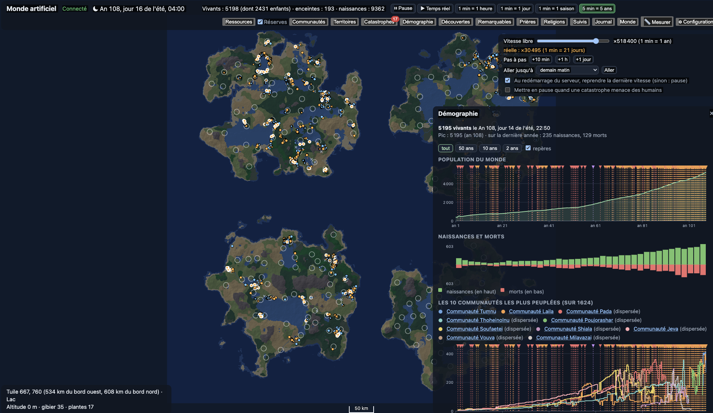

[Français](README.md) · **English**

# Artificial World

Simulation of a human community born from a founding myth. Client-server application: a .NET 10 server with a built-in HTTP server (Kestrel), and a web client opened in the browser.

Version 0.44.11 (shown in "Configuration"), author: MicG. What changed in each version is summed up in the [release notes](#release-notes). The "📖 Read the guide" button in Configuration opens this document in the interface language, with no internet connection. To have an LLM installed on your machine or in the cloud (ChatGPT, Claude, Mistral, Euria) play the Entity, see the [tutorial](#tutorial-having-an-llm-play-the-entity).



## Prerequisites

- .NET 10 SDK
- Node.js 22 or later (only to modify the web client)

## Run

```bash
cd src/Monde.Serveur
dotnet run
```

Then open http://localhost:5080: the page shows "Connected to the server" and the map of the continent with the starting humans.

At the top, the world date and the preset speeds: pause, real time, then fast-forward up to "5 min = 5 years". The "Time" panel, on the right just below the button bar (it follows its height, spanning several lines when the screen is narrow), gives full control; ▴ collapses it to the free speed only, and the browser remembers this choice:

- **Free speed**: a slider from slow motion (×0.1) to ×10,000,000. The world goes as fast as the machine allows; the speed actually reached is displayed next to it, in orange when the machine cannot keep up.
- **Step by step**: pauses, then advances by 10 minutes, one hour or one day.
- **Go to**: tomorrow morning, the next season, the next year, the next birth, the next death, the next alert about someone followed, or a specific date. The world runs at maximum speed, then pauses and announces it. Changing speed or "Stop" cancels the goal.
- **Jump ahead** 10, 50, 100 or 500 years (0.40.0): the world runs at maximum speed up to the date, with a progress bar, the years computed per minute and the time remaining; on arrival it pauses and a **summary** says what happened (see below).
- **Restart**: a checkbox chooses whether, when the server restarts, the world resumes paused (the default) or at its last speed.

To go faster, run the server in Release mode: `dotnet run -c Release` (watch the spelling: with `-c Realease`, the server runs without optimizations). The map darkens at night. The year has 4 seasons of 90 days, and the length of the day varies with the season.

The world is saved every 10 seconds and when the server stops (Ctrl+C), in a SQLite file:

- macOS: `~/Library/Application Support/MondeArtificiel/mondes/monde.db`
- Windows: `%LOCALAPPDATA%\MondeArtificiel\mondes\monde.db`
- Linux: `~/.local/share/MondeArtificiel/mondes/monde.db`

On restart, the world resumes at the saved date (paused, unless configured otherwise). To start over from scratch, use the "⚙ Configuration" button on the page (see below) then "Create this world"; the same window saves and restores a world. The old world is copied to `monde-avant-reinitialisation.db` alongside (only the latest copy is kept). The folder is changed with the `Monde:Dossier` setting. The [database manual](docs/manuel-base-de-donnees.md) details the files, backups, the size of the log and the copy for analysis.

The founders (33 couples by default, aged 14 to 40, number and location adjustable) appear on the map: orange dot for a woman, blue for a man, grey cross for a dead person. The "Alive" counter is at the top. Hovering over a human shows their name, age, what they are doing and their needs (hunger, thirst, fatigue, cold, health). Names are drawn at random for the observer; at the start humans have no language, then each community forges its own (see below), and names in its language are added. With the **Advanced language** box in Configuration, they arrive instead with a full language and a name in it.

Desire is an instinct that appears at puberty (humans do not know that it leads to a birth). They mate with their partner or with a human from another couple. Nothing is fixed in advance: each human has their own biology, partly inherited from their parents (age of puberty around 16, menopause around 49, individual fertility, 3% sterility), and the starting values come from studies of hunter-gatherers, cited in `Humains/Biologie.cs` and `Humains/Reproduction.cs`. The chance of conceiving depends on age, hunger, health and breastfeeding (almost nil in the first year; breastfeeding lasts until about age 3). Pregnancy lasts about 268 days, somewhat more or less for each woman; miscarriage, stillbirth, twins and death of the mother carry risks that vary with age, number of children, hunger and health.

Each person also has their own attachment to their children: strong in most, weak in a few. An attached parent will go to join a distant child and shares food and water with them; a mother with little attachment may neglect her baby when she is suffering. Babies stay in their mother's arms until age 2. Small children then stay very close to whoever looks after them, who leads them to water, food and shelter; they learn the places by watching, and leave alone only at their own age of autonomy, specific to each child, around 3 to 6 (Konner 2005; Crittenden et al. 2013). An orphan is taken in by the adult who loves them most (Hrdy 2009). Until age 14, children follow their own people; they leave and arrive with them in a community (“with her daughter X (3 years old)”), and real hostility hardly forms toward a child. Before puberty, the profile shows neither attraction nor orientation. On the map, a child is a small dot and a pregnant woman has a white outline.

Each human has their own **character** and **intelligence**, innate and partly passed on to their children (`Humains/Psyche.cs`): the five major traits of the Big Five model (openness, conscientiousness, extraversion, agreeableness, neuroticism), self-transcendence (spiritual or down-to-earth, after Cloninger), attachment to their children and endurance. Intelligence follows the IQ scale (mean 100, standard deviation 15): a general intelligence and verbal, spatial, manual, memory and artistic aptitudes; a few rare humans have an exceptional artistic talent. Charisma is deduced from character; the central figure of a group is not designated, it emerges.

These traits are not drawn separately: they are **linked to one another** as research shows (`Humains/Psyche.cs`, `Humains/Morale.cs`). To the five major traits (correlations from van der Linden et al. 2010) are added **honesty-humility** (Lee and Ashton 2005), **emotional empathy** (feeling what the other feels) and **cognitive empathy** (understanding them), **compassion**, **psychopathy** (continuous; about 1% of adults have the profile, two to three times more men; coldness, absence of remorse, charm that masks manipulation, noted in the secret garden), the **attachment style** (secure, avoidant or anxious, about 56/25/19%) and five **moral foundations** (care, fairness, loyalty, authority, purity; Graham et al. 2011). A community's morality is the average of that of its adults and changes with them. These traits have effects: food thefts (above all by the dishonest and psychopaths, when hunger presses), care for the sick, consolation of the bereaved, orphans taken in, fear spreading to neighbors, more or less intense grief and jealousy, betrayals, violence, exiles. Each is partly passed on to children according to its measured heritability. Character **matures** with age (more conscientious and calmer between 20 and 40, more agreeable toward old age; Roberts et al. 2006) and great **ordeals** (bereavement, war, exile, betrayal) leave a mark, deeper in the sensitive. Humans in a world created before version 0.17 receive these traits, drawn consistently with their existing character.

If no one is left alive, the simulation **pauses**: the log notes the last death (★), any "Go to" goal is cancelled and a banner offers to restore a backup or create a new world. Nature carries on if time is restarted.

**Memory** is individual: a human remembers waterholes, places where they ate and shelters where they slept (from 2 to 12 of each depending on their aptitude), and forgets them following the Ebbinghaus curve: quickly if they have little memory, slowly if they have a lot, and less and less with each return. A shelter they come back to every season may never be forgotten. When nothing is in sight, they return to a place they remember.

Humans weave **bonds** (familiarity, affection) with those they rub shoulders with: we become more attached to those who resemble us and when we are kind; the quarrelsome and the anxious clash, and crowds create friction. Friendships and hostilities are born and die out; people share their food with those they love, huddle against them for warmth, and move away from those they can no longer stand. Their **mood** varies (hunger, cold, company, births); the death of a loved one plunges their family, friends and community into mourning, for a longer or shorter time depending on each person's sensitivity. A sadness that lasts can turn into depression (the human neglects themselves, abandons their loved ones) and, rarely, into suicide.

**Communities** are not decreed: a community is born when at least 5 humans bound by friendship, including 3 adults, live together. It holds as long as at least 2 of its adults still live together; a member away for a time (hunting, fleeing, raid) remains a member, and a scattered group can be reborn under the same name if its elders find each other again. Thus foundings are rare (a few per year) and groups are lasting. Each human keeps the community where they were born. The "Communities" button lists them with their members, their date of birth, their central figure and the place where they live; choosing one outlines its members on the map.

**Nature is alive** (`Humains/Ecosysteme.cs`). Plants regrow according to the season (winter is lean) and the rains; if picked too much, they regrow more slowly. Game reproduces (logistic growth, about 35% per year at best), dies out locally if hunted too much and gradually comes back from neighboring lands. Each year, rainfall is drawn region by region (32 × 32 tiles): a drought hits a region about one year in ten and can last; the log notes it under the "Nature" heading.

Each human has **reserves** (fat, from 0 to 100) and their own **metabolism**, partly inherited. They spend more walking or hunting than sleeping, and more still when pregnant or breastfeeding. When hungry, they draw on their reserves; when they eat their fill, they rebuild them up to their usual level. Low reserves make people ill more often, dry up milk and block conception (Ellison): fertility thus follows available food, and a large population on exhausted lands has fewer children. Gathering yields according to the richness of the tile.

When a community lacks food (its members' reserves low or the lands around it exhausted), the **famine** is recorded and logged. The group heads for the richest lands that one of its members remembers, or tries its luck far away; most members follow, some stay, and a group can split. Between two communities, the relationship is deduced from the bonds between their members: allied, indifferent, hostile, or rival when they live on the same lands and food is short there. Hunger and rivalry degrade the bonds between the members of the two groups. The "Resources" button colors exhausted lands (yellow then red) and outlines regions in drought (orange) or heavily watered (blue); the "Communities" panel gives, for each one, the state of its lands, the hunger and reserves of its members, its destination and its neighbors.

**Every fact keeps its cause** (`Humains/Emotions.cs`, `Humains/Conflits.cs`). Any event in the log can cite the one that caused it: a pregnancy its mating, a bereavement the death mourned, a depression what triggered it, a departure the famine, a hostility between two groups the violence that gave rise to it. In the log and the profile, "why?" shows the originating event, then its own, and so on. Each person's mood also keeps its **reasons** (bereavement, hunger and thirst, cold, illness, loneliness, rejection, betrayal, anger, gloomy nature), written in plain language: “Vousaer sinks into deep sadness: he mourns his daughter Ana, he feels alone and anger gnaws at him.”

Uniting outside one's couple is neither forbidden nor without consequence. The partner may learn of it, by seeing them or through a friend; their **jealousy** depends on their temperament, their attachment and the custom of their community: indifference, or anger and **resentment** toward the unfaithful one and their accomplice. Anger drives them to confront the offender (a quarrel, sometimes blows, rarely fatal); resentment fades with time into **forgiveness**, or ends in a **separation**. A murder plunges the victim's relatives into mourning, gives them a thirst for vengeance and turns their community against the murderer's. Each community forges a **custom** about fidelity, from the temperament of its members and the affairs that marked it; where infidelity is frowned upon, the group disapproves of the unfaithful one, which can go as far as rejection. The log heading "Jealousy and conflicts" gathers these facts.

Each community has its **identity** and its **history**. At first, the observer names it after its central figure (“Community of …”); one day, a member gifted with speech proposes a **name** that the group adopts if it approves: it evokes their landscape (the river, the forest…), an ancestor, a respected figure, what they have been through, or simply “the humans”. It is an invention: the first group to name itself gives the idea to those who rub shoulders with it. A name can change (the group has left the river that named it, or no longer wants to bear the name of a hated member); the words that make it up are the group's **first words**, carried away in a split. Two allied communities may decide to **unite** (too small, a famine, a common enemy): the smaller joins the other and merges into it. A group's **lands** are those its members have covered during the year: the "Territories" button shows them on the map, today or at the start of any past season. In the communities panel, "Timeline" opens the log of what has happened to the group, and the card of a chosen community gives its successive names, its first words and its size over the seasons.

Communities can wage **war** (`Humains/Guerres.cs`). Nothing is decreed: a group prepares a **raid** against a hostile or rival group close enough (30 km at most) when it has reasons to strike (avenge its own, contest lands that no longer feed everyone) and feels clearly stronger; its figure, if conciliatory, holds its people back. War is **prepared**: the most ardent (anger, grudges, quarrelsome character) pushes the group to wage it; the log notes this **plan** (who is pushing, against whom, why, which allies they call on) and the Communities panel displays it. A few days or weeks later (from 2 days to 4 weeks: longer in a large group, shorter under the sway of a burning vengeance or driven by a charismatic instigator; the date is shown in the Communities panel), the group **debates** it: each man aged 16 to 50 decides for himself whether to follow (his ardor, his esteem for the instigator, the opinion of the group's figure if he respects them, the danger that the cautious weigh, his hunger), and the allies called on accept or refuse. The group **gives up** if almost no one follows, if the enemy is too strong for the assembled troop, if hunger has taken all strength from the warriors, or if the plan no longer has an object (peace made, enemy scattered); otherwise the volunteers set out, never the whole group. Among peoples without chiefs, no one is bound to follow whoever wants war (Boehm 1999; Glowacki and Wrangham 2013). No one yet knows how to make a **weapon**: they strike with fists, throw stones, bludgeon with a branch, depending on what the terrain offers (branches in forest, stones elsewhere) and whether they have had time to seize one; the branch kills most, fists rarely (real weapons will come with discoveries). The troop marches to the enemy camp, waits for dawn and attacks by surprise (as in most fights of stateless societies, according to Keeley 1996 and Wrangham and Glowacki 2012); depending on the surprise and the numbers, there are dead and wounded on both sides, then the troop returns home. The first blood opens a **war**: each death feeds the vengeance of the relatives, the group's **temperament** (from peaceful to warlike) is forged by what it lives through, no one goes over to the enemy while it lasts, and the threat welds the group together. Allied groups that have a common enemy seal a **pact**: their warriors count together and join the raids. A war ends in **peace** (when blood has not flowed for months and the figures are ready for it, all the faster when losses are heavy: grudges subside; the log gives the reasons), in the **defeat** of the weaker (too few in number, its last members join the victor; otherwise its figure chooses to **submit**, and the group delivers a share of its food each week until it becomes strong enough again to refuse, or to **flee** far away), or in the dispersal of one of the groups. A group that re-forms under another name keeps its wars. The Communities panel shows for each group its wars (raids, deaths on each side, outcome), its pacts, its submission or its vassals and its temperament; the log has a "Wars and alliances" filter. **Significant** events (war plan and giving up, allies' answers, raids, start and end of wars, pacts, submissions, catastrophes) are marked ★ in the log, which can show only them ("★ Significant only").

Each human has their **secret garden** (`Humains/Jardin.cs`, table `jardin`): their intentions (avenge a loved one, follow or refuse a war), their fears (hunger, a recurring catastrophe, an enemy raid), their hopes (a child to be born, better lands), their joys and sorrows (births, bereavements, the enemy struck down or the remorse of having killed), what they think of others and of themselves, their beliefs and their questions. After a catastrophe, minds inclined toward the invisible often see a hidden will in it (Guthrie 1993; Barrett 2000), while the curious wonder where it comes from. Each thing has its strength and its cause; it fades over the weeks, more slowly in those with a good memory, and beliefs last for years. The profile shows it by heading, with "why?" to trace back to the event that gave rise to it.

Nature has its **catastrophes** (`Nature/`), without the Entity having anything to do with them. Each continent receives, from its seed, a **geology**: old stable bedrock, rift or active coast (faults and volcanoes drawn on the map). **Earthquakes** follow the Gutenberg-Richter law (ten times fewer earthquakes with each degree of magnitude); they are felt more or less depending on distance (Mercalli scale), landslides kill in the mountains, a strong aftershock often follows, and a large earthquake under the sea raises a **giant wave** that drowns the low coasts. **Volcanoes** rumble for days or weeks before erupting (explosivity index from 1 to 7): lava flows, pyroclastic clouds, ash, and after a very large eruption a **volcanic winter** that cools the world and thins the harvests for years. Lightning starts **fires** that the wind drives, especially in summer and during droughts; **floods** overflow onto the banks, usually slowly (people move aside), sometimes all at once (flash flood); **storms** from the sea hit the coasts in summer and autumn; **cold waves** and **heat waves** weigh on the whole continent. The sky offers **eclipses**, **comets**, **fireballs** (sometimes a meteorite) and, very rarely, **auroras**; a destructive asteroid (10 megatons and more, like Tunguska in 1908) falls on a continent of this size only once in about ten million years, the large ones even more rarely (Brown et al. 2002). The world does not stop at the shores of the map: elsewhere on the planet, a large volcano explodes about once a century (index 6, like Pinatubo) and once a millennium (index 7, like Tambora), and its veil also cools this continent for one to three years (Newhall and Self 1982; Self et al. 1996; Oppenheimer 2003). **New diseases** pass from game to humans (like zoonoses); each has its contagiousness (R0), its duration, its lethality and its immunity, spreads among those who live together and becomes an **epidemic** when it affects several people at once. Frequencies and intensities come from real observations, cited in the code.

Each human reacts according to their character: the cautious flee earlier, sleepers sometimes wake too late; young children, the elderly and the weakened die more often. **Fear** weighs on mood and subsides in a few days, or in weeks for the most sensitive; before a phenomenon in the sky, contemplative minds marvel. Affected nature (burned land, ash, salt water, blown-over ground) turns green again at its own pace: a year and a half for a fern plain or a marsh, two or three years for tropical forest, eight for conifer forest, ten for desert and mountain, much more for land sterilized by lava or an impact (successions after the Yellowstone fires, Turner et al. 2003, and Mount St. Helens, del Moral and Wood 1993). As long as it has not turned green again, a finished catastrophe still has **aftermath**: those who die of hunger, thirst, cold, exhaustion or illness in the lands it devastated count among its dead (“in the lands devastated by the fire”), and on the day they have turned green again, the log gives its **full toll** (killed outright, wounded, dead from the aftermath). Only the damage that the catastrophe itself caused counts. An asteroid of 10,000 megatons or more plunges the world into **the long night**: dust and soot veil the sun, from −0.5 °C for six months to −26 °C for five years for an impact like Chicxulub (Toon et al. 1997; Brugger et al. 2017); those who then die of hunger or cold are attributed to it. All deaths, injuries and fears cite the catastrophe as cause; each affected community records it in its timeline with its dead. The "Catastrophes" button lists those under way and the history (a click shows the affected lands on the map), the diseases and the geology; an **alert** at the bottom of the screen announces each catastrophe that threatens humans (three at most, the most recent on top), a **badge** on the "Catastrophes" button counts unseen serious alerts, and the world can **pause** (checkbox in the "Time" panel, unchecked by default since 0.29.3); the "Show catastrophe alerts" checkbox in Configuration hides them. At the bottom of the panel, "✦ The Entity provokes…" lets you trigger a catastrophe at the chosen location (the form is never redrawn while you fill it in): the log keeps its origin.

The world has **real distances** (`Nature/Echelle.cs`, `Humains/Marche.cs`, `Monde/Geographie.cs`): a tile is 800 m on a side, the continent about 205 km, one degree of altitude 40 m. Everyone walks at their own **pace** (partly inherited), around 4.9 km/h for an adult on flat terrain (Bohannon and Andrews, 2011), slower as a child or elderly, ill, exhausted, pregnant or with a baby in their arms, faster when fleeing. The **terrain** (forest, marsh, snow, ford) and the **slope** (Tobler function) slow walking, so a ten-minute step is not always enough to reach the neighboring tile. Hovering over the map gives the position in km and the altitude in meters; a **scale bar** follows the zoom. The "World" button opens the **World characteristics**: surface area and dimensions of the continent, coasts, highest point, lakes and rivers, terrains, seasonal temperatures, population and density, paces, time to cross the continent on foot (with "show" on the map). The "📏 Measure" button gives, between two clicked points, the straight-line distance, the least arduous route on foot and its walking time. The log, communities and territories speak in km and km².

The world's **configuration** (`Monde/ConfigurationMonde.cs`) is stored in its database (table `etat`; the database is at schema v36, and an old world is migrated on opening): seed, number of starting couples (1 to 200), width and height of the map (51 to 819 km, in tiles of 800 m), number of continents (1 to 6, separated by sea) and starting location of the couples: on the largest continent (the default), on another continent chosen by its size, or spread over all of them in proportion to their habitable land. At each resume, the map is regenerated identically from these settings. A world created before the configuration keeps the original settings (33 couples, 205 × 205 km, one continent), which give back exactly the same map. The "⚙ Configuration" button shows the current world's settings; there you enter those of a new world, see its map ("Preview", the current world does not change), then "Create this world" creates it (the old one is kept as a copy). Settings that leave no room for the couples are refused with the reason. Beyond 400 km on a side, the simulation slows down. The same window also sets, for the current world: the **processor cores** ("Computation": one core, by default, or several; the same seed gives back the same world whatever the number of cores), the **world's leniency** (from 0 to 100%: the share of the risks of illness, childbirth, of the very young and of catastrophes that the Entity wards off; 0 by default) and the **"Log daily life"** checkbox (see the log).

**Backups** are made in the same window: "Back up now" copies the world as it is (without stopping it) into `mondes/sauvegardes/`; the list shows each backup (world date, living humans, size) and "restore" replaces the current world with it, paused. The replaced world is first backed up (`avant-restauration-…`), and the restored backup is not modified. The copy kept before the last creation of a world is restorable too. 🗑, after confirmation, moves a backup to the computer's **trash** (macOS or Windows Recycle Bin, freedesktop trash on Linux), from where it can be recovered as long as it has not been emptied; the world in progress cannot be. The "Followed" button gathers the followed humans and communities ("☆ Follow" on their profile), their alerts and their latest news mixed together; followed humans are outlined on the map. Since 0.40.0, follows are kept in the world's database, shared by all browsers (see "Jumping far into the future and alerts on followed humans"). The log freezes with ⏸ without stopping the simulation: new events wait (their number is shown) until ▶.

Each human has an **appearance** (facial symmetry and harmony, height, complexion, bearing, partly inherited from the parents) and a **sexual orientation** that is not binary: attraction toward men and toward women, from 0 to 100 (`Humains/Attirance.cs`). The proportions follow the large surveys (Copen et al. 2016; Bailey et al. 2016): among men about 2% homosexual, 2% bisexual, 6% “mostly heterosexual”; among women about 1.5%, 5.5% and 13%. Orientation is partly transmitted (Långström et al. 2010) and, among boys, slightly more often homosexual with each older brother (Blanchard and Bogaert 1996). Someone who is attracted to their own sex may not know it: they move from a poorly understood unease to certainty, over the course of their desires (Calzo et al. 2011). Their **relative beauty** is measured against their community's ideal; their **attractiveness** adds youth, bearing and vigor to it. **Desire** goes first to whoever pleases: attractiveness weighs more than affection and charisma (Eastwick and Finkel 2008). One can be **rejected** because one does not please, out of fidelity, or because the other does not dare: refusal hurts (more in the anxious), acceptance delights, and one no longer approaches for some time whoever rejected us. A **repressed** desire (out of fidelity, because custom disapproves of it, or for someone of one's own sex whom one does not dare love) is noted in the history and the secret garden. Love between people of the same sex is lived in secret where it is frowned upon; a witness may catch them; two who prefer their own sex can form a couple if the group allows it.

Each community has its own **customs** (`Humains/Moeurs.cs`): a tolerance toward these loves, born of its members' open-mindedness (Shackelford and Besser 2007), which grows used to what it rubs shoulders with without drama (Herek and Capitanio 1996) and hardens after a scandal; the custom (disapproved, no established custom, accepted) changes and the log notes it. It also has an **ideal of beauty** (height, complexion, build) that drifts toward the appearance of its members and its figure, and toward fuller bodies when food is scarce (Nelson and Morrison 2005). A community may **drive out** one of its members (`Humains/Exil.cs`) when most of the adults and its figure hold a grudge against them and almost no one defends them (Boehm 1999): the reason (murder, violence, disapproved customs, discord…) and the length of the exile, sometimes open-ended, are noted; the partner may follow; the exile leaves the group's lands and cannot return before the end of the exile. Before the exile, a member whom their people consider good (the group's brightest karma, compassionate, without grievance against the accused) may **plead** for them: each accuser reconsiders according to the esteem they hold for the pleader, and the group relents or shortens the exile; for a murder, the plea rarely succeeds (Boehm 1999). A parent may also **disown** an adult child. Ordinary **diseases** carry their true name in the log, even if no one knows how to name them (`Humains/Maladies.cs`): pneumonia, diarrhea, dysentery, malaria near warm waters, infected wound, tetanus, worms, skin infections (Gurven and Kaplan 2007); tuberculosis appears only beyond a thousand humans, measles beyond 250,000 (Black 1966). New diseases coming from game also carry a real name according to their profile (plague, influenza, leptospirosis, tularemia…).

Clicking on a human opens their **profile**, in collapsible sections (you open the ones you want, and they stay open from one human to the next): current thought, mood, fear, illness and immunities, relative beauty, attractiveness, orientation and what they know of it, exiles and disownings with their reason, grief and what weighs on their mood, anger and grudges, community, family, needs, character, intelligence, biology (including pace and current walking speed), bonds, knowledge and objects, faith, the Entity's gaze, latest thoughts, secret garden, places they remember and history. The names cited (relatives, community) lead to their profile, and a button goes back to the previous profile. The "Journal" button opens the **world log**: births, deaths, illnesses, couples, pregnancies, friendships and hostilities, bereavements, jealousy and conflicts, attractions and rejections, exiles and disownings, communities, nature, catastrophes, discoveries, care, arts, language, prayers and religions, acts of the Entity. Everything is recorded with its cause; you filter by type and by name, and each human name cited is a link to their profile. Routine acts (drinking, taking shelter, resting, sleeping, gathering, exploring, "Day of…" summary) are no longer logged by default, to keep the database light: the "Log daily life" checkbox in Configuration turns them back on. Acts toward others always remain in the history. What the Entity whispered or did is marked ✦.

**Languages.** The interface is displayed in French or English (choice in Configuration, remembered by the browser); the texts are in `langues/fr.json` and `langues/en.json`, and adding a language amounts to copying `en.json` under another code and translating it. Since 0.30.1, the log and thoughts are no longer written while the world runs: each fact is kept as a key and its parameters (humans, communities, numbers, invented words) and the sentence is written at display time, in the browser's language (`Simulation/Recits`). The language file describes its grammar (section `_grammaire`: elisions, contractions such as “de le” → “du”, plural forms); in a text, `{x}` inserts a value, `{^x}` capitalizes it and `{x:a|b}` chooses a form according to gender, number or a yes/no. Communities are named according to the language (“la communauté d'Ana”, “the Tako people”). The switch is made by domain: 0.30.1 translates life and society (births, deaths, bonds, bereavements, couples, quarrels, exiles, thefts, desires, communities and their names, everyday thoughts, days); 0.30.2, the secret garden (inner voice according to character, with its variants and its three registers, and everything humans confide there: bereavements, exiles, wars, prayers, words of the Entity, care…); 0.30.3 and 0.30.4, knowledge (discoveries, inventions and their laws, learning and teaching, forgetting, hygiene, fire, reserves, works, questions and ideas) then groups and nature (wars and raids, visits and gatherings, territories, catastrophes, volcanoes, diseases, sky and weather); 0.30.5, the Entity and the invisible (words, inspirations, acts, humans' view of the invisible, beliefs, solitary and collective prayers, refusals, religions, dogmas and rites, prophets), medicine (healers, trances, care) and language (words, signs, word order). A sentence written before the translation of its domain keeps its French, with a tooltip. The languages invented by humans do not change.

**Terrain and subsoil** (`Nature/Terrain.cs`, 0.31.0 and 0.31.1). Under each tile, a rock drawn from the geological context (granite, basalt, recent volcanic rocks, limestone, flint chalk, sandstone, schists, valley alluvium, salt and gypsum of desert basins) and a soil that follows from it with climate, slope and water (silts, volcanic ash, brown soils, acidic, tropical red, peat, thin soils, desert, saline). The soil changes plants by ±50% around the average of their terrain, game less; a new world starts from what the soil carries, an old world converges toward it. Flint, pyrite, obsidian, clay and ocher now come from the rocks. Cliffs (steep slopes of hard rock) bear rock shelters; limestone and lava flows, caves, which protect from cold better than a forest; springs well up at the foot of walls and caves, hot near volcanoes, salty near salt, and give water to drink. Each river has a discharge (rain that runs off, accumulated downstream; high water in spring, flood in rainy years) and a current (depth × speed, hydraulic geometry of Leopold and Maddock): one fords up to 0.5 to 1 m²/s depending on one's size and caution (Jonkman and Penning-Rowsell, 2008), beyond that one must swim. The deposits (salt, sulfur, bitumen, malachite, native copper, cassiterite, bog iron, river gold, coal, kaolin) are hidden; a human who passes over them may notice them if they outcrop or leave clues, according to their curiosity and sharpness, and remembers them as a place. Nothing is extracted from them yet: what is done with them will come from humans. Everything is computed from the seed and the map, with nothing recorded: an old world receives the same terrain as a new one. The "World characteristics" window gives the summary.

**Coasts and sea** (`Nature/Mer.cs`, 0.31.2). The sea has floors (continental shelf down to 200 m, slope beyond, depth softened near the coasts), shoals offshore and reefs in warm, clear, shallow water, far from river mouths. Each shore tile has its nature: beach, cliff, rocky coast, estuary, delta or marsh. Islands and the shortest sea crossings between two lands are measured, with what can be seen of the other shore, from the beach or from the summits (range set by the curvature of the planet, 3.57 × (√h₁ + √h₂) km, limited to 120 km by haze). The prevailing winds (easterly trade winds, which the summer monsoon can reverse) and surface currents (3% of the wind, along the coasts) are drawn once and for all. Navigation has used it since 0.31.5. Like the terrain, the sea is computed from the seed and the map, for old worlds as for new ones. The "Layers" button shows on the map the rocks, soils, rivers (thicker according to their discharge) and springs, sea floors and reefs, caves and shelters, and deposits (filled if a living person remembers them); hovering over a tile describes them.

**New terrains and sea between the continents** (0.31.3, new worlds only). A map is always recomputed from its settings: so that existing worlds keep theirs, each world records the map generation with which it was born (0 before 0.31.3, 1 since; schema v37). A world created since 0.31.3 has three more terrains: **broadleaf forest** (Cretaceous flowering plants, magnolias, plane trees; fruits and seeds, brown soil, between conifers and tropical forest), **mangrove** (low, warm and humid coasts; salty mud, shellfish and fish, the slowest walking of all terrains, mosquitoes) and **dry heath** (scrub between plain and desert; thin soil, burns faster than anything). Every rule that depends on terrain (fire, walking, shelter, soils, materials to pick up, plants and their virtues, diseases, regrowth after a catastrophe, makeshift weapons, place names) knows them. The configuration also offers the **sea between the continents**: close (straits of 10 to 90 km, as before), distant (smaller continents, centered in their part of the map, at least 200 km of sea between them: from 208 to over 300 km measured) or mixed (varied sizes and straits); a map too small for distant continents is refused with the size that would be needed. The preview gives the narrowest strait. The world characteristics show its map generation and its sea between the continents.

**Prayers in bulk, log and database size** (0.31.4, schema v38). The prayers window has two buttons: **grant all** pending prayers (with the number of vengeances requested in the confirmation) or **refuse them all**, in secret or by a sign; each follows the same rules as an answer one by one. Configuration has a **Log and database size** section: size of the world and measured growth per year; **keep the log** (unlimited by default, or N years) and **keep daily life** (day summaries, thoughts, sharing) for a separate duration; notable events and the lines of followed humans (★, actor or concerned) are kept unless the "Also delete…" checkboxes are checked; a confirmation precedes any deletion, which cannot be undone. **Compress the old log** (unchecked by default, beyond an adjustable one year) stores the ordinary log in packets of 4,096 lines compressed without loss (Brotli, about ten times less space): the game still reads it in full, filters, pages and causes included. Maintenance is done in the background, in small steps between two backups; the file gives back the freed space at the next startup (VACUUM when more than half is empty). A **copy for analysis** (folder `analyses`, next to the backups, optional period in years) puts the whole log back in plain form, archives included, with the written sentence in the `texte_redige` column, for an external SQL client; since 0.32.5, words there have their meaning in plain form (column `sens`) and the `lexique` view gives the words in use in each community. An erased cause is displayed as “cause not found (perhaps erased from the log)”.

**Crossing the sea** (0.31.5, schema v39, also applies to existing worlds). On a shore or a height, people look out to sea once an hour: a coast or a summit of another land is seen if it rises above the horizon (curvature of the Earth, eye height, trees) and if the day's air is clear enough (from 8 to 120 km depending on the day); at night, campfires, at 25 km at most. At dusk, signs: birds heading out to sea, a trunk or a worked object that the current has brought. Whoever sees remembers for a long time and tells their people, who tell it in turn. Three families of boats are invented from what has been seen floating: raft of **lashed logs**, bundle of **reeds** (new material from marshes and rivers, which becomes waterlogged within a few weeks), **dugout trunk** hollowed with fire and a sharp tool (canoe); the laws say what each carries, what swell it withstands and how fast it goes (with or without a paddle, which is also invented). People take to the sea to **fish** on reefs and shoals, **out of curiosity** even without seeing anything (the bold one who discovers a land pushes on to it or returns to tell of it), to **go and see** a land they remember, then, once they have set foot there, to **settle there** as a couple; in famine with no better land within walking distance, a community may leave entirely. At sea: wind (Weibull law around the season's wind), swell (wind, distance from the coasts, cyclones), current and drift, heading error (lower with a sense of space), thirst, sleep on board, return when the sea rises; a wave can capsize the boat, and whoever cannot swim may drown, children on board included. The way home is remembered and passed on. Notable events: the first time a community sees another land, sets foot there, and meets a human of another people (for both peoples). The log has a "Sea" type. When **creating a new world**, a checkbox (checked by default) chooses whether or not to keep a copy of the old one (monde-avant-reinitialisation.db); unchecked, the old world is erased and the previous copy stays as it is.

**The Entity speaks to a community** (0.31.6, schema v40). On a community's profile, "The Entity speaks" has two tabs: *To the community* and *To each of its members* (as before). To the group, eleven words that target one or several other communities (checkboxes, with distance and relationship) or a direction: make war, make peace, ally yourselves, go to meet, teach your knowledge, carry my word, share, unite, set out toward, drive from their lands, exterminate. Each adult receives it (dream, voice, sign, apparition), understands it, believes it or not and knows what they think of it; the group debates it on the day, target by target. The figure weighs more than the others, and decides alone if they have very strong authority (prestige, affection, respect of their people) or if they are feared as a tyrant (inclination to dominate, blows dealt to their own); the profile shows their authority, the fear they inspire and their hold on the debate. Outcomes: the group obeys, obeys only by half (a threat instead of a raid, a truce instead of peace, a delegation instead of the whole group), speaks of it again later, refuses, or its faithful act alone. The farther the other community is, the less one obeys; if one obeys, one moves closer to it. What the other group accepts (peace, alliance, welcome, union, gifts) depends on its own members and its figure; a messenger who believes in it and does not lie says that the Entity sends them, which touches those who believe in the invisible. Exterminate: war without quarter, without truce, without captives or submission. An alliance is sworn and lasts 2 to 10 years. Everything is in the log, as notable events chained by their causes, and the profile lists the words received (or that target this group) and their state. The log has two buttons "Select all" and "Select none". Worlds where the Entity does not speak to communities run exactly as in 0.31.5.

**Matter and heat** (`Chimie/`, `Humains/Fournaise.cs`, 0.32.0, schema v41, new worlds only). Each material has a composition: 21 elements and 44 mineral and organic phases (quartz, kaolinite, illite, calcite, goethite, cellulose, lignin, terpenes, copper…) with their real values (density, hardness, melting, specific heat). Its properties follow from it: hardness, color, whether it can be kneaded, dissolves in water, holds water, sticks, shines, rings, burns (heating value by the Dulong formula). Clay, ocher, pebble and sand depend on the rock and soil under the tile; to these are added limestone, sand, shells, bark and the colored stones of the deposits. The temperature of a hearth comes out of an energy balance (fuel, water in the wood, excess air according to the shape of the hearth and the wind, radiation losses): about 670 °C in the open air, 750 in a stone circle, 880 in a pit, 530 under earth, more than 1,200 with charcoal blown in an enclosure. Thirty reactions measured in the laboratory apply to any substance, without recipes: drying, dehydroxylation of clays (ceramic), yellow ocher turned red, quicklime then slaked lime (which heats up in water), carbonization of wood (charcoal) and bark (pitch), slowly heated flint (better flakes), combustion; and accidents (steam, shrinkage, quartz at 573 °C, thermal shock). Six new acts: shaping, putting into the fire (in the flames, brought closer little by little, under the embers, in a pit), covering the fire with earth, blowing on the embers, mixing, plunging a hot stone into water; striking crushes soft materials and hammers copper (which hardens, then becomes soft again in the fire). What the human retains is what they see (“the material hardens and no longer dissolves in water”), and it is this knowledge that is passed on. A fired pot that holds water serves to drink and carry water, charcoal feeds the fire, pitch glues a point, heated flint is knapped better. The earlier worlds (generations 0 and 1) run exactly as in 0.31.6.

**Copper drawn from stone** (0.32.5, generation 2 worlds, including those already begun). Heated, the green stone (malachite) turns into a black oxide; without air, the carbon monoxide of the fire takes its oxygen and leaves copper, from 700 °C and almost entirely by 1,100 °C, much faster if the crushed ore is mixed with charcoal (Rehder, 2000). Below 1,085 °C, the copper stays in specks within the mass, which are freed as grains by crushing it; above, it melts and gathers into a drop (a part stays trapped in the slag). A fifth way of putting things into the fire, the **crucible**: a hollow of fired clay in the heart of the burning charcoal (that of the hearth, or a piece poured into it), at about 1,000 °C, and 1,200 °C when blown on; the hollow sometimes cracks, all the more if it is poorly fired or already flawed. This is how the first smelters began, at Belovode around 5000 BC (Radivojević et al., 2010). On an outcropping deposit they know, a curious person sometimes picks up a piece of coloured stone (green stone, gleaming copper, gold, tin gravel) and takes it along, like the malachite beads of Shanidar around 10,000 years ago (Solecki, 1969): it is this piece that gets struck, mixed and put into the fire far from the deposit. Whoever has seen the metal come out of the stone goes and crushes more of it where it outcrops, puts it back in the fire, beats the drop into a plate and makes an ornament of it (it catches the eye), then, from a second plate, a point: the awl, which pierces hide to sew it (a warmer hide garment). Worlds of generations 0 and 1 run exactly as in 0.32.4.

**Cooking in water, lime, green stains** (`Humains/Cuisine.cs`, `Humains/Chaux.cs`, 0.32.6, schema v43, generation 2 worlds, including those already begun). Nobody knows how to cook in water at the start: it is discovered by setting a full pot in which roots are soaking on the embers, or by dropping hot stones into a waterskin, a gourd or a skin-lined hollow, and remembering what is seen ("what was put in softens and can be eaten"). Whoever knows it boils, when hunger presses and they are at the fire, what the raw gatherer leaves behind (tough roots, seeds: a tile at 300 still feeds, against 1,000 raw); cooking feeds 1.1 to 1.9 times more depending on the food (Carmody and Wrangham, 2009), the broth is drunk, the bones of a carried animal give up their fat (once per carcass), a bitter plant tasted at the fire loses part of its poison, and their small children near the fire get their porridge. A mother who makes porridge weans earlier: fertility returns after about 1.05 to 1.3 years instead of 1.5 (Bocquet-Appel, 2011). A poorly fired or cracked pot sometimes splits on the fire. **Lime**: slaked lime paste sets into a mass as it dries and hardens in the air (portlandite turns back into calcite, faster in a thin layer: Lawrence et al., 2006). It is spread on the hut to see what happens; coming back a few days later, they see that it has hardened, and whoever knows this maintains their hut (paste they carry, quicklime they slake, limestone they burn): the plastered hut firms up, shelters a little better and sags three times more slowly. Whoever builds while carrying paste binds the stones of the base with it (the low wall is not a separate object). A hide soaked in lime water loses its hair and makes a better garment. Wet quicklime burns the hands, sometimes the eyes, especially of those who do not know that it heats up. The painter who carries lime or green stone uses it alongside ochre (white, green). **Green stains**: a copper deposit below the surface betrays itself by green stains on the rock (the oxidized "cap"), seen five times more often than before; whoever knows how to dig finds the green stone there. The number of deposits does not change. Worlds of generations 0 and 1 run exactly as in 0.32.5.

**Cliffs, falls and fertile floods** (`Nature/Relief.cs`, `Humains/Falaises.cs`, `Humains/Limon.cs`, 0.32.7, schema v44, generation 2 worlds, including those already begun). Between two tiles where the ground jumps by more than 160 m, a **rock face** rises, all the more often as the rock is hard (limestone, granite, basalt more than chalk); some rock faces have a **way through** (ledge, chimney), more frequent in limestone and sandstone, and **passes** (saddles of a ridge) are identified: everything is drawn from the seed and the map, nothing is stored. Humans follow the **path of least effort** (slope, terrain, ways through): they go over passes rather than summits and skirt around rock faces, and remember the passes and ways through they have crossed. When the detour is too long, a bold and skilful person may **climb** the face (never at night, except to flee; children, the elderly and the exhausted almost never). **Falls**: the risk depends on height, age, night (less under a full moon), rain on the rock, fatigue, hunger, illness, skill, caution, a baby being carried and familiarity with the way; death follows a curve according to height (about one fall in two fatal around 14 m for an adult, less for a light child, more for an old person; Atanasijevic et al., 2005), otherwise a more or less serious injury. People also fall from trees while gathering. Cause of death "Fall", lines in the journal, fear of the place in the victim and the witnesses (the fearful avoid it for a while), first rock face climbed in "First times". It now rains by region, according to the season, in spells of a few days. **Fertile floods**: a slow flood leaves damage for a few weeks, then a **silt** that makes plants grow back 20 to 60 % stronger for one to three seasons, more on poor soil (the Nile, Mesopotamia); game follows; a flash flood mostly scours the riverbed. Whoever has seen a plain under water and later gathers plenty there may understand that "where the water has passed, everything grows back": the knowledge is confirmed or lost, told and taught, and those who believe it go back to gather on the plain once the water has receded. Two layers: **Cliffs and passes** (rock faces, ways through, passes) and **Flood silt**. Worlds of generations 0 and 1 run exactly as in 0.32.6.

**Lasting injuries, the camp on the floodplain, what grows back at camp** (`Humains/Sequelles.cs`, `Humains/Limon.cs`, `Humains/Rejets.cs`, 0.32.8, schema v45, generation 2 worlds, including those already begun). **Lasting injuries**: a serious injury (fall, blows, war, disaster) can leave, once the wound closes, a leg that makes them limp or a stiff, weak arm; this is rare after a 4 m fall, common after a 12 m fall that someone survives. The impairment lessens over a few months and then settles: either they no longer limp, or they will limp for the rest of their life; it is milder in a child and in whoever had their wound treated, worse in the elderly (Aché, Tsimane; Shanidar 1). Whoever limps walks up to half as fast, hunts and gathers less well, climbs less and falls more easily; they keep it to themselves, ashamed or resigned depending on their character; the compassionate who know them grow attached to them and bring them their share sooner, the hard-hearted regard them as a burden. The injury can be read in the Medicine section of the profile. **The camp on the floodplain**: when several adults in a community believe in flood silt and one of them knows of a drowned plain, a day or two away, whose water has receded and which is clearly better than their own land, the group can decide to go and camp there without waiting for famine; they stay or leave again afterwards depending on the abundance, as with any land. The first camp set up on a floodplain counts among the "First times". Knowledge of silt is forgotten less: seeing the water rise reminds whoever knows it, and a child who gathers on the plain with an adult who believes in it can learn it. **What grows back at camp**: around the camp, in the good season, the seeds, pits and bits of root that are thrown away germinate (growth up to +50%, which fades in a year or two with no one around; Anderson, 1952). An observer may notice that "what we throw away grows back", then bury a few seeds themselves near the camp or in the soil the flood left behind. This is not yet agriculture: no field, no harvest, no chosen plant. Worlds of generations 0 and 1 run exactly as in 0.32.7.

**Sowing, harvesting, keeping seed** (`Humains/Champs.cs`, `Humains/Cultiver.cs`, `Stockage/DepotChamps.cs`, 0.33.0, schema v46, generation 2 worlds, including those already begun). Each plant species now has what it gives to eat (seeds, pods, tubers, fruit or nuts), drawn from the world seed: yield, month of ripeness, bitterness, seed dormancy, perennial or annual, whether it can be grown from cuttings, and above all whether its seeds fall by themselves when ripe (nearly all of them, in wild plants: about one in a thousand holds to the stem). Nothing is decided in advance. Whoever has seen that "what we throw away grows back" can bury seeds or a bit of root near the camp, on the silt of a receded flood (if they believe in it) or in burnt ground; they note the season, and their people learn which seasons succeed. The plot sprouts, grows and ripens according to the plant, the rain, the frost, the drought, the animals that graze it if no one guards it, and the weeds that choke it: people may discover that they must be pulled out. Silt (+20 to 60%) and the ashes of a burn make it do better; people may also discover that burning before sowing is worth the trouble. At ripeness, the seeds that come loose fall day after day; those that fall come up again the next year, wild, and mix with the sowing. **The way of harvesting makes the plant**: shaking the ears over a basket takes only the seeds that come loose, while pulling up the stems or cutting them with a sharp flake also takes those that hold on; if part of the harvest is kept for sowing, the lineage takes on the share of tough seeds in what was taken, and sowing deep with a stick favours large seeds (Hillman and Davies 1990; Fuller 2007). A plant grown from cuttings improves faster: the finest, least bitter plants are replanted. One generation a year, whatever the number of plots. When a lineage can no longer sow itself (at least half its seeds hold on, or a plant grown from cuttings is clearly more vigorous and sweeter), the journal notes that it is **domesticated**: this is rare and slow. The harvest is eaten, or kept in store (new stores of grain, which keep a long time but attract rodents, and of tubers, which keep two to four months). Whoever takes from the field of someone else with whom they have no bond commits a theft, and the community forms an idea of fields as it does of stores: belonging to all, or to whoever sowed them. A group short of food stays near its fields if the harvest is close. Eating a lot of grain has a price: more disease for those who live mostly on it, and more in a camp that no longer moves; but a porridge of cooked grain makes it possible to wean earlier (Larsen 1995; Bocquet-Appel 2011). The camp on the floodplain can now be decided on the word of a single believer, if they are the group's figure, highly charismatic or from the family of an adult in the group, all the more readily when people are hungry and have fields there. First times: first sowing, first sowing on silt, first burn, first harvest, first domesticated plant, for the world and for each community. The Community profile has a **Fields** section (plots, area, expected harvest, lineages and their traits, idea of fields), and the Layers button has a **Sown fields** layer (one square per plot: brown sown, green growing, gold ripe; white edge: domesticated plant). Worlds of generations 0 and 1 run exactly as in 0.32.8.

**Kept animals, herds, milk** (`Humains/Faune.cs`, `Humains/Betes.cs`, 0.33.1, schema v47, generation 2 worlds, including those already begun). Each terrain has its own animals, drawn from the world seed and described by their form and a trait ("the horned beast with a red coat", "the prowler with a bushy tail"): there is no dog, goat or ox written in advance. Each species has the traits by which Diamond (1997) explains why so few large mammals have been domesticated: what it eats, its weight, the time it takes to grow up, its young per year, whether it breeds in captivity, its temper (whether it charges), its panic, whether it follows a leader, and whether it prowls around camps for scraps. About one grazer in fifteen has everything it takes. Two paths, those that Zeder (2012) draws from archaeology: **the commensal**, where prowlers come looking for scraps around a camp that lasts; a soft heart throws them bones, and after a few weeks their young are taken; **the prey**, where the hunter who kills a female in the birthing season sometimes brings back her young, out of pity or curiosity, then because they know that the young of animals can be raised. Nothing is guaranteed: a panicking animal escapes, a heavy, aggressive animal wounds its keeper, a species that does not breed in captivity never gives a herd. Grazers feed around the camp, the others on human scraps; when starving, they die. Once a year, in spring, they give birth; the calmest are kept for breeding and the wildest are eaten: tameness rises with each generation and size drops a little (Belyaev's foxes; Zeder, 2012), faster in animals that grow up fast. When a lineage no longer flees humans (60% tameness after at least eight litters), the journal notes that it is **domesticated**: this takes several decades. An animal is slaughtered when the group is hungry or when the herd exceeds what can be kept, never the last two. Whoever keeps nursing females may discover that they let themselves be **milked**; the milk feeds the children first, as adults digest it poorly (Ségurel and Bon, 2017). Tamed prowlers help with hunting (+30%); a herd's dung fertilises the plots around the camp (+20%); living among animals makes people fall ill slightly more often (+12%). First times: first young raised, first birth at the camp, first milking, first domesticated animal. The Community profile shows the **Kept animals** (adults, young, tameness, litters). The **Discoveries** curve also shows, in orange on the right-hand scale, how many skills each living person knows on average: it rises when skills spread, even when their number stays the same. Worlds of generations 0 and 1 run exactly as in 0.33.0.

**Discoveries by combination** (`Humains/Facture.cs`, `Humains/Combinaisons.cs`, `Serveur/ArbreDto.cs`, 0.34.0, schema v48, generation 2 worlds, including those already begun). There is no technology tree written in advance: a thing made by human hands is a **combination of parts**, and it is the laws of the world that say whether it holds and what it is good for. A part is a raw material (wood, stone, bone, fibres, hide…), a part **shaped** by a gesture that is known (sharpening, splitting, hollowing out, bending, plaiting, polishing, notching, fire-hardening, piercing), or two parts **joined** (end to end, crosswise, at both ends like a taut string, one launching the other, coated, sewn, attached to a line), with a binding if the joint calls for one. Each part has physical properties (hardness, mass, length, flexibility, edge, watertightness, capacity, hook); the laws compute the energy of a drawn bow, the speed of an arrow or of a spear thrown with a spear-thrower, the sharpness of a blade, what a container holds, and failure when it is too soft, too short or breaks. Four uses are rated on the same scales as hunting and cutting: hunting, cutting, containing, fishing. An idea is born from what a human already knows, the **adjacent possible** (Kauffman): applying a known gesture to a known part, joining two things they have, making a thing again with another material, or replacing one of its parts; it comes more often to inventive and open minds, after a missed hunt, and from seeing what the neighbours do. Humans also notice properties ("this wood springs back", "this fibre can be spun", "this hide holds water") that steer their ideas. Each find keeps a record of the skills it was born from. A thing that works is made again, strengthened by use, taught, forgotten; a thing that does not work is noted as a failure. The **Discoveries** window has a **🌳 Tree of knowledge** tab: each find linked to its parents, column by column from the roots, in grey what is lost, ✦ what the Entity whispered; beneath it, the number of combinations one step away from what they know, with a few examples (without saying whether they would work). The tree is drawn after the fact: the simulation never reads it. On a human's profile, **✦ The Entity whispers a combination**: you choose a gesture or a joint and the parts they have in mind; they try it at once if they have what it takes, and the laws say what comes of it (the log marks it as coming from the Entity). Configuration has a **Fertile minds** setting (off by default; 3, 10 or 30 times more ideas per combination), noted in the log as an act of the Entity; the laws do not change. Finally, **the share of fields** follows need: the more what is harvested pays off compared with gathering, the more is sown (an S-shaped curve), up to about fifty ares per mouth, instead of a fixed area. Worlds of generations 0 and 1 run exactly as in 0.33.1.

**Collective brain and regularities** (`Humains/CerveauCollectif.cs`, `Humains/Regularites.cs`, 0.34.1, schema v49, generation 2 worlds, including those already begun). Two people with different knowledge who find themselves in the same place (at the camp, on a visit, at a gathering) can **pool their knowledge**: the idea is born between them, from a gesture or a part from one and a gesture or a part from the other; the laws judge it as an idea that came from a single person. The log names both, both retain it, and the tree of knowledge says "X with Y". It comes more often to two ingenious, open minds who share words, and less readily with a stranger. Thus large, connected groups invent more, while small, isolated groups lose what they knew through imperfect copying and the forgetting already in place (Henrich 2004, Kline and Boyd 2010, Derex et al. 2013). Everyone also sees **series** go by: the full moon that returns, the seasons, the stars of clear nights, things in number. An attentive mind can read a **regularity** in them and use it to predict; at each return, the fact confirms or refutes it, and they correct their estimate. Without counting, a duration is judged with an error of 10 to 30% (Weber's law); someone who has learned to **count** (on fingers or with notches for each thing, found sooner by someone who can cut notches) keeps the moon to within a night and counts the moons of a year. A prediction that proves right is told to those who are present. This knowledge is useful: someone who **foresees the return of the cold** thinks of provisions from autumn, without waiting to be hungry, and stockpiles more readily; someone who knows that **the stars turn around a fixed point** keeps their heading better at sea. They enter the tree of knowledge with their parents (counting, the moon). Worlds of generations 0 and 1 run exactly as in 0.34.0.

**The Entity played by an LLM** (`Serveur/Entite/`, 0.35.0, schema v50, all worlds). An LLM installed on your machine can play the Entity: **Ollama** (default, `http://localhost:11434`), **LM Studio** (`http://localhost:1234`) or **llama.cpp** (`llama-server`, `http://localhost:8080`). Nothing is sent anywhere other than the chosen address. The **LLM Entity** button in the bar opens its window: choose the software and the address, **Test and list models**, choose a model (it must be able to produce JSON; a model of 12 to 30 billion parameters depending on the machine's memory), **Save** (kept for the installation, in `entite-llm.json` next to the worlds folder). Then **who plays the Entity**: *You alone* (as before), *The LLM acts* (it decides on its own, you keep all your powers) or *The LLM proposes* (its decisions wait for your approval in "Pending proposals"). It is called for strong (★) and collective prayers, for an adjustable share of ordinary prayers (10% by default), and each time you click **What would the Entity do?** on the sheet of a human or a community. It reads, in the interface language, the human's sheet (character, health, belief, view of the Entity, relatives, recent history, thoughts and **secret garden**), their community, the other communities, what can be whispered to it and its own latest acts; it answers with a JSON object imposed by a schema: why, **the words it says**, and up to four acts. These acts are **exactly your powers** (words to humans and communities, gestures, catastrophes, granting or refusing a prayer, whispering a gesture or a combination, inspiring a leaning, or doing nothing), checked and applied by the same rules as for you: each human understands, believes, obeys, hesitates or refuses according to what they are. Five boxes say what it is allowed to do (words, blessings, punishments and deaths, catastrophes, whispers). An unreadable answer or a forbidden act is sent back to it once with the reason. The world keeps running while it thinks; the **Wait for the Entity** box stops the clock while it answers. Each exchange is kept with the world (table `entite_echanges`, with what it read, compressed) and can be reread in **Conversations** ("What she read", "Copy as text"); the copy for analysis puts it in plain text (column `lu_texte`). In the log, lines born of its acts carry **(LLM)**; the humans, for their part, do not know who plays the Entity. In *You alone* mode, the simulation is exactly that of 0.34.1. The **Discoveries** curve now has, like Demography, a choice of duration (all, 50, 10, 2 years).

**The Entity takes the initiative** (0.35.1, schema v51, all worlds). In the **LLM Entity** window: the **Her view of the world** box (checked by default) and its period (**every** 91 days, one season, by default). When the LLM plays the Entity, it looks at the world at regular intervals: how many humans live and believe in her, what has happened since her last look (notable events counted by kind, first times, the gravest events: wars, disasters, religions, exiles, discoveries, deaths), each community (size, figure, famine, wars, average view of the Entity), those who speak in her name and the prayers that are waiting. It then decides whether to act, on whom, and how, with the same powers as for a prayer. The window's status shows the date of the next look. **The Entity's character**: a free text that you write (benevolent, jealous, playful, indifferent…), read at every call; left empty, the LLM chooses a character for itself at its first call and keeps it from one call to the next (shown in the window, with a **Forget** button so that it chooses another). New **Acts of the Entity** button in the bar: the timeline of everything the Entity has done, by you or by the LLM (marked), from most recent to oldest, with what the laws made of it (who understood, believed, obeyed; died, was healed; refused by the laws…), links to the sheets, the journal lines of each act and the exchange with the LLM that decided it. Filters: by whom, kind of act (words, gestures of blessing or punishment, disasters, prayers granted or refused, whispers…), human, community, years. At the top, the counts (prayers granted and refused, deaths dealt, blessings, punishments, words, successful whispers, disasters) and a curve of acts per year (player and LLM). The acts are kept in the table `entite_actes`; those from before 0.35.1 are taken once from the journal (lines of the Entity still in the table, marked "taken from the journal"). The simulation itself does not change.

**The Free Entity** (0.35.2, schema v52, all worlds). In the **LLM Entity** window, the **Free Entity** box (unticked by default, for the modes *The LLM acts* and *The LLM proposes*) lets the LLM go beyond your powers: it can change **the whole simulated state** of a human, a community or the world. Each change is checked by the server, which refuses only what it cannot represent (out-of-range value, unknown human…): age, health, hunger, character and aptitudes, belief and view of the Entity, dying, resurrecting, healing, making ill or wounding, forming or breaking a bond, changing community, moving, whispering a thought, making someone forget, giving or removing a piece of knowledge already known in the world, causing a child to be born; for communities, imposing war, peace, alliance or indifference; for a region (radius up to 20 tiles), plants, game and rain. It can also set **decrees**: a law of the world multiplied by ×0.1 to ×10 (fertility, longevity, diseases, plants, game, climate, learning, frequency of ideas), for one community or for all, for a set duration or forever, with its reason. An instruction asks it to stay consistent with the world, and the **Coherence judge** box (ticked by default) has each free act re-read by a second LLM call: an act judged incoherent is sent back to it once with the reason, then dropped and noted. The act is **visible** or **hidden**: if visible, its witnesses keep a memory of a prodigy in their secret garden, and their belief, fear or revolt change as for a sign, then the news spreads. In the log, one line tells the act (the account written by the LLM), followed by one line per change, marked **(free LLM)**. In **Acts of the Entity**, the free act is listed with its changes, the list of decrees in force (**Lift** button), the date of the world's first free act, and an **Undo** button that restores the previous values (what has followed from it since remains). In *The LLM proposes* mode, each free act awaits your approval. Inventing something the world does not yet know will come in 0.35.3. Without any free act or decree, the simulation is exactly that of 0.35.1. The client page is no longer cached by the browser: a new version appears without clearing the cache.

**Inventions of the Free Entity** (0.35.3, schema v53, all worlds). With the **Free Entity** box, the Entity can now create what the world had never known. **A plant**: its form (shrub, liana, grass, fern, tree, bush, root), its name, its virtues (toxic, astringent, febrifuge, antimalarial, antiseptic, vermifuge, psychotropic) and what it gives to eat (seeds, pods, tubers, fruits, nuts); it grows on the whole terrain of the chosen place, and humans taste it, heal themselves with it, and sow it according to the usual laws. **A beast**: its form (horned, hoofed, small grazer, digger, prowler, great hunter, running bird, climber), its name and the traits she wants to fix (weight, aggressiveness, panic, milk, litter, breeding in captivity, living in herds…); the others are those of its form, and it is hunted or tamed like the others. **Knowledge**: a gesture and its materials, even one never found; the laws of the world judge what it yields (rejected if it never yields anything), and the human now knows it, marked "whispered by the Entity". **A word**: a form given to a community or to a human for an idea (without a form, it is made from the sounds of their language). Each invention has its line in the log, marked "(free LLM)", is kept with the world (table `inventions`) and is undone like the other free acts: the plant or the beast vanishes, the knowledge and the word are withdrawn. No new material yet: materials are tied to the chemistry of the world, that will come later. Fixed: "Undo" failed on a granted knowledge or a forgotten thought (0.35.2). New: a tutorial for having an LLM play the Entity, higher up in this guide. Without a free act, the simulation is exactly that of 0.35.2.

**Speed: background humans** (`Humains/Fond.cs`, 0.36.0, all worlds, no schema change). Configuration has a **Speed: background humans simulated as a group** box (unchecked by default, can be changed during a game) and a threshold **Only from (living humans)** (empty: always). A background human keeps everything that makes them who they are, and their body lives every step (hunger, thirst, fatigue, cold, health, pregnancy); their kin feed them every step. But as long as they are **at rest** (asleep with no reason to wake, or resting with no pressing need), they do not decide every step: they play their free time (ideas, trials, learned gestures, the wish to go elsewhere) once an hour, with the chance of the whole hour. At the slightest need or event, they live the full step like everyone else: thirst, hunger, cold when they know where warmth comes from, a camp fire burning low or embers to revive, illness or wound, danger, a word from the Entity, a walk or stroll under way, a journey, raid, visit, gathering, commissioned work. This is the "level-of-detail AI" of large-world games (Brockington, 2002). Always kept as individuals: babies and their mothers, figures and religious figures, specialists, communities at war, and those you keep: the sheet of a human and of a community have a **Keep as an individual** box, and followed ☆ humans are kept automatically. The clock shows how many live in the background. Measured over 8 worlds × 20 years (33 couples): population, births, discoveries, deaths and kept fire are the same as with individuals, within chance; the computation runs **1.2 to 1.5 times faster**, mostly at night. That is less than first estimated: humans are rarely at rest, and every shortcut that changed their lives (fire no longer lit, stones no longer picked up while walking) was removed. Without the box, the simulation is exactly that of 0.35.3.

**A face for every human** (`Humains/Visages.cs`, `Serveur/VisageDto.cs`, `client/src/visage.ts`, 0.36.1, all worlds, no schema change). A human's sheet shows their **portrait**, drawn by the game, and a small face precedes each name in the sheet's bonds and in a community's list of members. Each human has a dozen inherited traits: width and length of the face, jaw, cheekbones, spacing, size and shape of the eyes, eye colour, nose, lips, eyebrows, ears, hair colour and texture, beard, baldness, age of the first grey hairs. A child receives the average of their parents plus the scatter of gene shuffling: brothers and sisters look alike without being identical, and an isolated group slowly takes on a family look. Heritabilities from twin studies (face shape 0.6 to 0.8, eye and hair colour 0.9, baldness 0.8). The founders come from one population, whose origin is specific to each world. Skin tone, symmetry, harmony of features and build are those the simulation already knows; hair and eyes are darker the darker the skin. Life shows in the face: a child's round face, wrinkles, grey hair and baldness with age, cheeks hollowed by hunger, pallor and fever of illness, an open wound, a scar from a blow or a war, mood (joy, sadness, anger, fear), and the portrait of a dead person is dulled. Nothing is stored or drawn from the simulation's randomness: the face is computed from the world's seed, the human's number and their parents, so worlds already under way have their faces too and the simulation is exactly that of 0.36.0. The face does not count in attraction yet.

**Speaking with a human** (`Entite/Dialogues.cs`, `Humains/Dialogue.cs`, `client/src/dialogue.ts`, 0.36.2, all worlds, schema 54). A human's sheet has a **Speak with…** button: the Entity, that is you, speaks to them freely, and the local LLM plays the human. If no model is chosen in the "Entity LLM" window, the button is greyed out. You first choose the way: **in a dream**, **as a voice** or **by appearing**. It counts as it does for the ready-made sayings: a dream is poorly understood, an appearance is believed more, and a voice or an appearance frightens the anxious. The world's clock is stopped during the dialogue. Each exchange unfolds in three steps. First the LLM translates your words into coded sayings, those that already exist ("Do not be afraid", "Go towards…", "Unite with…"), at most two, or none if you are only talking. Then **the rules decide**: each saying goes through the same rules as before (understand, believe, then obey, hesitate, obey only halfway or refuse, depending on character, morality and belief), and a simple conversation is understood and believed or not depending on the way, the human's mind and their belief. Finally the LLM makes **the human speak** from that result: it reads their sheet, their secret garden, their close ones, their trials, their knowledge, the words of their language and their past dialogues. They speak their own language, with only the words of their lexicon, and what they mean is translated under their words (0.36.5); they cannot say what they do not know. The consistency judge rereads each answer, and an inconsistent answer is redone once. The human can end the dialogue themselves: the dreamer wakes up (a dream phase lasts about ten minutes early in the night, nearly an hour in the morning), the frightened one flees, the unbelieving one turns away. What they keep from it: a memory in their secret garden, a line in the journal with the way and the number of exchanges, and if they believed it, they may tell their own people. Each coded saying is noted in the chronology of the Entity's acts. A background human becomes an individual again. With the **Free Entity** box, the human's reaction becomes free too: the LLM can have them change of their own accord their mood, emotions, belief, view of the invisible, bonds, a thought of their garden or their community, nothing else and in them alone. These changes go through the judge and are undone like a free act. When a human prays very hard (★ prayer), a banner **"X is calling you"** offers to answer them with a dialogue. The dialogue window keeps the whole conversation, and its **Conversations** button lists them all. The database keeps them in the tables `dialogues` and `dialogue_repliques`, and Copy for analysis adds in plain text what the LLM read. Without a dialogue, the simulation is exactly that of 0.36.1.

**Smooth map** (0.32.3). The map is rendered at the screen's real resolution (Retina, 4K) and the terrain is drawn at several pixels per tile (up to 8): altitude, water and colours are interpolated between tiles, shores and rivers become curves, neighbouring biomes meet along sharp, curved borders (0.32.4: no more blurry gradient), and relief shading is finer. Since 0.32.4, the layers (resources, territories, disasters, rocks, soils, sea floor) are smoothed the same way. Everything happens in the browser (Mac, Windows, Linux); the simulation is unchanged.

**First times** (0.32.1). The journal has a "First times" checkbox: the first discovery of each piece of knowledge in the world, the first words and the first grammar, the first gathering of two communities, the first trance, each community's first word, each religion's first rite, and each group's first land sighted, first landing and first contact overseas. They are never deleted by the journal retention settings nor packed into its archives (`PremieresFois.cs`).

Since 0.32.5 (schema v42), the world also remembers what has already happened to it, and what has already happened to each community (`RegistrePremieres`, table `premieres`). The line that tells of something for the first time carries a mark, shown at the end of the line: *first time in the world*, *for their community*, or both (column `premiere` of the journal: 1, 2 or 3). This covers birth, death (then the first death from each cause in the world), murder, forgiveness, union outside the couple, the same-sex couple, fire (the first in the community who knows how to make or keep it), war and peace (for both communities), religion (founded or followed), the prophet, the Entity (first word received, first word believed, first deed, first word to the group), prayer and the first answered prayer, and the first disaster of each kind (in the world, then for each community it strikes). The mark is placed when the line is added to the journal, in order of their numbers, with no random draw at all: the simulation does not change. A world from before 0.32.5 rereads its journal once on opening (plain lines and archived packs): what happened there counts as already happened, without the old lines being marked; if part of the journal has been erased, everything that could have been in it counts as already happened (never a false first time).

On the map: wheel to zoom, drag to move, double-click to recenter, hover to see a tile. The configuration preview shows the map of other settings without changing the current world. The seed of the very first world is set in `src/Monde.Serveur/appsettings.json` (`Monde:Graine`). The same seed always gives the same map, on all platforms.

The "Demographics" button opens the **demographic curves**: the world's population month by month, births and deaths, and the most populous communities (the ten largest of all history, each clickable, each curve can be hidden or shown with a click on its badge). **Markers** flag deadly catastrophes (red), the Entity's interventions (purple) and bloody wars (orange): you can read the effect of an event on the population, immediately and in the years that follow. The period can be chosen (all, 50, 10 or 2 years); the curves update while the world advances.

Humans **discover on their own** (`Humains/Savoirs.cs`, `Humains/Ingenium.cs`, `Humains/Flore.cs`, tables `savoirs`, `objets`, `foyers`, `huttes`, `decouvertes`, schema v19). Only the laws of the world are programmed: a flint struck against a pebble gives a flake, a flint against a pyrite sparks, dry wood rubbed for a long time in dry weather an ember (rarely), a branch scraped a point, a point passed through fire a spear, twisted fibers a rope, leaves on branches a shelter; each plant of the world has, from the seed, its real virtues (tannins against diarrhea, fever reducer, antimalarial, antiseptic, vermifuge), its poisons and sometimes visions. No one knows anything at the start. Who discovers, when, whether they notice what they obtained, what they believe of it (a false remedy may seem to work, since people often recover on their own), to whom they show it and whether they forget it: all of this emerges. People learn by **playing** (children far more, open minds more), by **need** (the sick person who tries a plant), by **observing nature** (the heat of a fire, a brand picked up from the embers, animals roasted on burnt land; the curious go to see the smoke), by **reflecting** (a spark resembles a small flame) and by **imitating** those they watch. Unused knowledge is forgotten; when no one knows it any more, it is lost to all (★), and can be found again (★). The Entity can **whisper an idea** to a human (profile, "✦ The Entity whispers an idea…"): they try it with what they have at hand, the laws decide the result, and the log marks what they get from it as coming from the Entity. The profile shows each person's knowledge (confidence, how and from whom they got it), their objects, their clothing and their ease in water; a community's profile its shared knowledge; the "Discoveries" button the timeline of firsts, and the log has a "Discoveries and knowledge" filter.

**Physics is inventive** (`Humains/Lois.cs`, `Humains/Invention.cs`, `Humains/Intuitions.cs`). Things have no object name, only properties (round, long, flat or hollow shape, hardness, weight, buoyancy, sharpness) and laws: friction, rolling, Archimedes' buoyancy, what pierces, cuts or pushes. A **need** (bringing back an animal that is too heavy, crossing a lake, cutting wood) makes people search, among what they know, for something that resembles the solution; they try it, and the laws say whether it works and why. Nothing names the sledge, the wheel or the raft: invention proceeds by analogy (Gentner 1983), the young explore more (Gopnik et al. 2017), and objects improve through small passed-on touch-ups (the “ratchet effect”, Tomasello 2009). In calm moments, an ingenious mind also has **spontaneous ideas**: would what works with this work with that? They try it and conclude, sometimes wrongly.

**Thoughts** and the **secret garden** follow character (`Humains/JardinVoix.cs`). The same situation does not give the same thought to an anxious person and a serene one, to a warm heart and a cold one, to a mind quick with words and a taciturn one: each thought is chosen according to the traits that make it plausible (Big Five, attachment, empathy, psychopathy, moral foundations, verbal aptitude), and comes back unchanged as long as nothing changes. The garden has its headings: love, desire, jealousy, longing, dreams, memories, pride, guilt, shame, envy, wonder, boredom. Desire and love follow Fisher's three systems (1998) and Sternberg's three components (1986).

The **Entity speaks** (`Humains/Paroles.cs`, `Humains/Entite.cs`). From the profile, "✦ The Entity speaks…" makes a human understand a simple sentence, in a **dream**, by a **voice**, a **sign** or an **apparition**. Humans have no words to receive it: they grasp its meaning more or less well depending on their intelligence and the manner. Then each, according to their character and belief, **believes** or doubts, **obeys**, hesitates, obeys by half or **refuses**, even when the order goes against their morality. The Entity can also deposit, without a word, a **romantic inclination** toward someone, which fades with time.

The very young are better protected. A breastfeeding woman can nurse an **orphan** at the breast (nursing by someone other than the mother, common among hunter-gatherers; Hrdy 2009). **Babies are carried** during travel. Mothers are **fed** by others (`Humains/Pourvoir.cs`): the partner brings back more when his wife is breastfeeding (Marlowe 2003), the maternal grandmother feeds her daughter and her weaned grandchildren (Hawkes et al. 1998), family and group contribute, each according to their attachment and what they have. An exhausted mother produces her milk at lower cost to herself (Prentice and Prentice 1988). A toddler who is no longer breastfed falls ill more often (`Humains/Sevre.cs`; Lamberti et al. 2011 and 2013), and the smoke of a closed hut damages their lungs (Dherani et al. 2008). In raids, the victors sometimes take away **captive women** (`Humains/Captivite.cs`; Keeley 1996, Bowles 2009): the captive follows her captor, may escape to rejoin her people, or end up living among them.

**Karma** is the gaze of the Entity (`Humains/Karma.cs`), which humans do not know about. It rises when they do good (sharing +0.5 per season, watching over a sick person, consoling, forgiving, pleading for an accused, up to +5 for breastfeeding or taking in an orphan) and falls when they do harm (stealing −3, betraying, abducting, deceiving −2, up to −50 for a murder; killing in self-defense weighs far less). An **ill intention** has no fixed price: praying that the invisible strike someone costs from −1 to −10, cursing from −3 to −10, depending on what is asked (that they suffer, that they die, them and their people), the offense suffered, the distress of the moment, the character (burning anger or cold malice) and the hatred nurtured (Cushman 2008; Malle et al. 2014). A child's faults count less. Each change is noted “☯ karma” in the log with its cause, and the profile shows it under "Gaze of the Entity". Each person also has their **belief in the invisible** (`Humains/Croyance.cs`, 0 to 100): low at the start (0 to 10), it rises when the invisible seems to show itself (word of the Entity, vision after a plant, dream of a dead person, catastrophe, bereavement; Tylor 1871, Norenzayan and Hansen 2006), is passed down from parents and relatives (Henrich 2009), and falls slowly when years pass without a sign. Faith and obedience to the Entity depend on it.

**Medicine** is born on its own (`Humains/Medecine.cs`). Since most diseases pass by themselves, a caregiver is credited with recoveries to which they contribute nothing (illusory correlation; Chapman and Chapman 1967): whoever has cured clearly more people than the others is held to be a **healer**, is called to the bedside of the sick, and people stop believing in them if they lose too many. People learn to treat **wounds** and to **help a woman in childbirth**. Where belief in the invisible is strong (belief of 50 or more), **shamans** heal through **trance**. Care also acts through what is believed of it: **placebo** (a little better) and **nocebo**; there are **charlatans**, and **curses** that can kill the one who believes themselves doomed by them.

The **arts** are born as well (`Humains/Arts.cs`): beating a **rhythm**, **singing**, **dancing**, grinding **ocher**, painting on rock (hands, animals, the dead, the dreamed invisible; the oldest painted hands are more than 40,000 years old, Aubert et al. 2014), **evening gatherings** around the fire, **laments** for the dead, **festivals**, and the trance that rhythm can bring. Each community has its **style**, which is passed on and changes. The "Remarkable" button lets you find the authors of works.

**Language** forms in each community (`Humains/Langage.cs`). There is no lexicon or grammar written in advance: through a **naming** game (Steels 1995), someone invents sounds or a **sign** for a thing, others adopt it, words that succeed take hold, those no longer used are forgotten. Language goes through **stages**: isolated words, then assembled words, then a **fixed order**. Humans receive a **name in the language** of their group, tell each other **evening stories**, **interpreters** appear between groups that rub shoulders, and a language splits into **dialects**. The history of each language is kept.

**Advanced language** (`Humains/LangueHeritee.cs`, 0.37.0, new worlds only, schema 56). The Configuration of a new world has an **Advanced language** box (unchecked by default, chosen at creation only). When checked, the founders arrive with a full language: every known human language is complete, including those of hunter-gatherers without writing or metal. The founders of one land form a single people (a hunter-gatherer people sharing a language numbers about 500: Birdsell, 1953) and speak one **mother tongue**: its sounds, its words (short for everyday things), a share of signs, and a word order drawn according to its frequency among the world's languages. Several lands of departure each have their own. Each founder knows it in their own way: nearly all everyday words, and more of the others the more at ease they are with words and the better their memory. From the first day, each one bears a name in their language that means something. Then everything stays alive: children learn and distort, unspoken words are forgotten, groups that split see their speech drift apart, and words for knowledge and plants are born with them. A group's language history marks these words "from the founders' language", never as inventions, and the language Firsts are not counted. New worlds (generation 3) also know **61 new ideas**, with or without the box: the body, kinship, time, numbers, morals, the unseen, places, food and what people do together. Each is only said when life gives the occasion: a wound makes people talk of blood, a living sister of her, a counted moon of the seasons, a grievance of forgiveness, a religion of offerings. In these worlds, an adult hardly forgets their mother tongue any more: a word learned in childhood fades twenty times more slowly in an adult than in a child (first-language attrition is small after puberty: Schmid, 2011; Bylund, 2009). Measured over 8 worlds × 20 years: with the box, about 94 words remain per group language and 89 per person (against 45 and 43 in generation 2), three quarters of the living speak with a fixed word order, and the population is the same. Worlds of generations 0 to 2 run exactly as in 0.36.5.

**The Entity speaks to the World** (`MondeSimule.ParoleAuMonde.cs`, `Humains/Commandements.cs`, 0.37.1, schema 57, all worlds). The **Speak to the World** button in the bar opens a panel: the Entity says a word to the **whole World**, or to **a single land** (a continent or island where humans live), in a dream, by a voice, by a sign or by appearing. Everyone old enough to understand hears it at the same time; a sign is seen only by those who are awake, while a voice or an apparition wakes sleepers. Fourteen words: reveal herself (“I am the one who made you all”), warn (a disaster is coming, do not eat this plant), reassure, point out someone (“Listen to Ana”), command (do not kill, do not take revenge, share with the hungry, make war no more, take care of the weak), and three words that target a community: **all of you, make war on…**, **make peace with…**, **welcome…**. Each person receives it according to who they are, exactly like a word spoken to them alone: they understand it or not, believe it or not, follow it, hesitate or refuse. A word that targets a community is debated by each of the others, like a word to a group (see above); those it targets hear it too, and are afraid if the World is set against them; those who live alone sometimes believe it without being able to do anything about it. The log records the word, one line for each human who received it, and **a summary per community** (heard, understood, believed, want to follow it, hesitate, refuse), all tied to the word by their cause; the panel shows this summary and the history of words to the World, and a community's sheet shows the words that touched it. **Commandments last** among those who accepted them: whoever follows “Do not kill” holds back the mortal blow in a fight and votes less willingly for war; whoever follows “Share” gives some of their food to a starving person nearby; whoever follows “Take care of the weak” watches over a sick or wounded person, an elder or a hungry child. They tell them to their children aged 5 to 15, and less often to someone close in their group, who take them in all the more the more they love the one who tells them; repeating them among the faithful makes them last, and they are forgotten when no one tells them any more (a norm is passed on mainly by parents, then by those close: Cavalli-Sforza and Feldman, 1981; Bisin and Verdier, 2001; Henrich, 2016). Measured on 4 worlds, with “Do not kill” and “Share” spoken to the World in year 5: about 30% of those who hear them want to follow them, and five years later 6 to 61 of the living still follow them, after 22 to 116 acts of sharing. A new word, **Welcome…**, also exists for a single community: the other group, if it accepts, comes to camp with the one that welcomes it. In the **Entity LLM** window, a separate box, **Allow the LLM to speak to the World** (unchecked by default, and only if the “Words” family is checked), opens this word to it: a mistake would affect everyone at once. Worlds where the Entity does not speak to the World run exactly as in 0.37.0.

The world keeps a reasonable **speed** over long games. The "Processor cores" setting makes all humans decide at the same time on several cores (`Humains/Tour.cs`). Each acts on a copy of themselves and sees the others as they were at the start of the step. What they do to others is applied afterward in a fixed order, so that the same seed gives back exactly the same world, with one core or with all.

**Fire** has other uses than warmth (`Humains/FeuDuCamp.cs`): the **evening fire** burns almost every evening among hunter-gatherers (Wiessner 2014), its **smoke** keeps mosquitoes away, **smoked meat** keeps for weeks, and one can **burn the grasses** to flush out game (Bird et al. 2005). People learn to carry water in a skin **waterskin**. **Hygiene** is discovered (`Humains/Hygiene.cs`): disgust already turns people away from stagnant water and rotten meat (Curtis et al. 2011), and after stomach aches they look for the cause. They find correct practices (washing hands, relieving themselves far from camp, drinking running water; Curtis and Cairncross 2003) or false causes, and experience confirms or casts doubt.

**Keeping the fire** is also a discovery (0.29.0, `Humains/GarderLeFeu.cs`, `Nature/FeuxDeCamp.cs`, `Humains/LeconsDuFeu.cs`): a burnt-out fire leaves an **ember**, which lasts an hour or two in the open air, all night under ash; whoever has seen it revived in the morning learns to **cover the fire** in the evening. A rope or fibers brought near the fire can **smolder without flaming**: this wick carries fire from one camp to another, far longer than a burning branch. The fewer adults around who can light a fire, the more carefully it is watched; whoever has no fire any more goes to **ask** neighbors for some, who give it or refuse according to their heart. The one who most often carries their people's fire becomes their **fire-bearer**. A campfire can, rarely, **spread to the grasses**: especially when dry, windy, left unattended, in the middle of grass; cleared and ringed with stones, or covered, almost never (the day's wind varies by region). Whoever had charge of it answers for it: a carelessness that wounds or kills is a small fault in the eyes of the Entity (from −0.5 to −3 depending on the negligence, never a murder), the victims' relatives hold it against them according to their character, and everyone can draw a lesson from it (**clear the hearth**, **do not light in the wind**, **put out when leaving**). A community remembers the fires that killed its people, and whoever sees a fire stop dead at the edge of already burnt land may invent the wet-season **protective burn** around the camp. **Stores** (`Humains/Reserves.cs`, tables `braises` and `reserves`, schema v32) are discovered in the same way: meat **dried** in the sun in dry weather, **nuts and seeds** gathered in autumn, meat **cached in the cold** under stones, **water buried** in a stoppered gourd. They spoil at their own pace (humidity, rodents, thaw, digging animals). Whoever is hungry draws on them; drawing on another's store can be **stealing**, depending on what the group thinks: if it has known sharing and is generous, it may decide that **the store belongs to all**; if it has known thefts and is wary, that it **belongs to whoever made it**. A community that has enough to feed its people for a month does not fall into famine. On the map, a burning fire is orange, a smoldering fire dark red, and a store a small square (brown or blue) that the "Stores" checkbox hides. A human's profile shows the fire they carry, their caches and their fire lessons; a community's profile its embers, how many know how to light a fire, its fire-bearer, its stores in days of food, its idea of the store and its fires.

**Prayers** rise toward the invisible (`Humains/Prieres.cs`). In distress, whoever believes asks for help: healing a loved one, food, rain, the end of a misfortune, a child, the protection of their people, striking whoever offended them, being loved (Spilka et al. 2003). No one answers, unless the Entity wills it: the **"Grant"** button in the "Prayers" window fulfills the request. But what was asked sometimes happens by itself, and people believe they were heard. Only strong prayers go to the log. The Entity can also **refuse** a prayer ("Refuse"): in secret, by default, the one who prays waits in vain; by a sign (a dream, a voice), they know it is no, and the fervent bow while the lukewarm grow bitter. A prayer has a **lifespan** according to its object (a few days for food, a season for a healing, a year for a child or rain) and according to each person's patience (conscientiousness, fervor; Roberts et al. 2005): after this time, it is no longer heard. When the same evil strikes many of their people (hunger, drought, war, epidemic, catastrophe), a priest, a prophet or the group's figure gathers the community for a **collective prayer** (`Humains/PrieresCollectives.cs`); the rite soothes fear, whether granted or not (Lang et al. 2015). The profiles of a human and of a community give the **tally** of their prayers: granted by the Entity, happened by themselves, refused, not heard, pending. **Prophets** arise: the one whom the Entity has designated ("Carry My word") passes on what It told them, sometimes crookedly; others come of their own accord, sincere visionaries or **impostors** who find power and food in it, especially in times of crisis (Wallace 1956). Their prophecies come true or not. **Religions** (`Humains/Religions.cs`, `Humains/Cultes.cs`) are born around them or around the cult of the dead: precepts, **rites**, **sacred places** where the invisible showed itself, followers who convert or leave, **schisms**. Human sacrifices are possible, but rare. The "Religions" button lists them, with their history, and the profile has a "Faith" section.

After a misfortune, communities tell themselves **why** it happened (`Humains/RecitsCatastrophesPasse.cs`, 0.39.0). Those who lived through it look for an explanation that fits their character: the **anger** of the invisible for some fault (the anxious and fearful), a **spirit** to be appeased, an **omen** (especially after an eclipse or a comet), or a **thing of nature** that returns and can be seen coming (those who have learned the seasons and the stars). The explanation of the person they listen to wins out; it is believed most by those who lived through it or lost someone close in it. The story changes the lives of those who believe it: the community **no longer camps** where it happened; children are taught the **signs** (the sea drawing back, the earth rumbling) and people flee earlier the next time (McAdoo et al. 2006); a yearly **rite** appeases the spirit; anger sometimes looks for a **scapegoat**, often the stranger or the unloved, who can be driven out (Evans-Pritchard 1937); after an epidemic, the animals of the place are **cursed**. The story is passed on to the children, **grows** in the telling (the number of dead in it rises), and is **forgotten** when no one tells it any more, more slowly if it has its rite (Vansina 1985). The Community profile has a "Stories and beliefs" section, and the LLM Entity knows about them. All worlds are affected, starting from the next misfortunes.

**Winter hunger and wars** (0.39.1). A starving person **asks** those camped near them for food, even if they do not know them well: the most willing gives, without needing to be full themselves, only if the asker is clearly hungrier. People give more to those they love, to their own, when compassionate, and less to a known freeloader; what they give, they do not eat (Peterson 1993, Winterhalder 1986). The meat of a catch is shared at the camp. A community in famine prefers to move to land where fewer people camp. In wars, hunger no longer drives a group to strike one as starving as itself, only a group with better land or reserves; a small group threatened by a much stronger hostile neighbour **flees** out of reach, **joins** a friendly group, or **submits** if its figure is cautious and conciliatory (Kelly 2000); after a year without fighting, a group's taste for war slowly drifts back down to the temperament of its members, faster under a conciliatory figure. For a new world, the founders arrive in **bands** of 5 to 12 couples who know each other and form a community from the first week (Marlowe 2005, Hill et al. 2011). All worlds are affected, except the bands, which are for new worlds only.

**Jumping far into the future and alerts on followed humans** (0.40.0, schema 60, all worlds). *Same story, faster*: the computation allocates five times less memory (terrain, sea and relief are no longer recomputed each time they are consulted; the value of objects and assemblies is remembered; pathfinding knows in advance which neighbouring cells are safe), for exactly the same world: on a world like the one in progress (200 couples), a year is computed in 142 s instead of 176 s in the test container (122 s with the background humans box, against about 175 s before). The **backup** now rewrites only what has changed (`DepotDifferentiel.cs`): before, each backup rewrote every human born since the start, the dead included, and took longer and longer as the world aged; the dead are no longer walked through by the passes that only concern the living. In the Time panel, **Jump ahead 10, 50, 100 or 500 years** starts a jump: a progress bar, the years computed per minute and the time remaining are displayed; during the jump, humans and the log are sent to the browser only every 2 seconds and the backup is made every 30 seconds, to let the computation run. Before a jump of 50 years or more, the game states the size of the database, how much it will grow at the measured pace of the log (depending on the retention and compression chosen) and the free space on the disk. On arrival, the world pauses and a **Jump summary** opens: population before and after, births, deaths by cause, stillborn children, notable discoveries, world firsts, communities born and gone, raids, religions born; each line opens the log for the period, filtered on what it counts ("Whole log" button to go back). **Follows ★** are now kept in the world's database, shared by all browsers; on first launch, those that a browser kept on its own join the world. The world **keeps watch** over them and **alerts**: for a followed human, their death, a child born to them, a couple formed or broken, an illness, blows or a murder, exile, captivity, a role (leading figure, prophet, priest, trade), a discovery or a first, the Entity and prayers, the sea; for a followed community, war, famine, the life of the group (split, scattering, merger, name), a new leading figure, religion, a disaster, a first. An alert is shown as a banner at the bottom of the screen (a click opens the profile), the **Followed** button carries a badge with the number of unread alerts, and the Followed window keeps their history (the last 2,000). In "Alert settings", one box per kind to **notify** (all checked) and one to **pause the world** (by default: none since 0.45.3; before, the death of someone followed and a war that touches a followed community). When someone followed dies, the alert offers to **follow** their living children and their partner; the **follow the heir** box (unchecked by default) moves the follow to the eldest of their living children, or else to the eldest of their grandchildren. "Go to" also offers **the next alert about someone followed**. The watch changes nothing in the world's history: it only warns. Finally, with the **background humans** box, a human at rest no longer lives their hour step by step: they pass it in one block, and their body catches up all at once at the next hour (hunger, thirst, fatigue, cold, health, risk of falling ill over the whole hour); pregnant women and small children live every step. Over 8 new worlds × 20 years, population (153 against 151 at year 20), births, deaths and discoveries are the same as before, within chance variation, for a computation about 23% shorter. Without the box, the simulation is exactly that of 0.39.1.

**3D World** (0.41.0, client only plus a read stream, simulation unchanged, all worlds). The **3D World** button in the bar opens a three-dimensional view that uses the computer's graphics card (Three.js, WebGPU rendering, or WebGL 2 when the browser has no WebGPU; `?webgl` in the address forces WebGL 2). The simulation thinks in cells of 800 m: the 3D view starts from the altitude of each cell and adds the detail it does not know, drawn from the seed (so the same on every visit): bumps that are more pronounced the steeper the cell, bare rock on the slopes, beach sand, lakes and large rivers, rivers traced from cell to cell with meanders, sea out to the horizon, ground colour blended at the edges of biomes. The sky follows the world's time (the sun rises and sets at the hours of the simulation, with the same day length per season), with haze, stars and moonlight; summer dries out the plains, autumn turns the broadleaves russet, and **snow** falls where it freezes at midday according to the day's temperature computed by the server. The **vegetation** depends on the biome and on the abundance of plants in the cell (araucarias, broadleaves, tree ferns, ferns, bushes, horsetails, rocks). **Humans** are silhouettes matching their height (age, sex) and their complexion, who walk from cell to cell at the pace the simulation gives them (the share of the path already covered and their current speed), sleep lying down, keep watch sitting by the fire, gather crouching, swim; babies are carried against their mother; their name floats above them within 45 m, hovering tells who they are and what they are doing, and a click opens their profile. Campfires blaze or smoulder, with their smoke and their light at night. You can **fly** (drag to look, W or ↑ to move forward, E or Space to go up, Q to go down, Shift to go faster, the scroll wheel to move forward) or **walk** at human height (M to switch; water that is too deep stops the walker). "**Go and see**" a human (by name, or the one whose profile is open) puts the player on foot a few metres from them. The **Quality** setting (Low, Medium, High) adjusts the fineness of the terrain, the range of the vegetation and the resolution. While exploring, time passes at **×60 at most** since 0.42.1 (×10 before): on entering the 3D view, a higher speed switches to real time, and it comes back on leaving (Esc or "2D map"). Profiles, the log and the other panels stay laid over the 3D. On the server side, only two reads: `Scene` (the living around the camera, as numbers, four times per second) and `Temperatures` (the day's temperature per cell); the simulation remains exactly that of 0.40.0. Next will come detailed bodies and the camp (0.41.1), faces in 3D (0.41.2), then the Entity appearing and speaking face to face (0.41.10, after realistic humans in 0.41.4, ground, vegetation and water in 0.41.5, light and image in 0.41.6, living postures in 0.41.7 and 0.41.8, and scanned rocks and ground cover in 0.41.9).

**Body, camp and minimap** (0.41.1, client and server reads, simulation unchanged, all worlds). Nearby humans now have a **detailed body**, built by the code from what the simulation says, with a skeleton animated according to what they are doing (walking, limping, sitting, crouching to gather, working with their hands, sleeping on their side, swimming, carrying their baby on one arm): proportions of age (the large head and short legs of a small child, adult stature around 17, the stooped back of the old), a height of each one's own, differences of sex from puberty only, the thinness of hunger or plumpness according to the body's reserves, the belly of pregnancy. A woman's **breasts** appear at puberty, fill during pregnancy and nursing, sag with the children brought into the world and with age, and diminish in old age; a child has none. **Musculature** (chest, shoulders, arms, thighs, calves) comes from sex, age, endurance, reserves and the life led (a spear carried for hunting, the fields). As long as nobody has clothing, bodies are naked: adult anatomy is shown soberly (pubic hair, the man's organs), and nothing on children. Once the simulation provides a **garment** (hide, fibres, leaves, bark), it is worn as a loincloth or skirt, shortened and frayed by wear. The **camp** appears: huts of branches or plastered with clay, in a circle around the fire's corner, opening toward the hearth, sagging as they deteriorate; stones around the fires; **fields** sown with their plants in rows, which sprout, turn green, ripen to blond and leave stubble; **beasts** kept in a stake enclosure near their keeper, and wild beasts in small herds according to each cell's game, each with the silhouette of its shape (the horned beast, the hoofed beast, the small grazer, the burrower, the prowler, the great hunter, the running bird, the climber) and a size according to its weight. The **levels of detail** follow distance and the Quality setting: detailed bodies up to 40, 90 or 150 m (16, 45 or 80 at a time), silhouettes up to 1.2, 2 or 2.5 km, then a simple dot of life; huts, fields and beasts up to 1.2 to 3 km. You **move much faster**: six speeds (×0.25, ×1, ×4, ×16, ×64, ×256) with keys 1 to 6 or + and −, or the "Speed" list; Shift multiplies by six again; when flying, speed grows with height (at ×256 and 1,000 m up, you cross a continent in a few seconds); on foot, the Entity can glide much faster than a walker. A **minimap** of the world sits at the bottom right: it shows where you are, what you are looking at and the living as dots; a click takes you there at once (when flying, above the chosen point), the wheel or the + and − buttons zoom in around yourself, ⤢ enlarges it. On the server side, the `Scene` stream gives six more numbers per human (reserves, endurance, height, children brought into the world, garment and its wear, plus three states: nursing, hunting, working in the fields), and a new `Camp` read gives huts, fields and beasts around the camera; the simulation remains exactly that of 0.41.0.

**Faces, gaze and following** (0.41.2, client only, simulation unchanged, all worlds). The nearest humans now have a **3D face** drawn from their portrait (the 18 facial features: head shape, jaw, cheekbones, eyes, eyebrows, nose, lips, ears, wrinkles, beard, scar, skin, eye and hair colours): eyelids that blink, eyes that move in small jerks, **expressions** according to the mood and fear the simulation gives (joy, sadness, anger, fear), lips that move while they answer you, eyes closed when they sleep; the hair follows their hairline and baldness, long hair hangs down. Up to 4, 8 or 14 detailed faces at a time depending on Quality (within 5, 8 or 12 m), the others keep the simple head. The **bodies** are finer: arms and legs in one piece with elbow, knee and calf, hands with palm, four curled fingers and thumb, foot with big toe, collarbones and navel. When you **talk to a human**, they stop, turn towards you (torso, neck and head) and look at you for as long as the conversation lasts (unless they are lying down, carried or in water). Fix: a human could **walk on the spot** (world paused, path blocked, or end of the journey); the legs now follow the path actually travelled, and they stay standing when not advancing. **Clicking on a human** opens their profile: their whole body now counts, from head to feet (before, only a small circle around the head responded). The **automatic follow** (the "Follow" button or the F key, the human whose profile is open) places the camera behind them, three-quarters on, and accompanies them wherever they go; dragging turns around them, the wheel zooms in or out, F, Esc or a movement key ends it; if they leave the scene, the camera catches up with them, and gives up after ten seconds if they remain nowhere to be found (dead, gone far away). The **ground close by** fills up according to biome, plant abundance, season and frost: horsetails and small ferns (the Cretaceous flora, where grass was still rare), moss cushions, flowers in spring and summer, dead leaves under trees, pebbles in mountains and desert; always the same in the same place, up to 30, 55 or 85 m depending on Quality, and only near the ground (nothing when flying high).

**Approach and light** (0.41.3, client only, simulation unchanged, all worlds). You can now come **right up close to a human**: the camera sees as near as 1 cm in front of it (before, everything within 20 cm disappeared), without losing anything in the distance; auto-follow comes down to 35 cm from the face; a seventh **speed**, ×0.05 (key 1; the others move to keys 2 to 7), lets you creep forward. The **Portrait** mode (P key, the "Portrait of…" button of the 3D view, or the "3D portrait" button of the profile when the 3D view is open) puts the camera in front of the face of the human being followed, the one whose profile is open or, failing that, the nearest one in front of you: dragging turns around their face (and above or below it), the scroll wheel moves closer or farther from 30 cm to 3 m, the camera follows the direction of their face (lying down, you look at them from above) and they keep their detailed face whatever the Quality; P, F or Esc to leave. The **light** has been redone: the **sky** is computed according to the atmosphere (scattering by air and dust along the line of sight, Nishita model), hence the blue of day, the whitened horizon, the halo around the sun, the reds and golds of dawn and dusk, the moon that lights the night; the sun turns red as it passes through more air near the horizon; **clouds** drift with the wind, more or fewer depending on the day; the water reflects the sky. The sun, and the moon at night, cast **cascaded shadows** (sharp close by, wider in the distance): trees, humans, huts, animals, and the terrain itself in High and Ultra. **Ambient occlusion** darkens hollows, folds and the undersides of foliage. The **tone mapping** imitates a film or a sensor (strong lights go to white without shifting hue) and the **exposure** adapts like the eye, within a second or two: the night stays dark but legible, a fire looks vivid there. Very bright lights (the sun, flames at night) spill into a slight **halo**. The **haze** takes the colour of the sky at the horizon in each direction and thickens at the bottom of valleys and over water, especially in the early morning. A new **Ultra Quality** sets everything to the maximum (4096 px shadows up to 1 km with softened edges, full-resolution occlusion, detailed faces up to 35 m and 32 at a time, detailed bodies up to 250 m, vegetation up to 2.2 km); High keeps the essentials (2048 px shadows up to 450 m, half-resolution occlusion, halo, faces up to 25 m and 20 at a time); Medium has only close shadows; Low stays as in 0.41.2, for small machines. The **I** key shows a counter: frames per second, average and longest frame time, draw calls and triangles.

**Realistic humans** (0.41.4, client only, simulation unchanged, all worlds). Nearby humans now have a **realistic body and face**, drawn from the open **MakeHuman** database (CC0 data, public domain: mesh, shape targets, skeleton; see `outils/makehuman`), shaped by what the simulation says. **Sex**, **age** (from infant to elder), **musculature**, **fat** and **thinness** give the silhouette; the **breasts** appear at puberty, fill out during pregnancy and breastfeeding, and sag with children and age; pregnancy rounds the belly. The **face** follows the traits inherited from the portrait: head width and length, jaw, cheekbones, spacing, size and shape of the eyes, nose, lips, ears; hunger hollows the cheeks, plumpness gives a double chin, age marks the features and eyelids. The **skin** has the portrait's complexion (and its pallor when sick), a grain, and darker lips and areolae; the **eyes** have an iris in the portrait's colour, a pupil, a glossy cornea; the **eyelashes**, **eyebrows**, men's **beard** (fuller or sparser, short or long), adults' **body hair** and the **hair** are made of strands: hairline, temples, nape, baldness, grey hair; long hair falls down the back, and is shorter and thicker when it is coily. The **loincloth** is shortened and frayed by wear; the anatomy of the nude adult man stays discreet, and there is none on children. **Expressions** follow mood and fear (joy, sadness, anger, fear), the eyes **blink**, the **gaze** moves in small jumps and turns toward the Entity when the human listens to it; the mouth opens when they answer it; they close their eyes while sleeping. The **postures** stay the same (walking, sitting, crouching, lying down, swimming, working, carried baby). How many humans are realistic depends on the Quality: 8 up to 15 m on Low, 16 up to 30 m on Medium, 40 up to 70 m on High, 70 up to 120 m on Ultra (the followed human, or the one in portrait, always is); beyond that, and while the database loads (4.7 MB, once), the computed bodies of 0.41.1 remain.

**Realistic ground, vegetation and water** (0.41.5, client only, simulation unchanged, all worlds). The **ground** is made of free **photographs** (Poly Haven, CC0, public domain): undergrowth, leaf litter, mud, sand, bare rock, mossy rock and snow, with their relief maps (normals). They blend according to the biome, the slope (mossy rock where it rains, bare elsewhere), the seashore (sand, wet where the wave has just passed), the beds of rivers and the marshes (glistening mud), and snow when it freezes; their own relief decides between them (sand fills the hollows of the rock) and two scales are overlaid so that the repetition is not visible. The colour of biomes, seasons and ground patches remains as a tint over the photograph; beyond the range of the plants, the land keeps its colour seen from afar (the green of the forests). The **vegetation** is textured, with photographed barks (Poly Haven) and foliage made of photographed leaves and fronds (Poly Haven and ambientCG, CC0): **araucarias** with a bare trunk and branchlets like scaly cords in tiers, Cretaceous **broadleaves** (magnolias, laurels) with three main branches, **cycads** with a thick stipe and stiff fronds, **tree ferns** with arching fronds, tufts of **ferns**, **horsetails** with nodes and whorls, **bushes**, **rocks** and cushions of **moss**, dead leaves. Everything **moves in the wind**: the day's wind (direction and strength drawn from each day, stronger in the afternoon) makes the trees lean and sway (slowly the large ones, quickly the small ones), bends the ferns and horsetails and makes the leaves quiver, in gusts. The **water** has been redone: it reflects the sky all the more as you look at it at a slant (Fresnel), ripples in the wind (the sea more, rivers run faster), the **swell** lifts the sea near you and fades over shallows; it is **transparent at the edge**, where you can see the sand on the bottom, turquoise where it is thin, dark blue-green in the depths; the **foam** comes and goes on the shore and crowns the crests in strong wind. Depth comes from a map of the seabed computed around you from the relief (fine over 1 km, coarse over 16 km). The textures (3.3 MB) are prepared by `outils/nature/composer.py`, which checks the fingerprint of each file (for Poly Haven, the one given by its official API); source and licence in `client/public/nature/LISEZMOI.txt`. If they fail to load, the view keeps the colours from before.

**Light and image** (0.41.6, client only, simulation unchanged, all worlds). The **sky** now counts the **multiple scattering** of light in the air (Hillaire's method, 2020, table computed once) and the lit ground seen through the air: the horizon no longer has its dark band, it is bright and whitish by day, orange at sunrise and sunset. The **haze** is an aerial perspective: the mist lying in the valley bottoms is lit on the sun's side and stays grey in the shade of the clouds. The **clouds** have a **shadow** that runs across the ground with them, at every Quality. On **High** and **Ultra**:
- the **cumulus** are **volumetric** (flat base around 1,500 m, rounded tops up to 3,300 m), computed by ray marching: three-dimensional shape, frayed edges, dark underside, white core and bright edges facing the sun (multiple scattering inside the cloud, "powder" effect), pushed by a wind that changes heading each day; on Low and Medium, the painted layer remains, with the same coverage map (the shadows match);
- **sun rays** cross the haze between the trunks, the foliage, the terrain and the clouds, stronger at dawn and when the sun is low, when you look towards it;
- on **Ultra** only, the **water** reflects the **shores, trees and humans** (screen-space reflections), disturbed by the ripples; the sky reflection takes over when the object leaves the screen;
- the **edges are smoothed** by temporal anti-aliasing (TRAA): the foliage no longer flickers when you move.

To stay smooth, the cumulus are computed on a smaller image (one ray per 4 × 4 pixels on High, 3 × 3 on Ultra) and then stretched, the sun rays on an image half the size on each side, and High renders 1.5 pixels per screen point (instead of 2). On **Medium**, the edges are smoothed by SMAA; **Low** does not change. The rendering goes through the computer's graphics card, in WebGPU (Mac, NVIDIA, AMD or Intel cards) or in WebGL 2; nothing is specific to one manufacturer. The **I** key shows the frames per second: if High or Ultra is too heavy, the lower Quality keeps the essentials.

**Living postures** (0.41.7, client only, simulation unchanged, all worlds). Realistic humans are no longer dolls: their skeleton goes from 17 to 51 bones (**collarbones**, five **fingers** with three phalanges each, **toes**), and each posture is written from real measurements rather than frozen. **Standing**, the weight rests on one leg (tilted hip, free knee bent) and shifts from one leg to the other now and then; the arms hang, cross, rest on the hip, behind the back or in front. **Walking** follows the measured curves of the gait cycle (Winter 2009, Perry 1992). **Sitting** has six ways of holding oneself (cross-legged, knees up, legs folded to the side, on the heels, legs stretched out, one leg folded), **squatting** three (flat feet, on tiptoe, one knee down), **lying** four (on the back, on the side, curled up, on the belly), after the resting postures recorded around the world by Hewes (1955); each person has favourites and changes now and then. Feet, buttocks, knees and hands **rest on the ground** and follow the **slope** (inverse kinematics): no more feet sunk into the ground or floating. People **move from one posture to the next** through gestures: they squat with one hand on the ground before sitting down, and get up by way of the knees. A **carried child** is held according to age: the infant in the **crook of the arm**, a hand beneath it; the toddler on the **hip**, the mother's forearm under its bottom; on the **lap** of a seated mother, her two hands around it; against her chest when she sleeps. Everyone **breathes** at the rate of their age (faster in children, faster after effort), moves a little all the time, scratches, stretches, rubs their hands; they **look** at someone nearby (their child or mother first), then elsewhere, and at the Entity when it speaks to them. Gatherers pick while squatting, stone knappers strike. These postures only apply to the detailed nearby bodies (the range depends on the Quality); the **I** key lets you check that the image stays smooth. The fine skeleton is read from `client/public/humain/makehuman.bin`, rebuilt by `outils/makehuman/convertir.py`; the postures are in `client/src/trois/pose.ts`.

**The body shows what the human is going through, and people turn towards one another** (0.41.8, client and Scene stream, plus one simulation action, all worlds). The Scene stream now also sends each person's felt cold, hunger, fatigue, health, neuroticism and extraversion; the 3D view derives their bearing from them (Wallbott 1998; Dael, Mortillaro and Scherer 2012). **Dejected** (tired, hungry, sad, ill): drooping shoulders, rounded back, head down, fewer gestures. **Chilled**: arms wrapped around oneself rubbing the arms, raised shoulders, **shivering** (even asleep), sitting with knees hugged, lying curled up. **Frightened**: withdrawn, arms held tight, faster breathing, sooner in anxious people than in calm ones. **Happy and confident**: open chest, head high, a hand on the hip more often in extraverts. **Ill**: one or both hands on the belly, faster breathing; a **pregnant woman** sometimes rests a hand on her belly. **Character** matters: anxious people move more and touch their face or hair (self-soothing gestures), extraverts take up more room and talk with both hands. **With others**: at a camp where a fire burns, those resting, working or keeping watch sit **in a circle around the fire**, facing it; two neighbours standing still **face each other and talk**, taking turns (turns of a few seconds), more often the more extraverted they are: the speaker accompanies speech with an open hand, the other looks at them and nods; people **look up at whoever arrives**; a child looks at its mother. Bodies at rest **no longer overlap**: each keeps its own spot (a sleeper takes up its body length). **Sleepers** mostly sleep on their side, then on their back, rarely on their belly (Skarpsno et al. 2017), with no knee sticking up, and **follow the slope**. A couple **making love** (the simulation's "mate" action) moves some fifteen metres away from camp and lies embraced, face to face, with no further detail, adults only. **Breastfeeding** is a simulation action: when things are calm, a mother nurses the child she carries, more often the younger it is (one ten-minute step sums up several feeds: about two hours a day for a newborn, half an hour around two and a half; Konner and Worthman 1980, Kent 2006); the milk already fed the baby, and this action makes visible the time she spends on it (log, thoughts, profile). In 3D she sits cross-legged or to the side, the child lying across the crook of her arm, belly to belly, and she looks at it. The rest is computed for display (`client/src/trois/pose.ts`, `client/src/trois/social.ts`): the simulation knows nothing of it.

**The ground cover** (0.41.9, client only, simulation unchanged, all worlds). Between the trees, the ground is no longer bare: it carries the low flora of the Cretaceous, **with no grass** (grasses appear, rarely, only at the very end of the era): **mosses** in cushions and, painted straight onto the ground, in patches with the liverworts; creeping **spikemosses**; **young horsetails** in colonies, dense in the marshes and even in shallow water; **small ferns** in sheets (the Cretaceous plains are fern savannas); **dwarf cycads**; **small primitive flowers**, pale, mostly at the water's edge, in spring and summer; **litter** of leaves in broadleaf forest and of araucaria needles in conifer forest, thicker in autumn. The mix depends on the biome, the abundance of plants in the tile, the proximity of water, the season, dryness and frost (nothing green under snow), with patches and clearings drawn from the seed. **The graphics card places the plants**: the processor only keeps, around the camera, a map at 1 m per point (ground height, density of each kind, wear) that fills in gradually wherever one goes; the graphics card draws each plant from its coordinates in the world (the same plants in the same place on every pass) and keeps it or not according to that map. Several plants per square metre up to 25 m, sparser up to 80 m, then the ground takes on their tint so that the limit is not visible. **The ground cover reacts**: it bends in the day's wind; it **lies down under the footsteps** of humans, animals and the Entity when it walks (and under sleepers), then rises again in about half a minute; it **wears away where people pass**: trampled ground around huts, the fire and enclosures, **paths** that wind from each hut to the heart of the camp, from the camp to the nearest water and to the fields (the soil of the fields stays bare). **Quality**: Low keeps the previous ground; Medium has a cover half as dense, up to 16 and 48 m; High (25 and 80 m) and Ultra (30 and 88 m) have it in full; nearby plants cast a shadow only in Ultra. The **I** key shows how many slots and vertices the cover costs each frame. Code: `client/src/trois/tapis.ts`. Scanned rocks and dead wood will come in 0.41.10, the Entity face to face in 0.41.11.

**Seeing a war in 3D** (0.42.0, simulation unchanged, all worlds). Two new **alerts**, for all wars, followed or not: "A war party sets out on a raid" and "A war party waits for dawn near a camp". The second one **pauses** the world by default. Each has its own box in the alert settings, and its **Watch in 3D** button opens the 3D view near the leader of the war party. "Go to… **the next attack in a war**" (Time panel, or the **T** key in the 3D view) makes the world run until the next attack, then stops it. The attack is still computed in one go, at dawn, with the same randomness. The simulation only keeps its **sequence of events** for two days (who struck whom, in what order, with what weapon, who was asleep, what happened), and the 3D view **replays** it when it takes place near the camera, with the world paused during the replay. The war party waits hidden about forty metres away, then rises and charges. Sleepers wake with a start. The duels follow one another: guard, blows with a branch or an axe struck from above, thrusts with a spear or a lance, thrown stones, parries. Children and those who do not fight flee to the other side and hide. Each outcome is the simulation's: the dead person falls and stays lying where they fell (two days), the wounded person drops to one knee, a hand on the wound, and the abductor leads the captive away by the wrist. Finally, the war party withdraws. Everyone keeps their eyes on their opponent; the exhausted strike more weakly, the fearful with less momentum. The **weapons** can be seen in hand: stone, branch, spear, stone-tipped lance, hafted axe. Whoever carries a shaped weapon also holds it in peacetime. The violence stays **restrained**: no blood or wound shown, no slow motion on a death. The **combat camera** first shows the camp at human height, then the duel in progress. **C** or any movement frees the camera, **V** sets the replay speed (×0.5 to ×4), and **R** replays an attack from the last two days. The Scene stream also reports the open wound, the serious injury and the weapon carried; the `Assauts` reading gives the sequences of events around the camera. Coming in 0.42.1: the gestures after combat (mourning, carrying a wounded person) and the "Wars" layer on the maps.

**Humans who make sense when you follow them** (0.42.1, client and Scene stream, simulation unchanged, all worlds). While exploring, time can now go up to **×60** (one minute per hour of the world) instead of ×10; to go faster, return to the 2D map. Humans move as a **time-lapse**: their legs, breathing, gaze and gestures follow the world's speed (up to ten times faster), instead of gliding along on slow-motion legs; strides stay readable (three and a half per second at most). **What they do within their cell**: the simulation only knows the 800 m cell; while a human stays in it, the view gives them a route suited to their activity, drawn from their identity and the time (the same for everyone): the **gatherer** goes from clump to clump, 40-220 m from camp, crouching for one to five minutes at each stop; the **hunter** tracks slowly further out and stops to lie in wait; the **fisher** stands at the water's edge, in the water up to the knees at most; the **explorer** walks without stopping for long; the one who **farms** moves back and forth in the field (orders of magnitude: Hadza and !Kung, Hawkes et al. 1991, Lee 1979, Marlowe 2010). Each has their own way and pace (age, endurance). **Water**: no place or stop is put in the water or on a cliff any more; the path from one camp to the next **goes round lakes** by a dry detour (up to 600 m) and only crosses when there is none (a river too wide). People **wade** up to the chest and only **swim** beyond that, so a child starts swimming sooner than an adult. **Swimming** is redone: those who can swim do the **breaststroke** with the head out of the water, in four phases (arm pull, hands drawn in under the chin while the legs fold, whip kick while the arms reach forward again, glide), the chest lifting to breathe, wider and steadier the better they swim; those who can barely swim do the **dog paddle**, chest upright, arms beating in turn under the water, legs pedalling, struggling more the worse they swim. For this the Scene stream now sends each human's **ease in water** (29 numbers per human). Humans' decisions (finishing what they started, a couple going to the same shelter to sleep) arrived in 0.42.4.

**Finishing what you started** (0.42.4, simulation, the history of worlds changes). Until now a human reconsidered everything they were doing at every ten-minute step: half of their activities lasted a single step, and they kept switching between exploring and resting. Now, **whoever explores keeps going** towards the goal they set themselves, unless hunger, thirst, cold, nightfall, danger or someone close calls them; an outing lasts roughly one to four hours, longer for the curious and the conscientious. **Whoever sits down really rests**: the length of the break depends on them, from half an hour to nearly two hours, longer if they are not very curious, not very conscientious, or downcast. **Couples no longer chase each other**: when one goes to sleep or seeks shelter and the other is already coming, they wait instead of setting off to meet them; they head for the shelter the other chose rather than for where the other stands; the shelter chosen for the night is kept as long as it protects well enough. Likewise, whoever wants to join someone close who is already on the way waits for them. Measured on a world of 40 humans over three days: 28% fewer activity changes, 20% fewer U-turns. Very old worlds without relief (created before 0.32) keep their history. Over eight worlds computed for twenty years before and after the change, demography stays of the same order (139 living on average before, 143 after, with wide differences from one world to another, as usual when history changes), communities are more numerous (15 on average, 22 after) and fire is discovered as often.

**How long she has been pregnant** (0.42.5, profile only, simulation unchanged, all worlds). At the very top of a pregnant woman's profile, a banner tells how long she has been pregnant, counted from conception: in days for the first two weeks, in weeks up to two months, then in whole months with the weeks in brackets ("Pregnant for 5 months (22 weeks)"), with the date of conception below. A month counts 30 days, as for babies' ages. The woman herself does not necessarily know it: this is the observer's view.

**Covering up, protecting, adorning oneself** (0.42.6, simulation, 3D client and save; the history of worlds with matter changes, very old worlds from before 0.32 keep theirs). Nothing tells humans to put on shoes, smear themselves or cover up: their **body endures**, and they think of it themselves, through the existing discovery mechanisms (trial, noticing, combination, imitation). **Feet**: rough ground, heathland and scorching midday sand bruise the sole; walking barefoot builds a **callus** that protects it (Holowka et al., 2019), soft in children, thick in adults, and lost by those who wear shoes; badly bruised feet make a person walk in small steps, then stop. Whoever has sore feet looks, among what they know how to combine, for something to protect them: a new way of joining, **tying a flat piece to the foot with a cord**, comes to whoever can twist a rope or has already covered themselves with a hide; the laws of matter alone decide what the thing is worth (a hide or a woven mat tied with a cord protects well, bark less, a leaf hardly at all; whatever is stiff, too heavy or badly tied does not hold). It is worn on the feet and wears out according to the material and the ground (a hide lasts about four months of walking, bark two weeks); the profile card calls it a "sandal". **The sun** burns in broad daylight, under an open sky, in summer especially, and much more on light skin than on dark skin (Jablonski and Chaplin, 2000); **mosquitoes** bite at dusk and at night, near still water and in the heat, less near a smoking fire. Whoever suffers seeks shade, covers up if they know how, or tries something: **mud** from the water's edge, large leaves, more rarely **red earth**. Skin that has been smeared no longer burns or gets bitten: an attentive mind notices it and remembers it, the others see it and imitate. The coating lasts a day or two and water washes it away. **Adornment**: the ochre of the dance stays on the skin; extraverts, those with an eye for it, and those who see others painted also paint themselves to be seen. When most adults in a community go painted, the paint becomes **its sign** (journaled); it is lost when almost nobody paints themselves any more. **Modesty** exists only if a community makes it a norm: where almost everyone has been covered for at least two years, a community attached to purity and order (Haidt's moral foundations) may consider it improper to remain naked; its members then cover up, and the rule is lost if nobody keeps to it any more. **In 3D**: skin painted with ochre or covered with mud can be seen (skin tint), and so can sandals (sole and straps on the foot); the Scene stream therefore sends everyone's shoes and coating (31 numbers per human). The human's profile card shows their body (callus, feet, sun, bites, coating, shoes). The save keeps all of this (schema 61). Over eight worlds computed for twenty years before and after the change, demography stays of the same order (141 living on average before, 138 after, with wide differences from one world to another), communities are somewhat fewer (25 on average, 18 after) and fire is discovered in six worlds out of eight instead of two.

**Walking around with a controller** (0.42.7, client only, simulation unchanged, all worlds). In the 3D World, a PlayStation, Xbox or other **controller** (recognised by the browser, standard layout, wired or Bluetooth) lets you walk around as in a video game; it works alongside the keyboard and mouse. **Left stick**: move forward, back, sideways (finely, according to how far it is tilted); **right stick**: look around, or orbit the followed human (and above or below); **L3** (click of the left stick): run, until the stick returns to the centre; **R2 / RT**: rise in flight, or move closer to the followed human; **L2 / LT**: descend, or move away; **✕ / A**: follow the nearest human in front of you (otherwise the one whose profile is open); **○ / B**: stop following, and when not following, two presses in a row return to the map; **□ / X**: walk or fly; **△ / Y**: portrait; **R1 / RB**: follow the next nearby human (the nearest one not yet seen), **L1 / LB**: go back to the previous one; **D-pad up / down**: movement speed; **D-pad left / right**: speed of time (×1, 2, 5, 10, 20, 30, 60); **Options / Menu**: pause or resume; **Create (Share) / View**: profile of the human you are looking at; **R3**: battle camera. The controller **vibrates** gently when the Entity speaks to the followed human, and harder when an attack begins very close by. The very first time a controller is connected, a help panel shows these controls with the symbols of that controller; it comes back with the **🎮 Controller** button. Buttons are polled every 16 ms, so a brief press is not lost even when the 3D runs at 5 frames per second. Vibration depends on the browser (Chrome and Edge support it; Safari and Firefox not always).

**Collapsing the controls** (0.44.5, client only, simulation unchanged, all worlds). The window at the bottom of the 3D World (2D map, Fly, Walk, Speed, Quality, Go and see, help) collapses with the **▾** button in its corner or the **H** key: only a small “▴ Controls (H)” tab remains, which opens it again with a click (or with H). Collapsed or open, it stays as you left it on your next visit. Keyboard keys and the controller still work while it is collapsed.

**Living beasts** (0.44.0, client and server reads, simulation unchanged, generation 2 worlds). The beasts of the 3D World are no longer silhouettes walking in circles: each species has a **computed body** based on its shape, trait and weight, with the build of a Cretaceous animal (`client/src/trois/betes3d.ts`): the horned beast is a frilled ceratopsian, the hoofed beast a broad-beaked ornithopod, the small grazer a small ornithopod or a domed pachycephalosaur, the rooter a club-tailed ankylosaur, the prowler a small feathered dromaeosaur, the great hunter a theropod, the running bird an ornithomimid, the climber a small feathered dinosaur. The trait determines the hide and the silhouette (russet, spotted or striped hide, crest, long snout, long tail, thick down, black snout, white feet, long neck, hump, spikes); the journal texts now work for scales as well as feathers ("with a russet hide" instead of "with a red coat"). The graphics card bends the legs, lowers the head, swings the tail and lays the beast down; three levels of detail depending on distance. **Display behaviour** (`client/src/trois/faune.ts`): herd-living species gather behind a lead female, while great hunters go alone; they graze, walk, and sleep at night (hunters prowl at dawn, at dusk and at night); when a human approaches, they raise their heads and watch, then flee, sooner if the species is prone to panic (from a few metres to about fifty), and the whole herd follows; an irascible species faces the human, charges and stops dead a few metres away. The number of beasts follows the game in each tile; the young follow their mother in spring and summer and grow up. **Kept beasts** spend the night in their pen near their community's camp and follow their keeper to pasture by day, all the closer as they are tame; a very skittish beast sometimes slips out of the pen for a while; dogs (tamed prowlers) follow their master. **Clicking a beast** opens its small card (name, weight, diet, mood, herd life, wild or kept by whom, adults and young, tameness) with a Follow button; with a controller, A/Cross follows the beast in front of you and Y/Triangle opens its card when it is closer than any human. New server reads: `Faune` (the species) and `FicheBete`; the `Camp` stream gives the species, adults, young, keeper and tameness of each group.

**Hunting, fishing, sky and sea** (0.44.1, client and server reads; the simulation only records its catches). When the simulation says a hunter caught a beast during the day, it lies near them, on its side, as soon as they stop: the species is the one you see on their tile. The fish a fisher caught at sea can be seen at their feet, with a twitch from time to time, and a shoal circles under their boat. The sky and the water have a life of their own as scenery (`client/src/trois/decor3d.ts`), which the simulation does not count but does govern: **pterosaurs** gliding in circles above the coasts and cliffs, with a few flaps to climb back up; **primitive birds** in undulating flights above the forests and marshes, more numerous where plants and game are plentiful, absent from burnt land; **dragonflies** above fresh water on warm days (not in winter or below 14 °C); **shoals of fish** in the rivers, lakes and near the coasts; **mosasaurs and plesiosaurs** out at sea, which surface to breathe every minute or two. Flyers sleep at night. The graphics card makes the swimmers undulate and the wings and fins beat; the processor computes only one position per beast, drawn from the tile and the time (everyone sees the same thing). A click on one of them opens its small card (name, size, way of life) and the Follow button; with a controller, A and Y find them too. Low quality: no fish or dragonflies, half as many birds.

**Animal population and animal map** (0.44.2, server reads, simulation unchanged). The **Fauna** button opens the table of the world's species: name, terrain, weight, diet, wild animals, trend, kept animals (adults, young, herds, domesticated or not), extinct species. Clicking a column title sorts by it, and clicking a name shows the species on the map. The simulation does not count wild animals one by one, only the game on each tile: the number shown is therefore an **estimate** (`MondeSimule.Population.cs`). The tile's game is shared equally among the species of its terrain, counted in live weight (one portion of game, which gives 1.2 kg of meat when hunted, is worth about 2.4 kg of live animal), then divided by the weight of one animal of the species. Kept animals, by contrast, are counted exactly. The **trend** compares with the snapshot from a few months ago: the server takes one per world month and keeps the last thirteen in memory (not in the database; they start over from zero when the server restarts). In the **Layers** menu, the **Show where animals live** checkbox tints the tiles where wild animals live, more strongly where they are numerous, for all species together or for one species chosen from the list. Kept herds appear there as circles in the color of their species, ringed in white if domesticated. On hover, a tile tells you which species live there and how many, and which herds are kept there. Fish, birds, pterosaurs, dragonflies and marine reptiles in the 3D view remain scenery that the simulation does not count. New read: `PopulationFaune`.

**Predators and toddlers' sleep** (0.45.0, `Humains/Fauves.cs`, `Humains/Coucher.cs`, schema v63, generation 2 worlds, including those already started). **Carnivores really attack.** Each tile carries as many carnivores as its prey can feed, about 90 kg of carnivores for 10 tonnes of prey (Carbone and Gittleman, 2002); where the land has been emptied of game, they linger for a time, starving, and go after humans more (Packer et al., 2005; Treves and Naughton-Treves, 1999). Every hour, each person runs their risk: mostly at dusk and at night, more when the moon is absent or rises late (Packer et al., 2011); the lone sleeper, the child (the risk is highest under 6 years: Löe and Røskaft, 2004; Linnell et al., 2002), the sick, the wounded, the one who limps, the one who gathers alone far from the camp or goes to the water alone, far more than the one who sleeps among their own. The group, a watcher (there is often someone awake in a camp: Samson et al., 2017), fire, shelter, dogs and a hedge of thorns protect; the smell of meat attracts. **An attack is told** with its circumstances ("no watcher, no fire in the camp, a dark night"): the victim struggles, flees or freezes; those present rush over according to their courage and their weapons; the beast lets go, is driven off, wounds, kills or carries off its victim; a defender can wound or kill it (its meat is eaten). The infant who sleeps against its mother is only taken through her. Bites and after-effects, cause of death "in the jaws of a beast". **The beast that has tasted humans returns**: it is known (its age, an old wound that pushes it toward easy prey: Beier, 1991), and it can be tracked and killed. **Fear** remains in the victim and the witnesses: the place is avoided for a time, it appears in their private thoughts, and some see the hand of the Invisible in it. **The lessons are not written**: whoever has seen an attack may understand that one must keep watch, press the children into the middle of the sleepers, not keep meat in the camp, go in groups, surround the camp with thorns; this knowledge is confirmed when the beast prowls without attacking, is lost, is taught. **Herds** also lose animals, fewer if they are guarded, with dogs or behind thorns (Ogada et al., 2003). On the banks of rivers, marshes and mangroves, **a great swimmer lying in wait** (a crocodilian) sometimes takes someone who is drinking or fishing (Leslie, 1997). The **Fauna** window now gives the true number of carnivores, counted the way the simulation counts them, and the great swimmers. **Measurement** over 8 worlds × 20 years: beasts cause 5.8% of deaths on average (32 out of 556), from 0% to 14% depending on the world: the most affected never found fire and lives among carnivores; two victims out of three are under 13; one attack in two to three is fatal; no population collapses (from 66 to 117-181 alive in twenty years). Among hunter-gatherers, beasts account for a few percent of deaths, more in some environments (jaguars among the Aché: Hill and Hurtado, 1996; pythons among the Agta: Headland and Greene, 2011).

**Where the toddler sleeps**: nothing is imposed; each evening, when going to bed, the mother decides, according to her character and the night. In most societies studied, the infant sleeps with its mother (Barry and Paxson, 1971; McKenna and McDade, 2005): most often **against her**, on her side, knees drawn up, one arm above the baby's head (the protective position described by Ball, 2006), all the more so when it is cold or she is afraid; **beside her**, within reach, when it is warm or she fears crushing it; **entrusted** for the night to the father, to her own mother, to an older sister or to another nursing mother when she is ill, exhausted or has another little one (Hrdy, 2009); **apart**, alone, with a mother who is downcast or neglects her child. She keeps her habits, all the more so the more consistent she is. This choice matters: the baby nurses less at night away from her, is colder beside her than against her, and alone and apart it is more exposed to beasts. The journal notes the first choice, a baby left alone apart, and otherwise a change of manner at most once per season. In 3D, the baby sleeps where its mother put it down: against her chest, the mother curled around it, beside her, against the one who is minding it, or a few steps away. The `Scene` stream gives two more numbers per human (the manner and the one they sleep against).

**Seeing predators in 3D** (0.45.1, client and server reads, simulation unchanged, generation 2 worlds). The **beasts known to humans** (those that have attacked) are in the 3D view at their true place, named on their sheet with what they have done (attacks, victims, age, old wound, taste for humans acquired, killed by whom); the one that has just attacked prowls around the camp the same day, then moves away. The **great swimmers** (crocodilians) have their body, low-slung on splayed legs, with a long flat snout and mud-coloured hide, and lie in wait on the bank wherever the water supports them, as many as the simulation counts. In the **Fauna** window, a 🎥 button next to each species opens the 3D view on the nearest one and follows it; the **Known predators** section lists the beasts that have attacked (the living first), with "Go and see", and counts the year's attacks. In the journal, an **attack** has a 🎥 "Go and see" button: the beast if it is still alive, otherwise the place. The **Show where animals live** layer shows the year's attacks (red if deadly, orange otherwise, paler with time) and the known predators (diamonds), with the detail on hover; the map now counts carnivores from the prey, like the simulation. New reads: `OuVoirEspece`, `AttaqueDuJournal`; `PopulationFaune` gives the known beasts and the year's attacks; the `Camp` stream gives two more numbers per group of beasts (known beast, minutes since its last attack). The year's attacks are kept in the database (same schema 63).

**What the Entity reveals stays in memory** (0.42.9; a world where the Entity reveals nothing keeps exactly the same history). When the Entity reveals something in a dialogue (the origin of the World, what she is, what will come), the human keeps it in memory, faithfully if they saw or heard her, more vaguely if they dreamt it; a new **Revelations** window lets you reveal something to a whole community or to the whole World (each understands or not, believes or not). Each then **tells** it, to their children first, otherwise to someone close in their community, more readily if they are outgoing and believe it; with each telling the memory **is distorted** a little, all the more as the teller's and listener's memory is weak (Bartlett's serial reproduction); what no one tells again **is forgotten** little by little. The journal records each telling, when more than half of a community knows it, and when no one remembers it any more. The profile card shows what the human knows of it (faithfulness, whom they heard it from, whether they believe it), and the LLM playing the human receives it: a distorted memory is told their own way. **The tone of the words matters**: reassuring eases fear, praise gladdens, a promise gives hope, a threat frightens the anxious and makes the unruly bristle, a reproach brings guilt to the conscientious and anger to the disagreeable; everything is bounded by their character and recorded in the journal. **They ask and promise you**: what they ask the Entity of their own accord becomes a real prayer; what they promise her (pray, tend the fire, fast…), they keep or not when the time comes depending on their conscientiousness, honesty and state, and feel remorse if they did not keep it.

**Really talking with a human** (0.42.8, simulation, server and client; a world where the Entity does not speak keeps exactly the same history). **They answer you**: in the dialogue, the main line is what the human answers the Entity, in plain words, addressed to it; if they speak aloud (voice or apparition), their words in their own language are written below, in small type; in a dream, they answer in their mind. Their secret thought stays apart, folded. The consistency judge rejects a reply that does not answer what the Entity has just said. **Asking for a gesture**: thirteen everyday gestures join the Entity's sayings ("Ask for a gesture" section of the profile card, and in the dialogue): sit down and rest, **pray** (a real prayer, asking for what they need or giving thanks, shown among the prayers and in the journal), sleep, eat, drink, go and find food, go to someone, tend the fire, talk to someone, show someone what you can do, sing, hide, fast. A compound order ("sit down and pray") gives two of them, at most three per reply. What they cannot do, they cannot do (tend a fire without fire or knowledge of fire, show a skill they do not have). **Their will of the moment** decides, for every saying: what they think of the Entity (authority, belief, faith, love, fear, revolt), their character (agreeableness, neuroticism, curiosity, persistence drawn from conscientiousness and endurance), their state (anger, tiredness, hunger, thirst, pain, grief, mood, fear before a voice or a presence) and what the order costs them; each reason is weighted by their character. They obey, hesitate (a few hours at most for an everyday gesture), half obey (they sit down but do not pray, hum instead of singing), or refuse; the **three strongest reasons** are given in the journal ("Ana decides to obey (her love for the Entity, her faith in this voice and her good mood)"), under the reply, and to the LLM playing the human. **They do it at once**, even though the clock is stopped during the dialogue: they sit down, kneel to pray (visible in 3D), their prayer is made; in a dream, they will do it when they wake. They keep at it as long as their persistence and their body allow (a prayer of ten to forty minutes, a fast of one to three days while hunger stays bearable), and a pressing need interrupts them. Two new activities: praying and singing.

**Seeing rain, fires and disasters** (0.43.0, server, map and 3D view; the simulation is unchanged, all worlds). The simulation only knows whether it rains or not, per 32-cell region and per day. The display derives from it the **detail of the showers**, always the same for a given world and day (`Temps` reading): from an hour and a half to nine hours of rain, in one to three showers, more in a very wet year; rain that carries on from the day before or into the next day when two rainy days follow each other; **snow** where it freezes; in summer, in great heat, about two rainy days out of three turn into a **thunderstorm**, in the afternoon, short and violent; a fire started by lightning has its thunderstorm, there and at that hour. **On the map**, two new layers to tick in the bar: **Weather** (a veil of rain falling in streaks, flakes, lightning ⚡ on thunderstorms; hovering tells the weather) and **Disasters**, always visible even with the panel closed: burnt land and ashes, a flickering flame front, smoke pushed by the wind, the rings of an earthquake, the spiral of a storm, land covered by a flood or a wave, each for as long as its damage lasts; a banner tells the disasters that affect the whole continent (impact winter, eclipse…). **In 3D**: rain falls in streaks around the camera, and snow in flakes (at Medium quality and above; at Low, only the sky and ground change), the sky clouds over and darkens under the rain, the **ground is wet** and then dries in two to six hours depending on the strength of the shower; the **thunderstorms** have their lightning, which lights up the whole sky. The **fires** burn along their front: flames higher in forest than on heath, embers, smoke that rises and drifts with the wind, a red glow at night; behind them the ground is black, the trees charred, the ground cover gone, and all of it turns green again as the simulation's damage fades. Nearby humans feel cold in the rain and fear before the fire. **Going to see**: a "🎥 View in 3D" button in the Disasters panel and on the alerts, and in the 3D view the **K** key (or **L3 + R3** on the gamepad) leads to the nearest ongoing disaster, facing the oncoming fire. Server readings `Temps` and `EnCours`. Coming in 0.43.1: the other disasters in 3D (eruption, flood, wave, storm, cold, phenomena of the sky, impact) and the other reactions of humans.

**Seeing the other disasters in 3D** (0.43.1, client and two server readings; the simulation is unchanged, all worlds). An **eruption** smokes when the volcano rumbles; at its height, a column of ash rises from a few kilometers to over twenty depending on the explosivity index, the crater glows red, a calm eruption spills tongues of lava around it, ash falls in gray flakes around the camera and the buried ground turns gray. A **flood** covers the lowlands with muddy water that mirrors the sky, then leaves a brown silt that fades with the damage; the **giant wave** likewise drowns the coasts, once it has arrived. Under a **storm**, rain beats down and thunder rumbles across its whole disc, the sky closes in and the wind flattens the rain and the vegetation. The **cold wave** and the **heatwave** now count in the temperature the 3D view receives: snow and frost follow a cold wave. In the sky: the **comet** and its tail, opposite the sun, at night; the **aurora**, red curtains and a little green low on the northern horizon (an aurora seen this far from the poles is mostly red); the **eclipse**, where the light dims for an hour and where, if total, night falls for a few minutes in broad daylight; the **fireball**, which crosses the sky in a few seconds toward the place where it falls. An **impact** blinds with a flash, then its mushroom cloud rises to over ten kilometers; the volcanic or impact **winters** veil the sun, turn it pale and red, and dim the light. An **earthquake** shakes the camera, more or less strongly and for longer or shorter depending on its magnitude and the distance. **Humans** raise their eyes to the comet, the aurora, the fireball or the sun going out (eight in ten), and take fright when the ground shakes. "View in 3D" and the K key choose a viewpoint for each kind (far for the mushroom cloud, inside the storm, at the edge of the flood). What is not there yet: the sea drawing back before the wave, rocks rolling and the dust of an earthquake, the air shimmering during the heatwave, the sea swelling under the storm, coughing in the smoke.

The **Community profile** (`Serveur/FicheCommunauteDto.cs`, `client/src/fichecommunaute.ts`) opens with a click on a community, in collapsible sections: birth and history, population and demographics, sexes and orientations, intelligence and aptitudes (average IQ, the highest and the lowest, named), character and morality, knowledge and discoveries made by its members, wars, peace and alliances, lands, food and health, faith and view of the Entity (with the memories of its acts), language, arts and rites, members. The past of a world created before this profile is recovered from the log and marked “estimated”. Names lead to the profiles of neighboring humans and communities. The "Remarkable" window ranks outstanding humans by a criterion (IQ, aptitudes, karma, belief, discoveries, care, works, descendants, longevity, victims), with the lowest for some; a birth with an IQ of 145 or more is marked ★.

The **Entity acts** on a human or a community (`Humains/Gestes.cs`, "✦ The Entity acts…" in both profiles). On a human: **strike dead** (lightning, sudden illness, or death in sleep), **make ill**, **heal**, **make fertile**. On a community: **epidemic**, **calamity** (a catastrophe on its lands), **famine**, or conversely **end of the famine**, **end of the epidemic**, **fertility** for a time, **blessing** that wards off a share of the risks. Each act has realistic bounds of duration and strength. It is **visible** (a voice, a sign, an apparition: those who see it tell of it) or **hidden** (it passes for natural). Those who learn of one judge it (`Humains/RegardInvisible.cs`): a punishment is judged deserved or unjust according to what they know of the victim (their faults, their reputation; for a stranger, it is presumed that they deserved it, Lerner 1980). Their **view of the invisible** changes: **love** after a benefit, **fear** after a deserved punishment, **revolt** after an unjust punishment. Fear makes people a little more honest (Shariff and Norenzayan 2011; modest effect). Revolt makes them stop praying, and sometimes curse the invisible; it subsides with time. Each community keeps the **memory** of the Entity's acts, which fades over decades. The log marks each act with a ✦; it never changes humans' karma.

**Passing on and losing knowledge** (0.29.1, `Humains/Enseigner.cs`, `Humains/Ingenium.cs`, table `progres`, schema v33). People more readily watch the most skilled (prestige bias: Henrich and Gil-White 2001), and keep of their act only a share of their skill: most often less, sometimes more in a deft and ingenious learner (imperfect copying in Henrich's 2004 model). At rest, whoever masters an act can also **show it on purpose** to their children, to those they love or to a curious person: they guide their hand, the learner learns far more often and leaves with a better share of the master's skill; a common word for the thing helps further (Kline 2015; Hewlett and Roulette 2016; Morgan et al. 2015). The urge to teach comes from patience (conscientiousness, agreeableness) and cognitive empathy; the psychopath and the barely compassionate show hardly anyone but their own. In the eyes of the Entity, teaching is worth as much as sharing. When knowledge is lost, the log says why: the last one who knew has died (and of what), or forgot it for lack of use. The "Discoveries" window shows the **curve of living knowledge**, of the world or of a community, with a red dot for each knowledge lost and a green one for each knowledge regained; for an older world, the years before 0.29.1 are reconstructed from the log (dotted). A human's profile says from whom they learned each piece of knowledge; a community's profile its **fragile knowledge**, held by only one or two members.

**Meetings between groups and workmanship** (0.29.2, `Humains/Rencontres.cs`, `Humains/Ouvrages.cs`, table `rassemblements`, schema v34). Whoever has a parent, child, partner or dear friend in another community on good terms with their own, within about forty kilometers, sometimes goes to **see** them for a few days: the urge comes from affection, time spent apart and a taste for company; hunger, illness or a toddler hold it back. Two **friendly** neighboring communities that eat their fill (abundance and stores) sometimes decide to **camp together** for one to three weeks: each goes according to their character, gifts are exchanged (karma of sharing), people watch each other work, couples form there; the log draws up the tally, and everyone goes home (a famine, a quarrel or a raid ends it earlier). People are less wary of an ally's acts than of an enemy's (Buttelmann et al. 2013; Wood et al. 2013). When knowledge comes from another group, the log says where from: seen at the other group, or brought by a newcomer (spouse, captive, exile). The clumsy sometimes go to **ask** the most skilled of their people to knap a point, assemble a weapon or sew a garment; the latter accepts according to their character and is paid in meat or an object where everyone keeps their own, otherwise one remains indebted to them. Whoever their people often come to find becomes their **specialist**, with no fixed group size: they teach more willingly what they do best. The arts remain apart.

## Tutorial: having an LLM play the Entity

An LLM (large language model) can play the Entity in your place, or alongside you. Installed on your machine, it is free and nothing leaves it. Since 0.38.0, it can also be a paid cloud service (see **Using a cloud LLM** below). Allow ten minutes the first time.

**1. Install a local LLM.** The simplest option is [Ollama](https://ollama.com) (Mac, Windows, Linux). Once installed, download a model in a terminal:

```bash
ollama pull gemma3:12b
```

Choose the model according to your machine's memory. With 16 GB or more, a 12-billion-parameter model (`gemma3:12b`, about 8 GB) plays the Entity well, including in free mode. With 8 GB, or to go faster, `gemma3:4b` (about 3 GB) answers two to three times faster but judges less finely. Avoid models that "think" before answering (such as `qwen3`): they are much slower, with no gain for the simulation. LM Studio and llama.cpp (`llama-server`) work too. Some thinking models (for example `prism-ml/bonsai-27b` in LM Studio) write their whole answer in their reasoning and leave the answer empty: since 0.44.3, the simulation looks for the JSON object there.

**2. Connect the LLM to the world.** Start the server and open the page. Click **LLM Entity** in the bar. In "LLM connection", choose the software (Ollama is already at the right address, `http://localhost:11434`), click **Test and list models**, choose the model, then **Save**. The setting is kept for the whole installation.

**3. Choose who plays the Entity.**
- *You alone*: nothing changes, the LLM speaks only if you click **What would the Entity do?** on the sheet of a human or a community, and its ideas are offered to you.
- *The LLM proposes*: the right mode to start with. Its decisions wait for your approval in **Pending proposals**: **Accept** or **Reject**.
- *The LLM acts*: it decides and acts alone; you keep all your powers.

**4. Say when she looks at the world.** Strong (★) and collective prayers are always submitted to her; a slider sets the share of ordinary prayers (10% by default). **Her view of the world** (every 91 days by default) makes her regularly look at what has happened and decide whether or not to act. Tick **Wait for the Entity** if you want the clock to stop while she thinks (useful at high speed).

**5. Give her a character.** In **The Entity's character**, write who she is, for example "a stern mother, who loves those who work and punishes pride". Left empty, she chooses a character for herself on her first call and keeps it.

**6. Choose what she is allowed to do.** Five boxes: words, blessings, punishments and deaths, disasters, whispers. Her acts are your powers, applied by the same rules: each human understands, believes, obeys or refuses according to who they are. A sixth box, set apart, **Allow the LLM to speak to the World** (0.37.1, unchecked by default), lets it say a word to the whole World or to one land.

**7. Going further: the Free Entity.** Tick **Free Entity** so that she steps outside the framework of the rules: she can directly change the state of the world (health, bonds, knowledge, nature, relationships between communities), decree laws (fertility, diseases, climate… from ×0.1 to ×10) and invent what the world has never known (a plant, a beast, a gesture, a word). Leave **Coherence judge** ticked: a second call rereads each free act and sends back whatever does not fit with the world. Start with *The LLM proposes* to see what she wants to do before accepting.

**8. Follow what she does.** In the log, her acts are marked **(LLM)**, or **(free LLM)** for free acts. **Conversations**, in the LLM Entity window, shows each exchange: what she read, why she acted, her words, what the rules made of them. **Acts of the Entity**, in the bar, gives the timeline of everything the Entity has done (by you or by the LLM), the decrees in force (**Lift**) and an **Undo** button on each free act. **In a Terminal** (0.37.2): tick **Write the exchanges to a text file** (section “Follow the exchanges in a terminal”); each exchange (view of the world, prayer, request, line of a dialogue) is then appended in plain text to the file `entite-echanges.log` in the application folder (on Mac: `~/Library/Application Support/MondeArtificiel/`), with what she read, her raw answer, her words, her thought, her acts and what the rules made of them, and a short line is written to the server console. To watch them arrive: `tail -f ~/Library/Application\ Support/MondeArtificiel/entite-echanges.log` (the window shows the exact command). The file grows fast: several thousand words per exchange.

**Use the LLM** (0.38.1). At the top of the "LLM Entity" window, this choice says what the LLM is used for in this world: **Never** (no call, nothing is spent; you answer prayers in the Prayers panel), **For the Entity only** ("Who plays the Entity", "What would the Entity do?"; no conversations with humans), **For conversations only** ("X is calling you" and conversations, where the LLM voices the human; it never plays the Entity) or **For everything**. A new world starts on "Never"; a world from before 0.38.1 keeps what it did ("For everything" if a model is set).

**Using a cloud LLM** (0.38.0). Instead of a local LLM, choose a cloud service in "Provider": **OpenAI** (ChatGPT), **Anthropic** (Claude), **Mistral**, **Infomaniak** (Euria, "AI Tools" offer, hosted in Switzerland; enter your product number) or **Other OpenAI-compatible service** (OpenRouter, Groq, a server on the network...). A cheap model is pre-filled (`gpt-5.4-mini`, `claude-haiku-5-5`, `mistral-large-latest`, `mistralai/Mistral-Small-4-119B-2603`), with its price in dollars per million tokens read and written (as of 8/11/2026, check with the provider). Create an API key with the provider (`platform.openai.com/api-keys`, `platform.claude.com/settings/keys`, `console.mistral.ai/api-keys`, `manager.infomaniak.com`), paste it into **API key**, then **Save key**, **Test and list models** and **Save**. The first time, a box says what is sent to the provider and what it costs; you must tick "I understand what is sent to the provider and what it costs."

- **What is sent over the Internet**: everything the Entity reads (sheets, secret garden, log extracts, the character you wrote, your sentences in dialogues). According to their published terms, OpenAI, Anthropic and Mistral do not train their models on API calls but keep them for up to about 30 days; Infomaniak says it stores nothing. Mistral and Infomaniak stay in Europe.
- **What it costs**: one exchange of the Entity reads about 8,000 tokens and writes 800; the judge and retries add to that. For 100 exchanges, expect about $0.10 with a small model (Claude Haiku, Mistral Small), $1 with GPT-5.4 mini, $5 and more with the largest (Claude Opus, GPT-5.5). The window shows the estimated cost of each exchange in **Conversations**, and **This month's spending (cloud)** (tokens actually billed, returned by the provider, all worlds combined). A **Monthly cap** ($5 by default, 0 = no cap) stops calls when it is reached, until the next month; an alert appears at 80%. The provider's invoice is what counts.
- **The key** is never in the world database, nor in `entite-llm.json`, nor sent back to the browser (only its last 4 characters are shown). It is kept encrypted in `cles-llm.dat`, next to the worlds folder (the encryption keys are in `cles-protection/`: protected by Windows, or readable by your account alone on macOS and Linux). It is sent only to the provider's address. On a server without a screen, an environment variable replaces it: `MONDE_CLE_OPENAI`, `MONDE_CLE_ANTHROPIC`, `MONDE_CLE_MISTRAL`, `MONDE_CLE_INFOMANIAK`, or `MONDE_CLE_AUTRE` with `MONDE_CLE_AUTRE_HOTE`.
- **From another device** on the network, you can play normally, but the keys, the cap and the choice of a cloud LLM can only be set from the server machine.
- **LLM for the judge and translations**: the coherence judge and the translation of your words in dialogues can go through another LLM (untick "Same LLM as the Entity"), for example a free local model while the Entity speaks through the cloud.

**If nothing happens.** Check that Ollama is running (its icon in the menu bar, or `ollama list` in a terminal) and that **Test and list models** responds. A first call may take about ten seconds, while the model loads. Errors are displayed at the top of the LLM Entity window and in Conversations.

## Testing

```bash
dotnet test
```

The full suite (648 tests) takes about ten minutes, because some tests simulate several entire years.

## Modifying the web client

```bash
cd client
npm install
npm run build   # compile dans src/Monde.Serveur/wwwroot
npm run dev     # ou : rechargement à chaud sur http://localhost:5173 (serveur .NET lancé à côté)
```

## Organization

| Folder | Role |
| --- | --- |
| `src/Monde.Simulation` | Pure simulation engine, without web or database. `Monde/GenerateurContinent.cs` creates the map, `Temps/` handles the calendar and speeds, `Humains/` contains the population and the behavior rules (`Comportement.cs` and its parts: psyche, bonds, desire, conflicts, wars, knowledge and inventions, medicine, arts, language, belief, prayers, religions, acts of the Entity…), `Nature/` the geology, catastrophes and diseases, `MondeSimule.cs` advances the world in steps of 10 minutes (`Humains/Tour.cs`: humans decide at the same time on several cores) |
| `src/Monde.Serveur` | Kestrel, SignalR hub `/hub/monde`, API `/api/carte`, objects sent to the client (`…Dto.cs`: profiles, log, communities, religions, acts…), client files in `wwwroot` |
| `src/Monde.Stockage` | Saving the world in SQLite (one file per world; `DepotMonde.cs` and one repository per domain, with the schema migrations) |
| `outils/makehuman` | Conversion of the MakeHuman human database (CC0) for the 3D view (`convertir.py`) |
| `outils/nature` | Textures of the ground, barks and foliage (CC0 photographs from Poly Haven and ambientCG) for the 3D view (`composer.py`) |
| `tests/Monde.Tests` | xUnit tests (unit and integration) |
| `client` | TypeScript client (PixiJS for the map) built with Vite: one module per window (`fiche.ts`, `fichecommunaute.ts`, `journal.ts`, `cultes.ts`, `gestes.ts`…) |

The server listens only on `localhost:5080` (see `src/Monde.Serveur/appsettings.json`).

## Release notes

Versions, newest first. Each new feature is described in detail in the guide above.

- **0.45.5** (17 Nov 2026): I key in the 3D World: **breakdown of the CPU time** per frame, item by item (terrain, vegetation, crowd, nearby bodies, ground cover, sky and weather, render submission…), the five heaviest. Simulation unchanged.
- **0.45.4** (17 Nov 2026): **smoother 3D World on PCs with an Nvidia card**: the I key panel now comes to the front (it was hidden by the simulation bar) and shows, besides the CPU time, the **GPU time** per frame (WebGPU); when the graphics card is the bottleneck and the rate drops below 30 frames/s, the **resolution adapts** (down to half per side, "Resolution" line of the I key) and comes back up when there is headroom again. Simulation unchanged.
- **0.45.3** (17 Nov 2026): **no pause by default any more**: replaying an attack in the 3D World no longer pauses the world unless "Pause during an attack" is ticked in the 3D World controls (or the L key; the choice is kept in the browser and applies at once during a replay); alerts on followed humans no longer pause by default (death, war, troop at the gates), each pause is ticked in Followed > Alert settings, now at the top of the page; settings already saved in a world are kept. Simulation unchanged.
- **0.45.2** (17 Nov 2026): **let time flow during an attack**: "Time flows during an attack" box in the 3D World controls, or the L key; unchecked (the default), the world still stops for the replay; the choice is kept in the browser and applies at once during a replay. War alerts have their own pause, to untick in Followed > Alert settings (now at the top of the Followed page). Simulation unchanged.
- **0.45.1** (17 Nov 2026): **seeing predators in 3D**: known beasts at their true place with their sheet (attacks, victims), the one that has just attacked prowls around the camp; body of the great swimmer (crocodilian); "Go and see" from the Fauna window (by species and the list of known predators) and from an attack in the journal; the year's attacks and known predators on the animals layer. Simulation unchanged.
- **0.45.0** (16 Nov 2026): **predators attack, the mother decides where her toddler sleeps**: carnivores as numerous as their prey allows, attacks mostly at night and at dusk, against children, sleepers without a watcher, those who go alone; defense, rescue, known beasts that return and are tracked, fear, lessons learned by experience (keep watch, press the children together, keep meat away, go in groups, hedge of thorns), herds attacked, great swimmer lying in wait at the water's edge; each evening the mother puts her baby to bed against her, beside her, entrusts it or leaves it apart, visible in 3D; true numbers of carnivores in the Fauna window. Measurement: 5.8% of deaths. Schema 63. The history of generation 2 worlds changes.
- **0.44.11** (16 Nov 2026): the Entity's orders. New order “Pass on what I revealed to you to your community” (“teach the sacred sound to your community”): if they obey, the human tells their latest revelation, day after day, to the members of their community who do not know it, faster or slower depending on their liveliness and perseverance, and the journal says how many they told. Under each line of the dialogue, and in an “Orders from the Entity” section of the sheet, each order shows what became of it: not understood, not believed, refused, put off, under way, done, half done, given up, or not done. An order that no human gesture allows is no longer passed over in silence: the dialogue says it will not be carried out.
- **0.44.10** (16 Nov 2026): dialogue fix. The human answers your last sentence: it is repeated to them just before they answer, and an answer repeated word for word, or one that speaks of the Entity instead of to it (“she is called Michel”), is redone once. The name the Entity gives itself (“My name is …”) is always kept as a revelation: the human remembers it from one dialogue to the next. The human also remembers your past dialogues, like a real memory: they recognise the Entity, keep the exact words for a few hours, then only the meaning, then forget. This depends on their memory, the time elapsed and the way: an apparition leaves a far deeper mark than a voice, a dream is soon forgotten.
- **0.44.9** (16 Nov 2026): fix: "Go see in 3D" on a troop alert no longer says the browser has neither WebGPU nor WebGL 2. When the browser briefly refuses the graphics card, the 3D view retries a few times before giving up, and it no longer opens twice at once. If the refusal lasts, the message suggests reloading the page. To stop an alert from pausing the world: Followed, "Alert settings", untick Pause on its line.
- **0.44.8** (16 Nov 2026): dialogue fix. A mother carrying her baby finally recognises it: what she carries is repeated at the top of what the LLM reads, and her sheet prevails even if she said otherwise in a past dialogue. The human answers the Entity itself and no longer speaks of it as another presence (“it says there is a child…”). The consistency judge rejects an answer that contradicts the sheet (family, carried baby, pregnancy) or speaks of the Entity in the third person. A woman also knows when she is not pregnant. “My child is here” no longer becomes a prayer to have a child, and a mere question from the Entity is no longer kept as a revelation.
- **0.44.7** (16 Nov 2026): fix: in a dialogue, the human knows their family: their partner, parents, children (with their age, or whether they died) and the baby they are carrying right now (their own, or that of a mother who is gone). They also know, each apart, their friends, close ones, those they dislike and their grudges, and their strongest inner thoughts of each kind. The LLM playing them receives their whole sheet, written as what they know of themselves: pregnancy, needs, character and intelligence in words (never numbers), attractions, trade, care given, the fire they keep, immunities and the places they know; nothing they cannot know, such as their karma. A mother carrying her newborn no longer answers that she has no children.
- **0.44.6** (16 Nov 2026): fix: the camera no longer circles endlessly around a followed human. When the Entity speaks to them, they turn towards the camera; the camera followed their body and moved aside again, and so on. It now stays in place while they listen. A non-standard gamepad with an axis resting at full travel (a trigger listed among the axes) no longer spins the view either.
- **0.44.5** (16 Nov 2026): in the 3D World, the controls window at the bottom collapses into a small tab with the ▾ button or the H key, and opens again the same way; its state is kept from one visit to the next.
- **0.44.4** (16 Nov 2026): fix: in a dialogue, a gesture asked for in plain words (“sit down and pray”, “sleep”, “assieds-toi et prie”) is always received, even when the LLM translating your words into orders misses it (empty list from a small model, or from a thinking model); a question, a prohibition (“do not pray”) or “je t'en prie” are not orders. When your words ask for nothing, the dialogue says so. The human still obeys, hesitates or refuses according to their will of the moment, and does nothing if they do not believe the Entity is speaking to them.
- **0.44.3** (16 Nov 2026): fix: with LM Studio and a thinking model (`prism-ml/bonsai-27b`), the dialogue and the LLM Entity showed "Unreadable answer (JSON expected)"; the answer is now read from the model's reasoning (`reasoning_content`, `reasoning`, `thinking`) when it is empty. Simulation unchanged.
- **0.44.2** (16 Nov 2026): **animal population and animal map**: Fauna window (each species, its wild animals estimated from the game, their trend over a year, its kept animals; sort by column) and the "Show where animals live" layer (all species or just one, kept herds, details on hover). Simulation unchanged.
- **0.44.1** (16 Nov 2026): **hunting, fishing, sky and sea**: the beast caught by a hunter lies near them, the fish caught by a fisher at their feet, a shoal under their boat; pterosaurs above the coasts and cliffs, birds above the forests and marshes, dragonflies near fresh water, fish in the rivers, lakes and sea, mosasaurs and plesiosaurs out at sea, governed by biome, plants, game, burnt land, time of day and season; card and following for these beasts. Simulation unchanged (it only records its catches for the 3D).
- **0.44.0** (16 Nov 2026): **living beasts** of the 3D World: a computed Cretaceous body for each species (ceratopsian, ornithopod, pachycephalosaur, ankylosaur, dromaeosaur, theropod, ornithomimid, small feathered climber), animated by the graphics card; herds behind a lead female, grazing, sleep, flight from humans according to panic, intimidation charges from irascible species; kept beasts in the pen at night and at pasture behind their keeper by day, dogs that follow their master; beast card on click, and following. Beast traits rewritten for scales and feathers. Simulation unchanged.
- **0.43.1** (16 Nov 2026): **the other disasters in 3D**: eruption (steam, ash column, red crater, lava, falling ash), flood and wave (muddy water, silt), storm (driving rain, wind), cold wave and heatwave in the 3D temperatures, comet, aurora, eclipse, fireball, impact (flash, mushroom cloud), volcanic and impact winters (veiled sun), earthquake (the camera shakes); humans look up at the sky and take fright when the ground shakes. Simulation unchanged.
- **0.43.0** (16 Nov 2026): **seeing rain, fires and disasters**: detailed showers based on the simulation's rainy days (hours, strength, snow under frost, summer thunderstorms), Weather and Disasters layers on the map (burnt land, fire fronts and smoke, floods, earthquakes, storms, banner of continent-wide disasters); in 3D, rain, snow, overcast sky, wet ground that dries, lightning, fires (flames, embers, smoke in the wind, glow at night, blackened land that turns green again); "View in 3D" and the K key. Simulation unchanged.
- **0.42.9** (16 Nov 2026): **the Entity's revelations stay in memory**: kept, told to children and close ones, distorted from mouth to mouth, forgotten when no one tells them again; Revelations window (reveal to the World or to a community, what remains of it) and a profile card section. The tone of the Entity's words (comfort, praise, promise, threat, reproach, wrath) touches each according to their character. What they ask for becomes a prayer; what they promise, they keep or not. Schema 62.
- **0.42.8** (16 Nov 2026): **really talking with a human**: they answer the Entity (in plain words, their words in their own language apart, their thought folded); thirteen everyday gestures to ask for (sit down, really pray, sleep, eat, drink, find food, go to, tend the fire, talk to, show, sing, hide, fast); their will of the moment (character, state, view of the Entity) decides whether they obey, hesitate, half obey or refuse, with their three reasons in the journal; they act at once (on waking if they were dreaming). A world where the Entity does not speak keeps the same history.
- **0.42.7** (15 Nov 2026): **walking around with a controller** (PlayStation, Xbox or other) in the 3D World: sticks to move and look, triggers to rise and descend, follow, portrait, next/previous nearby human, movement speed, speed of time, pause, profile, battle camera; vibration when the Entity speaks to the followed human or when an attack begins near you; help panel with the controller's symbols. Simulation unchanged.
- **0.42.6** (15 Nov 2026): **covering up, protecting, adorning oneself**: feet bruised by rough ground and a callus that protects them, sunburn (depending on skin), mosquito bites; sandals invented by combination (a flat piece tied to the foot), mud or ochre on the skin found by trial or noticing and imitated; body paint as adornment, then as a community's sign; modesty only if a community makes it a norm. Visible in 3D (painted skin, sandals). The history of worlds with matter changes.
- **0.42.5** (15 Nov 2026): **how long she has been pregnant**: banner at the very top of a pregnant woman's profile ("Pregnant for 5 months (22 weeks)", date of conception). Simulation unchanged.
- **0.42.4** (15 Nov 2026): **finishing what you started**: the explorer keeps going on their outing (one to four hours), breaks last according to character, couples no longer chase each other (one waits for the other, both head for the same shelter), the night's shelter is kept. 28% fewer activity changes; demography of the same order over eight twenty-year worlds. The history of worlds changes.
- **0.42.1** (15 Nov 2026): **humans who make sense when you follow them**: exploring up to ×60 as a time-lapse (legs, breathing and gestures at the world's pace); route within the cell according to activity (gathering from clump to clump, stalking and lying in wait, fishing at the water's edge, exploring); nobody placed in the water or on a cliff any more, detours round lakes; wading up to the chest; a real four-phase breaststroke, dog paddle for those who can barely swim; ease in water in the Scene stream. Simulation unchanged.
- **0.42.0** (15 Nov 2026): **seeing a war in 3D**: alerts "A war party sets out on a raid" and "A war party waits for dawn near a camp" for all wars, with "Watch in 3D"; "Go to the next attack" (T in 3D); the attack is replayed in 3D from its sequence of events (hidden war party charging, sleepers woken, duels, children fleeing, falls, wounded, captives led away, retreat), with the world paused during the replay; computed combat gestures, weapons in hand, the dead lying for two days, restrained violence; combat camera (C), replay speed (V), replay an attack (R). History of the worlds unchanged.
- **0.41.9** (15 Nov 2026): **the ground cover** of the Cretaceous, with no grass: mosses and liverworts, spikemosses, young horsetails in colonies, small ferns, dwarf cycads, primitive flowers at the water's edge, litter of leaves or needles, according to biome, water, season and frost; placed by the graphics card, several plants per square metre up to 25 m, sparse up to 80 m; it bends in the wind, lies down under footsteps then rises again, wears into paths and trampled ground around huts, the fire, enclosures, towards the water and the fields. Low unchanged, Medium at half, High and Ultra in full; measured with the I key. With the 3D fix for laptops with two graphics cards (RTX).
- **0.41.8** (15 Nov 2026): **the body shows what the human is going through**: dejected bearing (fatigue, hunger, sadness, illness), chilled (arms wrapped, raised shoulders, shivering), frightened (withdrawn), happy (open body), hand on the belly when ill or pregnant, gestures by character; **with others**: circle around the fire, neighbours facing each other and taking turns to talk, hand accompanying speech, looking up at whoever arrives; bodies no longer overlap, more natural sleepers that follow the slope, a couple lying embraced away from camp when making love; new **breastfeeding** action, visible in 3D (the child at the breast in the crook of the arm). Steady portrait on a sleeper; in the 3D view the profile scrolls with the keyboard and keeps a visible scrollbar. The Scene stream sends cold, hunger, fatigue, health, neuroticism and extraversion.
- **0.41.7** (15 Nov 2026): **living postures** for realistic humans: 51-bone skeleton (collarbones, fingers, toes), postures from real measurements with variants (6 sitting, 3 squatting, 4 lying, arms), feet, buttocks, knees and hands resting on the ground and slope, transitions between postures, carried child held according to age (crook of the arm, hip, lap), breathing by age and effort, weight shifts, waiting gestures, gaze. Simulation unchanged.
- **0.41.6** (14 Nov 2026): **light and image** in the 3D view: sky with multiple scattering (no more dark horizon), haze lit on the sun's side, cloud shadows on the ground; on High and Ultra, volumetric cumulus, sun rays in the haze, reflections of shores and trees on the water (Ultra), temporal anti-aliasing of edges (SMAA on Medium). Simulation unchanged.
- **0.41.5** (14 Nov 2026): **realistic ground, vegetation and water** in the 3D view: ground in CC0 photographs (undergrowth, litter, mud, sand, rock, mossy rock, snow) blended by biome, slope, shore and frost, with their relief; textured araucarias, broadleaves, cycads, tree ferns, ferns, horsetails, bushes and mosses, moving in the day's wind; water that reflects the sky, ripples, swells, is transparent at the edge, darker in the depths, with foam on the shore. Simulation unchanged.
- **0.41.4** (14 Nov 2026): **realistic humans** in the 3D view: bodies and faces drawn from the open MakeHuman database (CC0), shaped by sex, age, musculature, fat, breasts, pregnancy and the traits of the portrait; skin, eyes, eyelashes, eyebrows, beard, hair (long, coily, grey, baldness); expressions according to mood, blinking, gaze toward the Entity. Simulation unchanged.
- **0.41.3** (14 Nov 2026): **approach and light** of the 3D view: camera down to 1 cm, follow down to 35 cm, Portrait mode (P), ×0.05 speed; sky computed according to the atmosphere, clouds, cascaded sun and moon shadows, ambient occlusion, tone mapping and adaptive exposure, halo, valley haze, sky reflections on the water; Ultra Quality; frame counter (I). Simulation unchanged.
- **0.41.2** (14 Nov 2026): **faces, gaze and following** of the 3D view: 3D faces drawn from the portrait, with expressions, blinking, gaze and speaking lips; finer bodies (hands, elbows, knees, feet); the human you talk to stops and turns towards you; fixed: a human who walked on the spot; click on the whole body to open the profile; automatic follow of a human (F); horsetails, ferns, mosses, flowers, dead leaves and pebbles close by. Simulation unchanged.
- **0.41.1** (13 Nov 2026): **body, camp and minimap** of the 3D view: detailed bodies animated according to age, sex, puberty, pregnancy, nursing, children brought into the world, reserves and musculature, sober anatomy of naked adults, worn clothing; huts, hearth stones, ripening fields, beasts kept in enclosures and wild beasts; levels of detail according to Quality; much faster movement (six speeds); clickable minimap. Simulation unchanged.
- **0.41.0** (13 Nov 2026): **3D World**: three-dimensional view on the graphics card (WebGPU, or WebGL 2): terrain drawn from the seed over the simulation's cells, lakes, rivers, sea, sky at the world's time, seasons and snow according to the day's temperature, vegetation by biome, human silhouettes walking at the simulation's pace, campfires; flying, walking, "Go and see" a human, Quality setting; time at ×10 at most while exploring. Simulation unchanged.
- **0.40.0** (13 Nov 2026): **jumping far into the future**: the same story computed faster (one year of a 200-couple world: 142 s instead of 176; 122 s with background humans), **differential backup**, **Jump ahead 10/50/100/500 years** with progress, a warning on the size of the database and a **summary** on arrival (each line opens the log for the period); background humans at rest lived in whole hours (box checked only). **Alerts on followed humans ★**: follows kept in the world's database, 18 kinds of alerts (one box to notify, one to pause), banner, badge and history, following the relatives of someone who died or their heir, "next alert about someone followed" goal. Schema 60.
- **0.39.1** (12 Nov 2026): **sharing on request** (a starving person asks those camped near them; the giver only needs to be less hungry; what is given is no longer partly created) and **meat shared at the camp**; **wars**: hunger no longer makes a group strike one that has nothing, a small threatened group flees, joins a friend or submits, the taste for war calms down after a year of peace; a community in famine prefers a less frequented land; **founder bands** of 5 to 12 couples for a new world (generation 5). Tried then withdrawn: the autumn dispersal of families without a community, which caused more deaths (1,171 against 1,081 over 5 worlds like the one in progress, 200 couples, 3 years). Measurements: over those 5 worlds, 978 deaths instead of 1,081 and 1,804 alive instead of 1,754 after 3 years; over 8 new worlds × 20 years, population at year 20 from 194 (0.39.0) to 200, as many wars. Schema unchanged (59).
- **0.39.0** (12 Nov 2026): **younger founders** for a new world, drawn from the age pyramid of hunter-gatherers (men's ages used to be cut off at 40, creating a spike of childless people in their late thirties); mean age 26 instead of 28. **Stories born of catastrophes**: after a misfortune, each community gives itself an explanation (anger, spirit, omen, thing of nature) that changes the lives of those who believe it (a place where no one camps anymore, signs that make people flee earlier, a yearly rite, a scapegoat, cursed animals), passes to the children, grows and is forgotten; something that comes back revives the old story; "Stories and beliefs" section of the Community profile, known to the LLM Entity; all worlds. The **LLM Entity** no longer acts when the human has changed since it looked at the world (another community, fallen ill or healed, gone far away for a direction). In a dialogue, the LLM says whether words are a **question**, and "Go east, will you?" counts as an order. Measured on 8 new worlds × 20 years: population at year 20 from 183 (0.38.1) to 198; 16 to 32 stories per world. Schema 59.
- **0.38.1** (9 Nov 2026): a starving human whose thirst becomes dangerous goes to drink before looking for food; an emaciated body that also dies thirsty is recorded as dying of hunger (these winter deaths used to be recorded as thirst); a walking toddler dying of thirst next to an exhausted adult far from water goes to drink on its own. New **Use the LLM** setting (never, for the Entity, for conversations, for everything; "Never" for a new world). Measured on 7 new worlds × 20 years: comparable population (185 vs 189 at year 20, within noise). Applies to all worlds.
- **0.38.0** (8 Nov 2026): the Entity can be played by a cloud LLM: OpenAI (ChatGPT), Anthropic (Claude), Mistral, Infomaniak (Euria) or another OpenAI-compatible service. API key encrypted outside the database, settable from the server machine only; warning about data and costs; cost of each exchange, monthly spending and monthly cap ($5 by default); separate LLM possible for the judge and translations. Schema 58. The simulation does not change.
- **0.37.7** (8 Nov 2026): when the LLM suggests a gesture with materials that do not fit, the correction reminds it of what it gave, so that it corrects better on the second try.
- **0.37.6** (8 Nov 2026): a second server started on the same worlds folder refuses to start (lock `serveur.verrou`) instead of reading the world and then saving it as it stops. When the LLM has returned an unreadable answer, it is asked again with a repetition penalty and a lower temperature, without rereading the whole looping answer.
- **0.37.5** (8 Nov 2026): an LLM answer is capped at 2,048 tokens: a small model running away could write until the whole context was full (6 min 30 during a dialogue) and block the following requests; a cut answer is retried.
- **0.37.4** (8 Nov 2026): **Context** field in “LLM connection” (8,192 to 131,072 tokens; the interface used to always reset it to 16,384).
- **0.37.3** (8 Nov 2026): fixed: the sheet of humans who speak an inherited language would not open (words learned before the first day); a sheet that cannot be made now says so instead of waiting. Entity-LLM: a request too long for the context is shortened instead of being silently cut by Ollama (with a warning); an act still wrong on the second attempt is dropped instead of proposed; the first attempt's error is labelled as such; “mots” must no longer hold the coded names of words. Small text fixes.
- **0.37.2** (8 Nov 2026): “Write the exchanges to a text file” box (Entity LLM window) to follow the exchanges with the LLM in a Terminal (`tail -f`), and one line per exchange in the server console. The simulation does not change.
- **0.37.1** (5 Nov 2026): the Entity speaks to the whole World or to a single land (fourteen words, three of which target a community and are debated by all the others), with one log line per human and a summary per community; commandments that last and are told to children (do not kill, share, care for the weak); the word “Welcome…”; a separate box for the LLM, unchecked by default. Schema 57. Worlds where the Entity does not speak to the World are identical.
- **0.37.0** (3 Nov 2026): "Advanced language" box when creating a world: one mother tongue per land of departure, known by each according to their ease with words, and a name in that language for each founder. Generation 3 of new worlds: 61 new ideas (body, kinship, time, numbers, morals, the unseen, places, food), and an adult hardly forgets their mother tongue any more. Schema 56. Older worlds are identical.
- **0.36.5** (3 Nov 2026): in a dialogue, the human speaks their own language: only the words of their lexicon, the names they know, and gestures or cries between asterisks; an invented word is refused (at the second try, it becomes “…”). What they mean is shown translated under their words. Schema 55 (`sens` column). The simulation without an LLM is identical.
- **0.36.4** (3 Nov 2026): dialogue truer to the rules. One speaks in a dream only to a sleeping human: otherwise, “Wait until they sleep” lets the world go on and opens the dialogue when they fall asleep; a voice or an appearance wakes a sleeper. The whole dialogue counts as a single manifestation: no more witnesses or “harassment” at each order, and if they already believe they are speaking to her, their faith is not drawn again. With the Free Entity, one exchange does not change a heart at once: each change is bounded by their character (neuroticism for emotions, openness for belief, agreeableness for affection); deciding to join a community makes them set off on foot towards its camp, with no teleporting. The LLM: repetitive output is tightened, too many acts are pointed out to it, and a proposal accepted too late is marked “too late” with the reason. The simulation without an LLM is identical.
- **0.36.3** (3 Nov 2026): the LLM makes fewer mistakes and corrects itself. Each of its acts is tried against the world before acting (living human, community still there, prayer still open, direction, plant, place, bounds of a free act): a mistake is sent back to it with the reason for a second try, instead of a “refused by the rules”. Names (sayings, ways, gestures, manners, catastrophes, free changes) are given to it as closed lists and read regardless of capitals; “direction” works everywhere. In a dialogue: the target of an order must be named in your words, the human's free reaction cannot contradict what the rules decided (believing or doubting), the LLM Entity waits for the dialogue to end and no longer answers a prayer you answered by speaking to them, and a dialogue cut off by a server stop is closed at restart. The simulation without an LLM is identical.
- **0.36.2** (3 Nov 2026): speak directly with a human played by the local LLM (dream, voice or appearance); the rules decide what they understand, believe and do; "X is calling you" on a strong prayer. Fix of 3 Nov: a question is no longer translated into orders (each saying must quote the words that say it), and a freely changed bond must name the other human.
- **0.36.1** (2 Nov 2026): a drawn face for every human, inherited from their parents, on their sheet and as a thumbnail before names.
- **0.36.0** (2 Nov 2026): "Speed: background humans simulated as a group" option (threshold in number of living humans), "Keep as an individual" box on sheets.
- **0.35.3, fix 4** (2 Nov 2026): an LLM gesture on a number that is not a living human (or a community, depending on the gesture) is refused before the act, with the reason.
- **0.35.3, fix 3** (2 Nov 2026): during its look at the world, the LLM receives the exact keys of the gestures and their materials; a gesture with guessed names is refused before the act, with the correct list.
- **0.35.3, fix 2** (2 Nov 2026): during its look at the world, the LLM is no longer offered to whisper a combination (it does not have the humans' pieces); a combination with unknown pieces is refused before the act, with the reason.
- **0.35.3, fix** (2 Nov 2026): when the LLM sends a whole community a word meant for a single human ("Unite with…"), it is refused before the act, with the reason, and the LLM can correct itself on a second try.
- **0.35.3** (2 Nov 2026): the Free Entity invents plants, animals, knowledge and words; tutorial for having an LLM play the Entity. Fixed: "Undo" on a given piece of knowledge or a forgotten thought.
- **0.35.2** (1 Nov 2026): the Free Entity (the LLM can change the whole state of the world), decrees, coherence judge, Undo button; the page is no longer cached.
- **0.35.1, fix** (1 Nov 2026): "What would the Entity do?" visible at the top of a human's sheet.
- **0.35.1** (1 Nov 2026): the Entity takes the initiative: periodic look, the Entity's character, "Acts of the Entity" window.
- **0.35.0** (31 Oct 2026): the Entity played by a local LLM (Ollama, LM Studio, llama.cpp); duration of the Discoveries curve.
- **0.34.1** (31 Oct 2026): ideas shared by several people (collective brain); regularities: moon, seasons, stars, counting.
- **0.34.0** (31 Oct 2026): discoveries by combining pieces judged by the laws of the world, knowledge tree, sowing according to need, "Fertile minds" box.
- **0.33.1** (31 Oct 2026): tamed animals, herds, milk, dogs; knowledge spread curve.
- **0.33.0** (31 Oct 2026): sowing, harvesting, keeping seed; "Read the guide" button.
- **0.32.8** (31 Oct 2026): after-effects of serious injuries, camp on the floodplain, what regrows around the camp.
- **0.32.7** (30 Oct 2026): cliffs, passes, falls, and fertile silt from floods.
- **0.32.6** (30 Oct 2026): cooking in water, uses of lime, green stains from copper.
- **0.32.5** (30 Oct 2026): first times of the world and of communities; copper drawn from stone, crucible, ornament and awl; lexicon in the copy for analysis.
- **0.32.4** (30 Oct 2026): sharp, curved boundaries between terrains, smoothed layers.
- **0.32.3** (30 Oct 2026): sharp map at screen resolution, smoothed terrain.
- **0.32.2** (28 Oct 2026): text search in the log.
- **0.32.1** (28 Oct 2026): "First times" box in the log, never deleted.
- **0.32.0** (27 Oct 2026): matter and heat (shaping, firing, charcoal, blowing), new worlds.
- **0.31.6** (25 Oct 2026): the Entity speaks to a community, toward other communities (war, peace, alliance…).
- **0.31.5** (25 Oct 2026): crossing the sea; copy of the old world optional.
- **0.31.4** (25 Oct 2026): bulk prayers; log retention and compression; copy for analysis.
- **0.31.3** (24 Oct 2026): broadleaf forest, mangrove, heath, sea between the continents.
- **0.31.2** (24 Oct 2026): coasts and sea, Layers button.
- **0.31.0 and 0.31.1** (24 Oct 2026): rocks, soils, deposits, relief, caves, springs and watercourses.
- **0.30.0 to 0.30.5** (23-24 Oct 2026): interface, log, thoughts and secret garden in French and English.
- **0.29.3** (23 Oct 2026): time window under the bar, backups moved to the trash.
- **0.29.2** (23 Oct 2026): visits, gatherings between friendly groups, specialists.
- **0.29.1** (23 Oct 2026): copying the most skilled, teaching on purpose, progress curve.
- **0.29.0** (21 Oct 2026): keeping the fire, campfires, water and food stores.
- **0.28.1** (21 Oct 2026): refusing a prayer, lifespan of prayers, collective prayers.
- **0.28.0** (21 Oct 2026): revenge and curses, pleading before exile, alerts, ☆ follow.
- **0.27.1** (20 Oct 2026): gestures of the Entity, look into the invisible.
- **0.27.0** (20 Oct 2026): Community sheet.
- **0.25.1 and 0.26** (20 Oct 2026): health of the young, prayers, prophets and religions.
- **0.25.0** (19 Oct 2026): hygiene, lessons from fire, spontaneous ideas, carried babies.
- **0.24.0** (19 Oct 2026): feeding mothers, leniency of the world, "Remarkable" window.
- **0.22.0 to 0.22.3** (17-18 Oct 2026): speed, multi-core computation, stable communities.
- **0.21.0 and 0.21.1** (17 Oct 2026): language.
- **0.20.0 to 0.20.6** (13-16 Oct 2026): inventive physics, inspired love and the Entity's word, karma, belief, medicine, arts and music.
- **0.19.0** (13 Oct 2026): thoughts and secret garden according to personality.
- **0.18.0 and 0.18.1** (12-13 Oct 2026): discoveries made by humans, founders aged 14 to 40.
- **0.17.0** (12 Oct 2026): correlated psychological traits, morality, extinction.
- **0.16.0** (12 Oct 2026): aftermath of catastrophes, population curves.
- **0.14.0 and 0.15** (11-12 Oct 2026): wars and alliances, secret garden, attraction, customs, exile, named diseases.
- **First steps** (10-11 Oct 2026): map, clock, humans and their needs, reproduction, time control, thoughts, log, character, bonds, communities, resources, causes, catastrophes, configuration.
