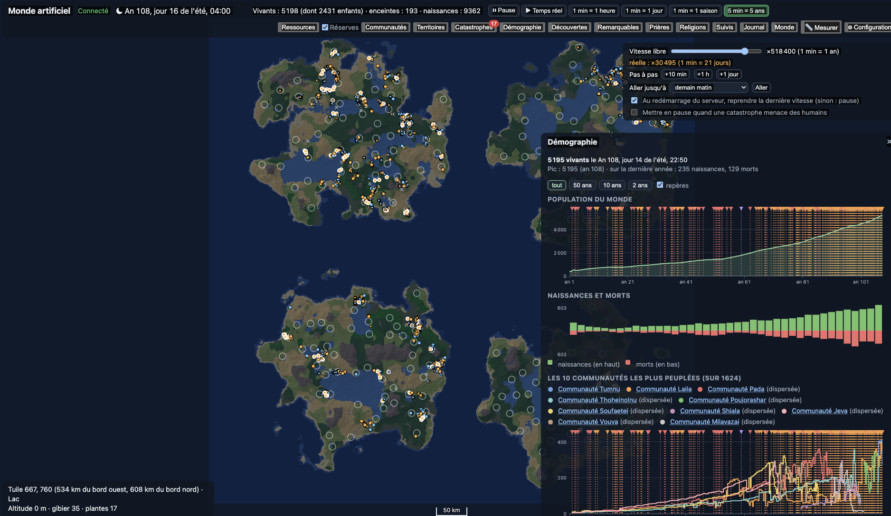

**Français** · [English](README.en.md)

# Monde artificiel

Simulation d'une communauté humaine née d'un mythe fondateur. Application client-serveur : un serveur .NET 10 avec serveur HTTP intégré (Kestrel), et un client web ouvert dans le navigateur.

Version 0.41.2 (affichée dans « Configuration »), auteur : MicG. Ce qui a changé à chaque version est résumé dans les [notes de version](#notes-de-version). Le bouton « 📖 Lire le guide » de la Configuration ouvre ce document dans la langue de l'interface, sans connexion à internet. Pour faire jouer l'Entité par un LLM installé sur votre machine ou dans le cloud (ChatGPT, Claude, Mistral, Euria), voir le [tutoriel](#tutoriel--faire-jouer-lentité-par-un-llm).



## Prérequis

- SDK .NET 10
- Node.js 22 ou plus (seulement pour modifier le client web)

## Lancer

```bash
cd src/Monde.Serveur
dotnet run
```

Puis ouvrir http://localhost:5080 : la page affiche « Connecté au serveur » et la carte du continent avec les humains de départ.

En haut, la date du monde et les vitesses préréglées : pause, temps réel, puis l'accéléré jusqu'à « 5 min = 5 ans ». Le panneau « Temps », à droite juste sous la barre de boutons (il suit sa hauteur, sur plusieurs lignes quand l'écran est étroit), donne le contrôle complet ; ▴ le réduit à la seule vitesse libre, et le navigateur retient ce choix :

- **Vitesse libre** : un curseur du ralenti (×0,1) à ×10 000 000. Le monde va aussi vite que la machine le permet ; la vitesse réellement atteinte s'affiche à côté, en orange quand la machine ne suit pas.
- **Pas à pas** : met en pause, puis avance de 10 minutes, d'une heure ou d'un jour.
- **Aller jusqu'à** : demain matin, la prochaine saison, la prochaine année, la prochaine naissance, la prochaine mort, la prochaine alerte d'un suivi ou une date précise. Le monde file à la vitesse maximale, puis se met en pause et l'annonce. Changer de vitesse ou « Arrêter » annule l'objectif.
- **Avancer de** 10, 50, 100 ou 500 ans (0.40.0) : le monde file à la vitesse maximale jusqu'à la date, avec une barre de progression, les années calculées par minute et la durée restante ; à l'arrivée, il se met en pause et un **bilan** dit ce qui s'est passé (voir plus bas).
- **Redémarrage** : une case choisit si, au redémarrage du serveur, le monde repart en pause (par défaut) ou à sa dernière vitesse.

Pour aller plus vite, lance le serveur en mode Release : `dotnet run -c Release` (attention à l'orthographe : avec `-c Realease`, le serveur tourne sans optimisations). La carte s'assombrit la nuit. L'année compte 4 saisons de 90 jours, et la durée du jour varie selon la saison.

Le monde est sauvegardé toutes les 10 secondes et à l'arrêt du serveur (Ctrl+C), dans un fichier SQLite :

- macOS : `~/Library/Application Support/MondeArtificiel/mondes/monde.db`
- Windows : `%LOCALAPPDATA%\MondeArtificiel\mondes\monde.db`
- Linux : `~/.local/share/MondeArtificiel/mondes/monde.db`

Au redémarrage, le monde reprend à la date enregistrée (en pause, sauf réglage contraire). Pour repartir de zéro, utilise le bouton « ⚙ Configuration » de la page (voir plus bas) puis « Créer ce monde » ; la même fenêtre sauvegarde et restaure un monde. L'ancien monde est copié dans `monde-avant-reinitialisation.db` à côté (seule la dernière copie est gardée). Le dossier se change avec le réglage `Monde:Dossier`. Le [manuel de la base de données](docs/manuel-base-de-donnees.md) détaille les fichiers, les sauvegardes, la taille du journal et la copie pour analyse.

Les fondateurs (33 couples par défaut, de 14 à 40 ans, nombre et emplacement réglables) apparaissent sur la carte : point orange pour une femme, bleu pour un homme, croix grise pour un mort. Le compteur « Vivants » est en haut. Survoler un humain affiche son nom, son âge, ce qu'il fait et ses besoins (faim, soif, fatigue, froid, santé). Les noms sont tirés au hasard pour l'observateur ; au départ les humains n'ont pas de langage, puis chaque communauté forge le sien (voir plus bas), et les noms dans sa langue s'ajoutent. Avec la case **Langage avancé** de la Configuration, ils arrivent au contraire avec une langue complète et un nom dans cette langue.

Le désir est un instinct qui apparaît à la puberté (les humains ne savent pas qu'il mène à une naissance). Ils s'accouplent avec leur compagnon ou avec un humain d'un autre couple. Rien n'est fixé à l'avance : chaque humain a sa propre biologie, héritée en partie de ses parents (âge de la puberté vers 16 ans, ménopause vers 49 ans, fertilité propre, 3 % de stérilité), et les valeurs de départ viennent d'études sur les chasseurs-cueilleurs, citées dans `Humains/Biologie.cs` et `Humains/Reproduction.cs`. La chance de concevoir dépend de l'âge, de la faim, de la santé et de l'allaitement (presque nulle la première année, l'allaitement dure jusque vers 3 ans). La grossesse dure environ 268 jours, plus ou moins selon chacune ; fausse couche, mort-né, jumeaux et mort de la mère ont des risques qui varient avec l'âge, le nombre d'enfants, la faim et la santé.

Chacun a aussi son propre attachement à ses enfants : fort chez la plupart, faible chez quelques-uns. Un parent attaché va rejoindre son enfant éloigné et partage nourriture et eau avec lui ; une mère peu attachée peut délaisser son bébé quand elle souffre. Les bébés restent dans les bras de leur mère jusqu'à 2 ans. Les petits enfants restent ensuite tout près de celui qui veille sur eux, qui les mène à l'eau, à la nourriture et à l'abri ; ils apprennent les lieux en le regardant faire, et ne partent seuls qu'à leur âge d'autonomie, propre à chacun, vers 3 à 6 ans (Konner 2005 ; Crittenden et al. 2013). Un orphelin est recueilli par l'adulte qui l'aime le plus (Hrdy 2009). Jusqu'à 14 ans, les enfants suivent les siens ; ils partent et arrivent avec eux dans une communauté (« avec sa fille X (3 ans) »), et une vraie hostilité ne se forme guère avec un enfant. Avant la puberté, la fiche ne montre ni attirance ni orientation. Sur la carte, un enfant est un petit point et une femme enceinte a un contour blanc.

Chaque humain a son **caractère** et son **intelligence**, innés et transmis en partie à ses enfants (`Humains/Psyche.cs`) : les cinq grands traits du modèle Big Five (ouverture, conscience, extraversion, agréabilité, névrosisme), la transcendance de soi (spirituel ou terre à terre, d'après Cloninger), l'attachement à ses enfants et l'endurance. L'intelligence suit l'échelle du QI (moyenne 100, écart-type 15) : une intelligence générale et des aptitudes verbale, spatiale, manuelle, de mémoire et artistique ; quelques rares humains ont un talent artistique exceptionnel. Le charisme se déduit du caractère ; la figure centrale d'un groupe n'est pas désignée, elle émerge.

Ces traits ne sont pas tirés séparément : ils sont **liés entre eux** comme le montre la recherche (`Humains/Psyche.cs`, `Humains/Morale.cs`). Aux cinq grands traits (corrélations de van der Linden et al. 2010) s'ajoutent l'**honnêteté-humilité** (Lee et Ashton 2005), l'**empathie émotionnelle** (ressentir ce que l'autre ressent) et **cognitive** (le comprendre), la **compassion**, la **psychopathie** (continue ; environ 1 % des adultes en ont le profil, deux à trois fois plus d'hommes ; froideur, absence de remords, charme qui masque la manipulation, noté au jardin secret), le **style d'attachement** (sûr, évitant ou anxieux, environ 56/25/19 %) et cinq **fondements moraux** (soin, équité, loyauté, autorité, pureté ; Graham et al. 2011). La morale d'une communauté est la moyenne de celle de ses adultes et change avec eux. Ces traits agissent : vols de nourriture (surtout les peu honnêtes et les psychopathes, quand la faim presse), soins aux malades, consolation des endeuillés, orphelins recueillis, peur qui gagne les voisins, deuil et jalousie plus ou moins vifs, trahisons, violence, exils. Chacun est transmis en partie aux enfants selon son héritabilité mesurée. Le caractère **mûrit** avec l'âge (plus consciencieux et plus serein de 20 à 40 ans, plus agréable vers la vieillesse ; Roberts et al. 2006) et les grandes **épreuves** (deuil, guerre, exil, trahison) laissent une trace, plus profonde chez les sensibles. Les humains d'un monde créé avant la version 0.17 reçoivent ces traits, tirés de façon cohérente avec leur caractère existant.

Si plus personne ne vit, la simulation **se met en pause** : le journal note la dernière mort (★), tout objectif « Aller jusqu'à » est annulé et un bandeau propose de restaurer une sauvegarde ou de créer un nouveau monde. La nature continue si l'on relance le temps.

La **mémoire** est propre à chacun : un humain retient les points d'eau, les lieux où il a mangé et les abris où il a dormi (de 2 à 12 de chaque selon son aptitude), et les oublie selon la courbe d'Ebbinghaus : vite s'il a peu de mémoire, lentement s'il en a beaucoup, et de moins en moins à chaque retour. Un abri où il revient chaque saison peut ne jamais être oublié. Quand rien n'est en vue, il retourne à un lieu dont il se souvient.

Les humains tissent des **liens** (familiarité, affection) avec ceux qu'ils côtoient : on s'attache davantage à qui nous ressemble et quand on est bienveillant ; les querelleurs et les anxieux se heurtent, et la foule crée des frictions. Des amitiés et des hostilités naissent et s'éteignent ; on partage sa nourriture avec ceux qu'on aime, on se serre contre eux pour avoir chaud, on s'éloigne de ceux qu'on ne supporte plus. Leur **humeur** varie (faim, froid, compagnie, naissances) ; la mort d'un proche endeuille sa famille, ses amis et sa communauté, plus ou moins longtemps selon la sensibilité de chacun. Une tristesse qui dure peut tourner à la dépression (l'humain se néglige, délaisse les siens) et, rarement, au suicide.

Les **communautés** ne sont pas décrétées : une communauté naît quand au moins 5 humains liés d'amitié, dont 3 adultes, vivent ensemble. Elle tient tant qu'au moins 2 de ses adultes vivent encore ensemble ; un membre parti un temps (chasse, fuite, raid) en reste membre, et un groupe dispersé peut renaître sous le même nom si ses anciens se retrouvent. Ainsi les fondations sont rares (quelques-unes par an) et les groupes durables. Chaque humain garde la communauté où il est né. Le bouton « Communautés » les liste avec leurs membres, leur date de naissance, leur figure centrale et l'endroit où elles vivent ; en choisir une entoure ses membres sur la carte.

La **nature est vivante** (`Humains/Ecosysteme.cs`). Les plantes repoussent selon la saison (l'hiver est maigre) et les pluies ; trop cueillies, elles repartent plus lentement. Le gibier se reproduit (croissance logistique, environ 35 % par an au mieux), s'éteint localement s'il est trop chassé et revient peu à peu depuis les terres voisines. Chaque année, les pluies sont tirées région par région (32 × 32 cases) : une sécheresse touche une région environ une année sur dix et peut durer ; le journal la note dans la rubrique « Nature ».

Chaque humain a des **réserves** (graisse, de 0 à 100) et un **métabolisme** propre, hérité en partie. Il dépense plus en marchant ou en chassant qu'en dormant, et plus encore enceinte ou en allaitant. Quand il a faim, il puise dans ses réserves ; quand il mange à sa faim, il les reconstitue jusqu'à son niveau habituel. Des réserves basses rendent malade plus souvent, tarissent le lait et bloquent la conception (Ellison) : la fécondité suit donc la nourriture disponible, et une population nombreuse sur des terres épuisées fait moins d'enfants. La cueillette rapporte selon la richesse de la tuile.

Quand une communauté manque de nourriture (réserves de ses membres basses ou terres épuisées autour d'elle), la **disette** est constatée et journalisée. Le groupe part vers les terres les plus riches dont un de ses membres se souvient, ou tente sa chance au loin ; la plupart des membres suivent, certains restent, et un groupe peut se scinder. Entre deux communautés, la relation se déduit des liens entre leurs membres : alliées, indifférentes, hostiles, ou rivales quand elles vivent sur les mêmes terres et que la nourriture y manque. La faim et la rivalité dégradent les liens entre les membres des deux groupes. Le bouton « Ressources » colore les terres épuisées (jaune puis rouge) et encadre les régions en sécheresse (orange) ou très arrosées (bleu) ; le panneau « Communautés » donne pour chacune l'état de ses terres, la faim et les réserves de ses membres, sa destination et ses voisines.

**Chaque fait garde sa cause** (`Humains/Emotions.cs`, `Humains/Conflits.cs`). Tout événement du journal peut citer celui qui l'a provoqué : une grossesse son accouplement, un deuil la mort pleurée, une dépression ce qui l'a déclenchée, un départ la disette, une hostilité entre deux groupes la violence qui l'a fait naître. Dans le journal et la fiche, « pourquoi ? » affiche l'événement à l'origine, puis le sien, et ainsi de suite. L'humeur de chacun garde aussi ses **raisons** (deuil, faim et soif, froid, maladie, solitude, rejet, trahison, colère, naturel sombre), écrites en clair : « Vousaer sombre dans une profonde tristesse : il pleure sa fille Ana, il se sent seul et la colère le ronge. »

S'unir hors de son couple n'est ni interdit ni sans suite. Le compagnon peut l'apprendre, en les voyant ou par un ami ; sa **jalousie** dépend de son tempérament, de son attachement et de l'usage de sa communauté : indifférence, ou colère et **rancune** contre l'infidèle et son complice. La colère pousse à affronter l'offenseur (une querelle, parfois des coups, rarement mortels) ; la rancune s'efface avec le temps en **pardon**, ou finit par une **séparation**. Un meurtre endeuille les proches de la victime, leur donne soif de vengeance et dresse sa communauté contre celle du meurtrier. Chaque communauté se forge un **usage** sur la fidélité, à partir du tempérament de ses membres et des affaires qui l'ont marquée ; là où l'infidélité est mal vue, le groupe réprouve l'infidèle, ce qui peut aller jusqu'au rejet. La rubrique du journal « Jalousie et conflits » rassemble ces faits.

Chaque communauté a son **identité** et son **histoire**. Au début, l'observateur la nomme d'après sa figure centrale (« Communauté de … ») ; un jour, un membre doué pour la parole propose un **nom** que le groupe adopte s'il l'estime : il évoque leur paysage (la rivière, la forêt…), un ancêtre, une figure respectée, ce qu'ils ont traversé, ou simplement « les humains ». C'est une invention : le premier groupe à se nommer en donne l'idée à ceux qui le côtoient. Un nom peut changer (le groupe a quitté la rivière qui le nommait, ou ne veut plus porter le nom d'un membre détesté) ; les mots qui le composent sont les **premiers mots** du groupe, emportés lors d'une scission. Deux communautés alliées peuvent décider de **s'unir** (trop petites, une disette, un ennemi commun) : la plus petite rejoint l'autre et s'y fond. Les **terres** d'un groupe sont celles que ses membres ont parcourues dans l'année : le bouton « Territoires » les montre sur la carte, aujourd'hui ou au début de n'importe quelle saison passée. Dans le panneau des communautés, « Chronologie » ouvre le journal de ce qui est arrivé au groupe, et la carte d'une communauté choisie donne ses noms successifs, ses premiers mots et sa taille au fil des saisons.

Les communautés peuvent se faire la **guerre** (`Humains/Guerres.cs`). Rien n'est décrété : un groupe prépare un **raid** contre un groupe hostile ou rival assez proche (30 km au plus) quand il a des raisons de frapper (venger les siens, disputer des terres qui ne nourrissent plus tout le monde) et qu'il se sent nettement plus fort ; sa figure, si elle est conciliante, retient les siens. La guerre se **prépare** : le plus ardent (colère, rancunes, caractère querelleur) pousse le groupe à la faire ; le journal note ce **projet** (qui le pousse, contre qui, pourquoi, quels alliés il sollicite) et le panneau Communautés l'affiche. Quelques jours ou quelques semaines plus tard (de 2 jours à 4 semaines : plus long dans un grand groupe, plus court sous le coup d'une vengeance brûlante ou poussé par un instigateur charismatique ; la date s'affiche dans le panneau Communautés), le groupe en **débat** : chaque homme de 16 à 50 ans décide pour lui-même de suivre ou non (son ardeur, son estime pour l'instigateur, l'avis de la figure du groupe s'il l'estime, le danger que les prudents mesurent, sa faim), et les alliés sollicités acceptent ou refusent. Le groupe **renonce** si presque personne ne suit, si l'ennemi est trop fort pour la troupe réunie, si la faim a ôté toute force aux guerriers, ou si le projet n'a plus d'objet (paix faite, ennemi dispersé) ; sinon les volontaires partent, jamais tout le groupe. Chez les peuples sans chef, nul n'est tenu de suivre qui veut la guerre (Boehm 1999 ; Glowacki et Wrangham 2013). Personne ne sait encore fabriquer d'**arme** : on frappe des poings, on lance des pierres, on cogne avec une branche, selon ce que le terrain offre (branches en forêt, pierres ailleurs) et si l'on a eu le temps de s'en saisir ; la branche tue le plus, les poings rarement (les vraies armes viendront des découvertes). La troupe marche jusqu'au camp ennemi, attend l'aube et attaque par surprise (comme dans la plupart des combats des sociétés sans État, d'après Keeley 1996 et Wrangham et Glowacki 2012) ; selon la surprise et le nombre, il y a des morts et des blessés des deux côtés, puis la troupe rentre. Le premier sang ouvre une **guerre** : chaque mort nourrit la vengeance des proches, le **tempérament** du groupe (de pacifique à guerrier) se forge avec ce qu'il vit, on ne passe pas chez l'ennemi tant qu'elle dure, et la menace soude le groupe. Des groupes alliés qui ont un ennemi commun scellent un **pacte** : leurs guerriers comptent ensemble et se joignent aux raids. Une guerre finit par la **paix** (quand le sang ne coule plus depuis des mois et que les figures y sont prêtes, d'autant plus vite que les pertes sont lourdes : les rancunes s'apaisent ; le journal en donne les raisons), par la **défaite** du plus faible (trop peu nombreux, ses derniers rejoignent le vainqueur ; sinon sa figure choisit de se **soumettre**, et le groupe livre chaque semaine une part de sa nourriture jusqu'à ce qu'il redevienne assez fort pour refuser, ou de **fuir** au loin), ou par la dispersion d'un des groupes. Un groupe qui se recompose sous un autre nom garde ses guerres. Le panneau Communautés montre pour chaque groupe ses guerres (raids, morts de chaque côté, issue), ses pactes, sa soumission ou ses vassaux et son tempérament ; le journal a un filtre « Guerres et alliances ». Les événements **significatifs** (projet de guerre et renoncement, réponses des alliés, raids, début et fin des guerres, pactes, soumissions, catastrophes) sont marqués ★ dans le journal, qui peut ne montrer qu'eux (« ★ Significatifs seulement »).

Chaque humain a son **jardin secret** (`Humains/Jardin.cs`, table `jardin`) : ses intentions (venger un proche, suivre ou refuser une guerre), ses peurs (la faim, une catastrophe qui revient, un raid ennemi), ses espoirs (un enfant à naître, des terres meilleures), ses joies et ses peines (naissances, deuils, l'ennemi abattu ou le remords d'avoir tué), ce qu'il pense des autres et de lui-même, ses croyances et ses questions. Après une catastrophe, les esprits portés vers l'invisible y voient souvent une volonté cachée (Guthrie 1993 ; Barrett 2000), les curieux se demandent d'où elle vient. Chaque chose a sa force et sa cause ; elle s'estompe avec les semaines, plus lentement chez qui a bonne mémoire, et les croyances tiennent des années. La fiche le montre par rubriques, avec « pourquoi ? » pour remonter à l'événement qui l'a fait naître.

La nature a ses **catastrophes** (`Nature/`), sans que l'Entité y soit pour rien. Chaque continent reçoit, de sa graine, une **géologie** : vieux socle stable, rift ou côte active (failles et volcans dessinés sur la carte). Les **séismes** suivent la loi de Gutenberg-Richter (dix fois moins de séismes à chaque degré de magnitude) ; on les sent plus ou moins selon la distance (échelle de Mercalli), les éboulements tuent en montagne, une forte réplique suit souvent, et un grand séisme sous la mer lève une **vague géante** qui noie les côtes basses. Les **volcans** grondent des jours ou des semaines avant d'entrer en éruption (indice d'explosivité de 1 à 7) : coulées de lave, nuées brûlantes, cendres, et après une très grande éruption un **hiver volcanique** qui refroidit le monde et maigrit les récoltes pendant des années. La foudre allume des **incendies** que le vent pousse, surtout l'été et pendant les sécheresses ; les **crues** débordent sur les rives, d'ordinaire lentement (on s'écarte), parfois d'un coup (crue subite) ; des **tempêtes** venues de la mer frappent les côtes en été et en automne ; des **vagues de froid** et des **canicules** pèsent sur tout le continent. Le ciel offre des **éclipses**, des **comètes**, des **boules de feu** (parfois une météorite) et, très rarement, des **aurores** ; un astéroïde destructeur (10 mégatonnes et plus, comme Toungouska en 1908) ne tombe sur un continent de cette taille qu'une fois en une dizaine de millions d'années, les gros d'autant plus rarement (Brown et al. 2002). Le monde ne s'arrête pas aux rivages de la carte : ailleurs sur la planète, un grand volcan explose environ une fois par siècle (indice 6, comme le Pinatubo) et une fois par millénaire (indice 7, comme le Tambora), et son voile refroidit aussi ce continent pendant un à trois ans (Newhall et Self 1982 ; Self et al. 1996 ; Oppenheimer 2003). Les **maladies nouvelles** passent du gibier à l'homme (comme les zoonoses) ; chacune a sa contagion (R0), sa durée, sa létalité et son immunité, se transmet entre ceux qui vivent ensemble et devient une **épidémie** quand elle touche plusieurs personnes à la fois. Fréquences et intensités viennent d'observations réelles, citées dans le code.

Chaque humain réagit selon son caractère : les prudents fuient plus tôt, les dormeurs se réveillent parfois trop tard ; les jeunes enfants, les vieillards et les affaiblis meurent plus souvent. La **peur** pèse sur l'humeur et s'apaise en quelques jours, ou en des semaines chez les plus sensibles ; devant un phénomène du ciel, les esprits contemplatifs s'émerveillent. La nature touchée (terre brûlée, cendres, eau salée, sol soufflé) reverdit à son rythme : un an et demi pour une plaine de fougères ou un marais, deux ou trois ans pour la forêt tropicale, huit pour la forêt de conifères, dix pour le désert et la montagne, bien plus pour une terre stérilisée par la lave ou un impact (successions après les feux de Yellowstone, Turner et al. 2003, et le mont Saint Helens, del Moral et Wood 1993). Tant qu'elle n'a pas reverdi, une catastrophe finie a encore des **suites** : ceux qui meurent de faim, de soif, de froid, d'épuisement ou de maladie dans les terres qu'elle a dévastées comptent parmi ses morts (« dans les terres dévastées par l'incendie »), et le jour où elles ont reverdi, le journal donne son **bilan complet** (morts sur le coup, blessés, morts des suites). Seuls comptent les dégâts que la catastrophe a causés elle-même. Un astéroïde de 10 000 mégatonnes ou plus plonge le monde dans **la longue nuit** : poussières et suies voilent le soleil, de −0,5 °C pendant six mois à −26 °C pendant cinq ans pour un impact comme celui de Chicxulub (Toon et al. 1997 ; Brugger et al. 2017) ; ceux qui meurent alors de faim ou de froid lui sont imputés. Toutes les morts, blessures et peurs citent la catastrophe comme cause ; chaque communauté touchée l'inscrit dans sa chronologie avec ses morts. Le bouton « Catastrophes » liste celles en cours et l'histoire (un clic montre les terres touchées sur la carte), les maladies et la géologie ; une **alerte** en bas de l'écran annonce chaque catastrophe qui menace des humains (trois au plus, la plus récente en haut), une **pastille** sur le bouton « Catastrophes » compte les alertes graves non vues, et le monde peut se mettre en **pause** (case à cocher dans le panneau « Temps », décochée par défaut depuis la 0.29.3) ; la case « Afficher les alertes de catastrophe » de la Configuration les cache. En bas du panneau, « ✦ L'Entité provoque… » permet de déclencher une catastrophe à l'endroit choisi (le formulaire n'est jamais redessiné pendant qu'on le remplit) : le journal en garde l'origine.

Le monde a des **distances réelles** (`Nature/Echelle.cs`, `Humains/Marche.cs`, `Monde/Geographie.cs`) : une case fait 800 m de côté, le continent environ 205 km, un degré d'altitude 40 m. Chacun marche à sa propre **allure** (en partie héritée), autour de 4,9 km/h pour un adulte en terrain plat (Bohannon et Andrews, 2011), moins vite enfant ou âgé, malade, épuisé, enceinte ou un bébé dans les bras, plus vite quand il fuit. Le **terrain** (forêt, marais, neige, gué) et la **pente** (fonction de Tobler) ralentissent la marche, si bien qu'un pas de dix minutes ne suffit pas toujours pour atteindre la case voisine. Le survol de la carte donne la position en km et l'altitude en mètres ; une **barre d'échelle** suit le zoom. Le bouton « Monde » ouvre les **Caractéristiques du Monde** : surface et dimensions du continent, côtes, point culminant, lacs et rivières, terrains, températures des saisons, population et densité, allures, temps pour traverser le continent à pied (avec « voir » sur la carte). Le bouton « 📏 Mesurer » donne, entre deux points cliqués, la distance à vol d'oiseau, le trajet à pied le moins pénible et son temps de marche. Le journal, les communautés et les territoires parlent en km et en km².

La **configuration** du monde (`Monde/ConfigurationMonde.cs`) est enregistrée dans sa base (table `etat` ; la base en est au schéma v36, et un monde ancien est migré à l'ouverture) : graine, nombre de couples de départ (1 à 200), largeur et hauteur de la carte (51 à 819 km, par cases de 800 m) nombre de continents (1 à 6, séparés par la mer) et départ des couples : sur le plus grand continent (par défaut), sur un autre continent choisi par sa taille, ou répartis sur tous en proportion de leurs terres habitables. À chaque reprise, la carte est régénérée à l'identique depuis ces réglages. Un monde créé avant la configuration garde les réglages d'origine (33 couples, 205 × 205 km, un continent), qui redonnent exactement la même carte. Le bouton « ⚙ Configuration » montre les réglages du monde courant ; on y saisit ceux d'un nouveau monde, on voit sa carte (« Aperçu », le monde courant ne change pas), puis « Créer ce monde » le crée (l'ancien est gardé en copie). Des réglages qui ne laissent pas la place aux couples sont refusés avec la raison. Au-delà de 400 km de côté, la simulation ralentit. La même fenêtre règle aussi, pour le monde courant : les **cœurs du processeur** (« Calcul » : un cœur, par défaut, ou plusieurs ; une même graine redonne le même monde quel que soit le nombre de cœurs), la **clémence du monde** (de 0 à 100 % : la part des risques de maladie, de couches, des tout-petits et des catastrophes que l'Entité écarte ; 0 par défaut) et la case **« Journaliser la vie quotidienne »** (voir le journal).

Les **sauvegardes** se font dans la même fenêtre : « Sauvegarder maintenant » copie le monde tel qu'il est (sans l'arrêter) dans `mondes/sauvegardes/` ; la liste montre chaque sauvegarde (date du monde, humains vivants, taille) et « restaurer » remplace le monde courant par elle, en pause. Le monde remplacé est d'abord sauvegardé (`avant-restauration-…`), et la sauvegarde restaurée n'est pas modifiée. La copie gardée avant la dernière création d'un monde est restaurable aussi. 🗑, après confirmation, met une sauvegarde à la **corbeille** de l'ordinateur (Corbeille de macOS ou de Windows, corbeille freedesktop sous Linux), d'où l'on peut la reprendre tant qu'elle n'est pas vidée ; le monde en cours ne peut pas l'être. Le bouton « Suivis » rassemble les humains et les communautés suivis (« ☆ Suivre » sur leur fiche), leurs alertes et leurs dernières nouvelles mêlées ; les humains suivis sont entourés sur la carte. Depuis la 0.40.0, les suivis sont gardés dans la base du monde, communs à tous les navigateurs (voir « Aller loin dans le futur et alertes sur les suivis »). Le journal se fige avec ⏸ sans arrêter la simulation : les nouveaux événements attendent (leur nombre s'affiche) jusqu'à ▶.

Chaque humain a une **apparence** (symétrie et harmonie du visage, taille, teint, allure, en partie héritées des parents) et une **orientation sexuelle** qui n'est pas binaire : attirance vers les hommes et vers les femmes, de 0 à 100 (`Humains/Attirance.cs`). Les proportions suivent les grandes enquêtes (Copen et al. 2016 ; Bailey et al. 2016) : chez les hommes environ 2 % homosexuels, 2 % bisexuels, 6 % « surtout hétérosexuels » ; chez les femmes environ 1,5 %, 5,5 % et 13 %. L'orientation est en partie transmise (Långström et al. 2010) et, chez les garçons, un peu plus souvent homosexuelle à chaque frère aîné (Blanchard et Bogaert 1996). Celui qui est attiré par son propre sexe peut ne pas le savoir : il passe d'un trouble mal compris à la certitude, au fil de ses désirs (Calzo et al. 2011). Sa **beauté relative** se mesure à l'idéal de sa communauté ; son **attractivité** y ajoute la jeunesse, l'allure et la vigueur. Le **désir** va d'abord à qui plaît : l'attractivité pèse plus que l'affection et le charisme (Eastwick et Finkel 2008). On peut être **repoussé** parce qu'on ne plaît pas, par fidélité, ou parce que l'autre n'ose pas : le refus blesse (plus chez les anxieux), l'acceptation réjouit, et l'on ne sollicite plus de quelque temps qui nous a repoussé. Un désir **refoulé** (par fidélité, parce que l'usage le réprouve, ou pour quelqu'un de son sexe qu'on n'ose pas aimer) est noté dans l'histoire et le jardin secret. Les amours entre personnes de même sexe se vivent en secret là où elles sont mal vues ; un témoin peut les surprendre ; deux qui préfèrent leur sexe peuvent former un couple si le groupe l'admet.

Chaque communauté a ses **mœurs** (`Humains/Moeurs.cs`) : une tolérance envers ces amours, née de l'ouverture d'esprit de ses membres (Shackelford et Besser 2007), qui s'habitue à ce qu'elle côtoie sans drame (Herek et Capitanio 1996) et se durcit après un scandale ; l'usage (réprouvées, sans usage établi, acceptées) change et le journal le note. Elle a aussi un **idéal de beauté** (taille, teint, corpulence) qui glisse vers l'apparence de ses membres et de sa figure, et vers les corps en chair quand la nourriture manque (Nelson et Morrison 2005). Une communauté peut **chasser** un de ses membres (`Humains/Exil.cs`) quand la plupart des adultes et sa figure lui en veulent et que presque personne ne le défend (Boehm 1999) : la raison (meurtre, violence, mœurs réprouvées, discorde…) et la durée de l'exil, parfois sans terme, sont notées ; le compagnon peut le suivre ; l'exilé quitte les terres du groupe et ne peut y revenir avant la fin de son exil. Avant l'exil, un membre que les siens tiennent pour bon (le karma le plus lumineux du groupe, compatissant, sans grief contre l'accusé) peut **plaider** pour lui : chaque accusateur reconsidère selon l'estime qu'il lui porte, et le groupe renonce ou raccourcit l'exil ; pour un meurtre, le plaidoyer réussit rarement (Boehm 1999). Un parent peut aussi **renier** un enfant adulte. Les **maladies** ordinaires portent leur vrai nom dans le journal, même si personne ne sait les nommer (`Humains/Maladies.cs`) : pneumonie, diarrhée, dysenterie, paludisme près des eaux chaudes, plaie infectée, tétanos, vers, infections de la peau (Gurven et Kaplan 2007) ; la tuberculose n'apparaît qu'au-delà de mille humains, la rougeole au-delà de 250 000 (Black 1966). Les maladies nouvelles venues du gibier portent elles aussi un nom réel selon leur profil (peste, grippe, leptospirose, tularémie…).

Cliquer sur un humain ouvre sa **fiche**, en sections déroulantes (on ouvre celles qu'on veut, et elles restent ouvertes d'un humain à l'autre) : pensée du moment, humeur, peur, maladie et immunités, beauté relative, attractivité, orientation et ce qu'il en sait, exils et reniements avec leur raison, chagrin et ce qui pèse sur son humeur, colère et rancunes, communauté, famille, besoins, caractère, intelligence, biologie (dont l'allure et la vitesse de marche du moment), liens, savoirs et objets, foi, regard de l'Entité, dernières pensées, jardin secret, lieux dont il se souvient et histoire. Les noms cités (proches, communauté) mènent à leur fiche, et un bouton revient à la fiche précédente. Le bouton « Journal » ouvre le **journal du monde** : naissances, morts, maladies, couples, grossesses, amitiés et hostilités, deuils, jalousie et conflits, attirances et refus, exils et reniements, communautés, nature, catastrophes, découvertes, soins, arts, langage, prières et religions, gestes de l'Entité. Tout est enregistré avec sa cause ; on filtre par type et par nom, et chaque nom d'humain cité est un lien vers sa fiche. Les gestes routiniers (boire, s'abriter, se reposer, dormir, cueillir, explorer, résumé « Journée de… ») ne sont plus journalisés par défaut, pour garder la base légère : la case « Journaliser la vie quotidienne » de la Configuration les remet. Les actes envers autrui restent toujours dans l'histoire. Ce que l'Entité a soufflé ou fait est marqué ✦.

**Langues.** L'interface s'affiche en français ou en anglais (choix dans la Configuration, retenu par le navigateur) ; les textes sont dans `langues/fr.json` et `langues/en.json`, et ajouter une langue revient à copier `en.json` sous un autre code et à le traduire. Depuis la 0.30.1, le journal et les pensées ne sont plus écrits pendant que le monde tourne : chaque fait est gardé sous forme d'une clé et de ses paramètres (humains, communautés, nombres, mots inventés) et la phrase s'écrit à l'affichage, dans la langue du navigateur (`Simulation/Recits`). Le fichier de langue décrit sa grammaire (section `_grammaire` : élisions, contractions comme « de le » → « du », formes du pluriel) ; dans un texte, `{x}` insère une valeur, `{^x}` lui met une majuscule et `{x:a|b}` choisit une forme selon le genre, le nombre ou un oui/non. Les communautés se nomment selon la langue (« la communauté d'Ana », « the Tako people »). La bascule se fait par domaine : la 0.30.1 traduit la vie et la société (naissances, morts, liens, deuils, couples, querelles, exils, vols, désirs, communautés et leurs noms, pensées courantes, journées) ; la 0.30.2, le jardin secret (voix intérieure selon le caractère, avec ses variantes et ses trois registres, et tout ce que les humains y confient : deuils, exils, guerres, prières, paroles de l'Entité, soins…) ; les 0.30.3 et 0.30.4, les savoirs (découvertes, inventions et leurs lois, apprentissage et enseignement, oublis, hygiène, feu, réserves, œuvres, questions et idées) puis les groupes et la nature (guerres et raids, visites et rassemblements, territoires, catastrophes, volcans, maladies, ciel et météo) ; la 0.30.5, l'Entité et l'invisible (paroles, inspirations, gestes, regard des humains sur l'invisible, croyances, prières seules et collectives, refus, religions, dogmes et rites, prophètes), la médecine (guérisseurs, transes, soins) et le langage (mots, signes, ordre des mots). Une phrase écrite avant la traduction de son domaine garde son français, avec une infobulle. Les langues inventées par les humains ne changent pas.

**Terrain et sous-sol** (`Nature/Terrain.cs`, 0.31.0 et 0.31.1). Sous chaque case, une roche tirée du contexte géologique (granite, basalte, roches volcaniques récentes, calcaire, craie à silex, grès, schistes, alluvions des vallées, sel et gypse des cuvettes désertiques) et un sol qui en découle avec le climat, la pente et l'eau (limons, cendres volcaniques, sols bruns, acides, rouges tropicaux, tourbe, sols minces, désertiques, salés). Le sol change les plantes de ±50 % autour de la moyenne de leur terrain, le gibier moins ; un monde neuf part de ce que porte le sol, un monde ancien y converge. Silex, pyrite, obsidienne, argile et ocre viennent désormais des roches. Les falaises (pentes fortes de roche dure) portent des abris sous roche ; le calcaire et les coulées de lave, des grottes, qui protègent du froid mieux qu'une forêt ; des sources sourdent au pied des parois et des grottes, chaudes près des volcans, salées près du sel, et donnent à boire. Chaque rivière a un débit (pluie qui ruisselle, cumulée vers l'aval ; hautes eaux au printemps, crue les années pluvieuses) et un courant (profondeur × vitesse, géométrie hydraulique de Leopold et Maddock) : on passe à gué jusqu'à 0,5 à 1 m²/s selon sa taille et sa prudence (Jonkman et Penning-Rowsell, 2008), au-delà il faut nager. Les gisements (sel, soufre, bitume, malachite, cuivre natif, cassitérite, fer des marais, or des rivières, charbon, kaolin) sont cachés ; un humain qui passe dessus peut les remarquer s'ils affleurent ou laissent des indices, selon sa curiosité et sa vivacité, et s'en souvient comme d'un lieu. Rien n'en est encore tiré : ce qu'on en fera viendra des humains. Tout se calcule de la graine et de la carte, sans rien enregistrer : un monde ancien reçoit le même terrain qu'un neuf. La fenêtre « Caractéristiques du Monde » en donne le bilan.

**Côtes et mer** (`Nature/Mer.cs`, 0.31.2). La mer a des fonds (plateau continental jusqu'à 200 m, talus au-delà, profondeur adoucie près des côtes), des hauts-fonds au large et des récifs dans l'eau chaude, claire et peu profonde, loin des bouches des rivières. Chaque case de rivage a sa nature : plage, falaise, côte rocheuse, estuaire, delta ou marécage. Les îles et les plus courts passages par mer entre deux terres sont mesurés, avec ce qu'on voit de l'autre rive, depuis la plage ou depuis les sommets (portée par la courbure de la planète, 3,57 × (√h₁ + √h₂) km, limitée à 120 km par la brume). Les vents dominants (des alizés d'est, que la mousson d'été peut retourner) et les courants de surface (3 % du vent, le long des côtes) sont tirés une fois pour toutes. La navigation s'en sert depuis la 0.31.5. Comme le terrain, la mer se calcule de la graine et de la carte, pour les mondes anciens comme pour les neufs. Le bouton « Calques » montre sur la carte les roches, les sols, les rivières (plus épaisses selon leur débit) et les sources, les fonds marins et les récifs, les grottes et abris, et les gisements (pleins si un vivant s'en souvient) ; le survol d'une case les décrit.

**Nouveaux terrains et mer entre les continents** (0.31.3, mondes neufs seulement). Une carte se recalcule toujours de ses réglages : pour que les mondes existants gardent la leur, chaque monde note la génération de carte avec laquelle il est né (0 avant la 0.31.3, 1 depuis ; schéma v37). Un monde créé depuis la 0.31.3 a trois terrains de plus : la **forêt de feuillus** (plantes à fleurs du Crétacé, magnolias, platanes ; fruits et graines, sol brun, entre les conifères et la forêt tropicale), la **mangrove** (côtes basses, chaudes et humides ; vase salée, coquillages et poissons, la marche la plus lente de tous les terrains, moustiques) et la **lande sèche** (broussailles entre la plaine et le désert ; sol mince, brûle plus vite que tout). Chaque règle qui dépend du terrain (feu, marche, abri, sols, matières à ramasser, plantes et leurs vertus, maladies, repousse après une catastrophe, armes de fortune, noms des lieux) les connaît. La configuration propose aussi la **mer entre les continents** : proches (détroits de 10 à 90 km, comme avant), éloignés (continents plus petits, centrés dans leur part de carte, au moins 200 km de mer entre eux : de 208 à plus de 300 km mesurés) ou mélangés (tailles et détroits variés) ; une carte trop petite pour des continents éloignés est refusée avec la taille qu'il faudrait. L'aperçu dit le détroit le plus étroit. Les caractéristiques du monde montrent sa génération de carte et sa mer entre les continents.

**Prières en bloc, journal et taille de la base** (0.31.4, schéma v38). La fenêtre des prières a deux boutons : **exaucer toutes** les prières en attente (avec le nombre de vengeances demandées dans la confirmation) ou **les refuser toutes**, en secret ou par un signe ; chacune suit les mêmes règles qu'une réponse une à une. La Configuration a une rubrique **Journal et taille de la base** : taille du monde et croissance mesurée par an ; **conserver le journal** (illimitée par défaut, ou N années) et **garder la vie quotidienne** (résumés des journées, pensées, partages) pour une durée à part ; les faits marquants et les lignes des humains suivis (★, acteur ou concerné) sont gardés sauf si les cases « Effacer aussi… » sont cochées ; une confirmation précède tout effacement, qui ne revient pas. **Compresser le journal ancien** (décoché par défaut, au-delà d'un an réglable) range le journal ordinaire par paquets de 4 096 lignes compressés sans perte (Brotli, environ dix fois moins de place) : le jeu le lit toujours en entier, filtres, pages et causes compris. L'entretien se fait en arrière-plan, par petits pas entre deux sauvegardes ; le fichier rend la place libérée au démarrage suivant (VACUUM quand plus de la moitié est vide). Une **copie pour analyse** (dossier `analyses`, à côté des sauvegardes, période facultative en années) remet tout le journal en clair, archives comprises, avec la phrase rédigée dans la colonne `texte_redige`, pour un client SQL externe ; depuis la 0.32.5, les mots y ont leur sens en clair (colonne `sens`) et la vue `lexique` donne les mots en usage dans chaque communauté. Une cause effacée s'affiche « cause introuvable (peut-être effacée du journal) ».

**Traverser la mer** (0.31.5, schéma v39, s'applique aussi aux mondes existants). Sur un rivage ou une hauteur, on regarde au large une fois par heure : une côte ou un sommet d'une autre terre se voit s'il dépasse l'horizon (courbure de la Terre, hauteur des yeux, arbres) et si l'air du jour est assez clair (de 8 à 120 km selon les jours) ; la nuit, des feux de camp, à 25 km au plus. Au crépuscule, des signes : des oiseaux qui gagnent le large, un tronc ou un objet travaillé que le courant a apporté. Celui qui voit s'en souvient longtemps et le raconte aux siens, qui le racontent à leur tour. Trois familles de bateaux s'inventent de ce qu'on a vu flotter : radeau de **troncs liés**, botte de **roseaux** (nouvelle matière des marais et des rivières, qui se gorge d'eau en quelques semaines), **tronc creusé** au feu et à l'outil tranchant (pirogue) ; les lois disent ce que chacun porte, quelle houle il tient et à quelle vitesse il avance (avec ou sans pagaie, qui s'invente aussi). On prend la mer pour **pêcher** sur les récifs et les hauts-fonds, **par curiosité** même sans rien voir (le hardi qui découvre une terre pousse jusqu'à elle ou rentre le raconter), pour **aller voir** une terre dont on se souvient, puis, une fois qu'on y a posé le pied, pour **s'y installer** en couple ; en disette sans meilleure terre à portée de marche, une communauté peut partir tout entière. En mer : le vent (loi de Weibull autour du vent de la saison), la houle (vent, distance aux côtes, cyclones), le courant et la dérive, l'erreur de cap (moindre avec le sens de l'espace), la soif, le sommeil à bord, le retour quand la mer grossit ; une vague peut renverser le bateau, et qui ne sait pas nager peut se noyer, enfants à bord compris. Le chemin du retour est retenu et se transmet. Faits marquants : la première fois qu'une communauté voit une autre terre, y pose le pied, et rencontre un humain d'un autre peuple (pour les deux peuples). Le journal a un type « Mer ». Au moment de **créer un nouveau monde**, une case (cochée par défaut) choisit de garder ou non une copie de l'ancien (monde-avant-reinitialisation.db) ; décochée, l'ancien monde est effacé et la copie précédente reste telle quelle.

**L'Entité parle à une communauté** (0.31.6, schéma v40). Sur la fiche d'une communauté, « L'Entité parle » a deux onglets : *À la communauté* et *À chacun de ses membres* (comme avant). Au groupe, onze paroles qui visent une ou plusieurs autres communautés (cases à cocher, avec la distance et la relation) ou une direction : faites la guerre, faites la paix, alliez-vous, allez à la rencontre, enseignez vos savoirs, portez ma parole, partagez, unissez-vous, partez vers, chassez de leurs terres, exterminez. Chaque adulte la reçoit (rêve, voix, signe, apparition), la comprend, y croit ou non et sait ce qu'il en pense ; le groupe en débat le jour venu, cible par cible. La figure pèse plus que les autres, et tranche seule si elle a une très forte autorité (prestige, affection, respect des siens) ou si elle est crainte comme un tyran (penchant à dominer, coups portés aux siens) ; la fiche montre son autorité, la crainte qu'elle inspire et son emprise sur le débat. Issues : le groupe obéit, n'obéit qu'à moitié (une menace au lieu d'un raid, une trêve au lieu de la paix, une délégation au lieu de tout le groupe), en reparle plus tard, refuse, ou ses fidèles agissent seuls. Plus l'autre communauté est loin, moins on obéit ; si l'on obéit, on se rapproche d'elle. Ce que l'autre groupe accepte (paix, alliance, accueil, union, dons) dépend de ses propres membres et de sa figure ; un messager qui y croit et ne ment pas dit que l'Entité les envoie, ce qui touche ceux qui croient en l'invisible. Exterminer : guerre sans quartier, sans trêve, sans captifs ni soumission. Une alliance se jure et tient de 2 à 10 ans. Tout est au journal, en faits marquants chaînés par leurs causes, et la fiche liste les paroles reçues (ou qui visent ce groupe) et leur état. Le journal a deux boutons « Tout sélectionner » et « Ne rien sélectionner ». Les mondes où l'Entité ne parle pas aux communautés tournent exactement comme en 0.31.5.

**La matière et la chaleur** (`Chimie/`, `Humains/Fournaise.cs`, 0.32.0, schéma v41, mondes neufs seulement). Chaque matière a une composition : 21 éléments et 44 phases minérales et organiques (quartz, kaolinite, illite, calcite, goethite, cellulose, lignine, terpènes, cuivre…) avec leurs vraies valeurs (densité, dureté, fusion, chaleur massique). Ses propriétés en découlent : dureté, couleur, si elle se pétrit, se défait dans l'eau, tient l'eau, colle, luit, sonne, brûle (pouvoir calorifique par la formule de Dulong). L'argile, l'ocre, le galet, le sable dépendent de la roche et du sol sous la case ; s'y ajoutent le calcaire, le sable, les coquillages, l'écorce et les pierres colorées des gisements. La température d'un foyer sort d'un bilan d'énergie (combustible, eau du bois, excès d'air selon la forme du foyer et le vent, pertes par rayonnement) : environ 670 °C à l'air libre, 750 dans un cercle de pierres, 880 en fosse, 530 sous la terre, plus de 1 200 avec du charbon soufflé dans une enceinte. Trente réactions mesurées au laboratoire s'appliquent à toute substance, sans recette : séchage, déshydroxylation des argiles (céramique), ocre jaune devenue rouge, chaux vive puis éteinte (qui chauffe dans l'eau), carbonisation du bois (charbon) et de l'écorce (poix), silex chauffé lentement (meilleurs éclats), combustion ; et les accidents (vapeur, retrait, quartz à 573 °C, choc thermique). Six gestes nouveaux : modeler, mettre au feu (dans les flammes, approché peu à peu, sous la braise, en fosse), couvrir le feu de terre, souffler sur les braises, mêler, plonger une pierre chaude dans l'eau ; frapper écrase les matières tendres et martèle le cuivre (qui durcit, puis redevient doux au feu). Ce que l'humain retient est ce qu'il voit (« la matière durcit et ne se défait plus dans l'eau »), et c'est ce savoir qui se transmet. Un pot cuit qui tient l'eau sert à boire et à porter l'eau, le charbon nourrit le feu, la poix colle une pointe, le silex chauffé se taille mieux. Les mondes d'avant (générations 0 et 1) tournent exactement comme en 0.31.6.

**Le cuivre tiré de la pierre** (0.32.5, mondes de la génération 2, y compris ceux déjà commencés). La pierre verte (malachite) chauffée devient un oxyde noir ; sans air, le monoxyde de carbone du feu lui prend son oxygène et laisse du cuivre, à partir de 700 °C et presque tout vers 1 100 °C, bien plus vite si le minerai broyé est mêlé de charbon (Rehder, 2000). Sous 1 085 °C, le cuivre reste en points dans la masse, qu'on libère en grains en l'écrasant ; au-dessus, il fond et se rassemble en une goutte (une part reste prise dans la scorie). Une cinquième façon de mettre au feu, le **creuset** : un creux de terre cuite au cœur du charbon ardent (celui du foyer, ou un morceau qu'on y verse), environ 1 000 °C, et 1 200 °C en soufflant ; le creux se fend parfois, d'autant plus qu'il est mal cuit ou déjà fêlé. C'est ainsi qu'ont commencé les premiers fondeurs, à Belovode vers 5000 av. J.-C. (Radivojević et al., 2010). Sur un gisement qui affleure et qu’il connaît, un curieux ramasse parfois un morceau de pierre colorée (verte, cuivre qui luit, or, graviers d’étain) et l’emporte, comme les perles de malachite de Shanidar vers 10 000 ans (Solecki, 1969) : c’est ce morceau qu’on frappe, mêle et met au feu loin du gisement. Qui a vu le métal sortir de la pierre va en écraser là où elle affleure, la remet au feu, bat la goutte en plaque et en fait une parure (elle attire l'œil), puis, d'une seconde plaque, une pointe : l'alêne, qui perce la peau pour la coudre (un vêtement de peau plus chaud). Les mondes des générations 0 et 1 tournent exactement comme en 0.32.4.

**Cuire dans l'eau, la chaux, les taches vertes** (`Humains/Cuisine.cs`, `Humains/Chaux.cs`, 0.32.6, schéma v43, mondes de la génération 2, y compris ceux déjà commencés). Personne ne sait cuire dans l'eau au départ : on le trouve en posant sur les braises un pot plein où trempent des racines, ou en jetant des pierres chaudes dans une outre, une calebasse ou un creux garni de peau, et l'on retient ce qu'on voit (« ce qu'on y a mis s'attendrit et se mange »). Qui le sait fait bouillir, quand la faim presse et qu'il est au feu, ce que le cueilleur cru laisse (racines dures, graines : une case à 300 nourrit encore, contre 1 000 cru) ; la cuisson nourrit 1,1 à 1,9 fois plus selon l'aliment (Carmody et Wrangham, 2009), le bouillon se boit, les os d'une bête portée rendent leur graisse (une fois par carcasse), une plante amère goûtée au feu perd une part de son poison, et ses petits enfants près du feu ont leur bouillie. Une mère qui fait des bouillies sèvre plus tôt : la fécondité revient vers 1,05 à 1,3 an au lieu de 1,5 (Bocquet-Appel, 2011). Un pot peu fritté ou fêlé se fend parfois sur le feu. **La chaux** : la pâte de chaux éteinte prend en masse en séchant et durcit à l'air (la portlandite redevient calcite, plus vite en couche mince : Lawrence et al., 2006). On l'étale sur la hutte pour voir ; revenu quelques jours plus tard, on voit qu'elle a durci, et qui le sait entretient sa hutte (pâte qu'il porte, chaux vive qu'il éteint, calcaire qu'il cuit) : la hutte enduite se raffermit, abrite un peu mieux et s'affaisse trois fois moins vite. Qui bâtit en portant de la pâte en lie les pierres de la base (le muret n'est pas un objet à part). Une peau trempée dans l'eau de chaux perd ses poils et fait un meilleur vêtement. La chaux vive mouillée brûle les mains, parfois les yeux, surtout chez qui ne sait pas qu'elle chauffe. Le peintre qui porte de la chaux ou de la pierre verte s'en sert à côté de l'ocre (blanc, vert). **Les taches vertes** : un gisement de cuivre sous la surface se trahit par des taches vertes sur la roche (le « chapeau » oxydé), vues cinq fois plus souvent qu'avant ; qui sait fouir y trouve la pierre verte. Le nombre de gisements ne change pas. Les mondes des générations 0 et 1 tournent exactement comme en 0.32.5.

**Falaises, chutes et crues fertiles** (`Nature/Relief.cs`, `Humains/Falaises.cs`, `Humains/Limon.cs`, 0.32.7, schéma v44, mondes de la génération 2, y compris ceux déjà commencés). Entre deux cases où le sol saute de plus de 160 m, une **paroi** se dresse d'autant plus souvent que la roche est dure (calcaire, granite, basalte plus que craie) ; une part des parois a un **passage** (vire, cheminée), plus fréquent dans le calcaire et le grès, et les **cols** (selles d'une crête) sont repérés : tout est tiré de la graine et de la carte, rien n'est enregistré. Les humains suivent le **chemin de moindre effort** (pente, terrain, passages) : ils passent par les cols plutôt que par les sommets et contournent les parois, et retiennent les cols et les passages qu'ils ont franchis. Quand le détour est trop long, un audacieux et adroit peut **escalader** la paroi (jamais la nuit, sauf pour fuir ; l'enfant, le vieillard et l'épuisé presque jamais). **Les chutes** : le risque dépend de la hauteur, de l'âge, de la nuit (moins sous la pleine lune), de la pluie sur le rocher, de la fatigue, de la faim, de la maladie, de l'adresse, de la prudence, du nourrisson porté et de l'habitude du passage ; la mort suit une courbe selon la hauteur (environ une chute sur deux mortelle vers 14 m pour un adulte, moins pour un enfant léger, plus pour un vieillard ; Atanasijevic et al., 2005), sinon une blessure plus ou moins grave. On tombe aussi d'un arbre en cueillant. Cause de mort « Chute », lignes au journal, peur du passage chez la victime et les témoins (le craintif le contourne quelque temps), première paroi franchie dans « Premières fois ». Il pleut désormais par région, selon la saison, en épisodes de quelques jours. **Les crues fertiles** : une crue lente laisse des dégâts pour quelques semaines puis un **limon** qui fait repousser les plantes de 20 à 60 % pendant une à trois saisons, davantage sur un sol pauvre (le Nil, la Mésopotamie) ; le gibier suit ; une crue subite racle surtout le lit. Qui a vu une plaine sous l'eau et y cueille plus tard une abondance peut comprendre que « là où l'eau est passée, tout repousse » : le savoir se confirme ou se perd, se raconte et s'enseigne, et qui le croit retourne cueillir dans la plaine une fois l'eau retirée. Deux calques : **Falaises et cols** (parois, passages, cols) et **Limon des crues**. Les mondes des générations 0 et 1 tournent exactement comme en 0.32.6.

**Séquelles, camp sur la plaine de crue, ce qui repousse au camp** (`Humains/Sequelles.cs`, `Humains/Limon.cs`, `Humains/Rejets.cs`, 0.32.8, schéma v45, mondes de la génération 2, y compris ceux déjà commencés). **Les séquelles** : une blessure grave (chute, coups, guerre, catastrophe) peut laisser, quand la plaie se referme, une jambe qui fait boiter ou un bras raide et faible ; c'est rare pour une chute de 4 m, fréquent pour une chute de 12 m qu'on survit. La gêne décroît pendant quelques mois puis se fixe : il ne boite plus, ou il boitera toute sa vie ; elle est moindre chez l'enfant et chez celui dont la plaie a été soignée, pire chez l'âgé (Aché, Tsimane ; Shanidar 1). Celui qui boite marche jusqu'à deux fois moins vite, chasse et cueille moins bien, grimpe moins et tombe plus facilement ; il le garde pour lui, honteux ou résigné selon son caractère ; les compatissants qui le connaissent s'attachent à lui et lui rapportent sa part plus tôt, les durs le tiennent pour un poids. La séquelle se lit dans la rubrique Médecine de la fiche. **Le camp sur la plaine de crue** : quand plusieurs adultes d'une communauté croient au limon et que l'un d'eux connaît une plaine noyée, à une ou deux journées, dont l'eau s'est retirée et qui vaut nettement mieux que leurs terres, le groupe peut décider d'aller y camper sans attendre la disette ; il y reste ou en repart ensuite selon l'abondance, comme de toute terre. Le premier camp posé sur une plaine de crue est une « Première fois ». Le savoir du limon s'oublie moins : voir l'eau monter le rappelle à qui le sait, et l'enfant qui cueille sur la plaine avec un adulte qui y croit peut l'apprendre. **Ce qui repousse au camp** : autour du camp, à la belle saison, les graines, noyaux et bouts de racines jetés germent (pousse jusqu'à +50 %, qui s'efface en un an ou deux sans personne ; Anderson, 1952). Un observateur peut remarquer que « ce qu'on jette repousse », puis enfouir lui-même quelques graines près du camp ou dans la terre que la crue a laissée. Ce n'est pas encore l'agriculture : ni champ, ni récolte, ni plante choisie. Les mondes des générations 0 et 1 tournent exactement comme en 0.32.7.

**Semer, récolter, garder la semence** (`Humains/Champs.cs`, `Humains/Cultiver.cs`, `Stockage/DepotChamps.cs`, 0.33.0, schéma v46, mondes de la génération 2, y compris ceux déjà commencés). Chaque espèce de plante a désormais ce qu'elle donne à manger (graines, gousses, tubercules, fruits ou noix), tiré de la graine du monde : rendement, mois de maturité, amertume, dormance des graines, plante vivace ou annuelle, qui se bouture ou non, et surtout si ses graines tombent d'elles-mêmes à maturité (presque toutes, chez les plantes sauvages : une sur mille environ tient à la tige). Rien n'est décidé d'avance. Celui qui a vu que « ce qu'on jette repousse » peut enfouir des graines ou un bout de racine près du camp, sur le limon d'une crue retirée (s'il y croit) ou dans une terre brûlée ; il note la saison, et les siens apprennent quelles saisons réussissent. La parcelle lève, pousse et mûrit selon la plante, la pluie, le gel, la sécheresse, les bêtes qui la broutent si personne ne la garde, et les herbes qui l'étouffent : on peut découvrir qu'il faut les arracher. Le limon (+20 à 60 %) et les cendres d'un brûlis la font mieux venir ; on peut découvrir aussi qu'il vaut la peine de brûler avant de semer. À maturité, les graines qui se détachent tombent jour après jour ; celles qui tombent relèvent l'an d'après, sauvages, et se mêlent au semis. **La façon de récolter fait la plante** : secouer les épis au-dessus d'un panier ne prend que les graines qui se détachent, arracher les tiges ou les couper d'un éclat tranchant prend aussi celles qui tiennent ; si l'on garde une part de la récolte pour semer, la lignée prend la part de graines tenaces de ce qu'on a pris, et semer profond au bâton favorise les grosses graines (Hillman et Davies 1990 ; Fuller 2007). Une plante qu'on bouture s'améliore plus vite : on replante les plus beaux plants, les moins amers. Une génération par an, quel que soit le nombre de parcelles. Quand une lignée ne peut plus se semer seule (graines qui tiennent pour moitié au moins, ou plante bouturée nettement plus vigoureuse et plus douce), le journal note qu'elle est **domestiquée** : c'est rare et lent. La récolte se mange, ou se garde en réserve (nouvelles réserves de grains, qui se gardent longtemps mais attirent les rongeurs, et de tubercules, qui se gardent deux à quatre mois). Qui prend dans le champ d'un autre sans lien avec lui commet un vol, et la communauté se fait une idée des champs comme des réserves : à tous, ou à qui les a semés. Un groupe en disette reste près de ses champs si la récolte approche. Manger beaucoup de grain a un prix : plus de maladies pour qui en vit surtout, et davantage dans un camp qui ne bouge plus ; mais une bouillie de grains cuits permet de sevrer plus tôt (Larsen 1995 ; Bocquet-Appel 2011). Le camp sur la plaine de crue peut maintenant être décidé à l'écoute d'un seul croyant, s'il est la figure du groupe, très charismatique ou de la famille d'un adulte du groupe, d'autant plus volontiers qu'on a faim et qu'on y a des champs. Premières fois : premier semis, premier semis sur le limon, premier brûlis, première récolte, première plante domestiquée, au monde et par communauté. La fiche Communauté a une rubrique **Champs** (parcelles, surface, récolte attendue, lignées et leurs traits, idée des champs), et le bouton Calques un calque **Champs semés** (un carré par parcelle : brun semé, vert qui pousse, or mûr ; bord blanc : plante domestiquée). Les mondes des générations 0 et 1 tournent exactement comme en 0.32.8.

**Bêtes gardées, troupeaux, lait** (`Humains/Faune.cs`, `Humains/Betes.cs`, 0.33.1, schéma v47, mondes de la génération 2, y compris ceux déjà commencés). Chaque terrain a ses bêtes, tirées de la graine du monde et décrites par leur forme et un trait (« la bête à cornes au pelage roux », « le rôdeur à la queue touffue ») : il n'y a ni chien, ni chèvre, ni bœuf écrits d'avance. Chaque espèce a les traits par lesquels Diamond (1997) explique que si peu de grands mammifères aient été domestiqués : ce qu'elle mange, son poids, le temps qu'elle met à grandir, ses petits par an, si elle se reproduit en captivité, son humeur (elle charge ou non), sa panique, si elle suit un meneur, et si elle rôde autour des camps pour les restes. Environ un brouteur sur quinze réunit tout ce qu'il faut. Deux chemins, ceux que Zeder (2012) tire de l'archéologie : **le commensal**, où des rôdeurs viennent chercher les restes autour d'un camp qui dure ; un cœur tendre leur jette des os, et après quelques semaines on prend leurs petits ; **la proie**, où le chasseur qui tue une femelle à la saison des naissances rapporte parfois son petit, par pitié ou par curiosité, puis parce qu'il sait qu'on peut élever les petits des bêtes. Rien n'est garanti : une bête qui panique s'échappe, une bête lourde et agressive blesse son gardien, une espèce qui ne se reproduit pas captive ne donne jamais de troupeau. Les brouteurs mangent autour du camp, les autres des restes des humains ; affamées, elles meurent. Une fois l'an, au printemps, elles mettent bas ; on garde les plus calmes pour la reproduction et l'on mange les plus farouches : la docilité monte à chaque génération et la taille baisse un peu (les renards de Belyaev ; Zeder, 2012), plus vite chez les bêtes qui grandissent vite. Quand une lignée ne fuit plus l'homme (docilité de 60 % après au moins huit portées), le journal note qu'elle est **domestiquée** : il y faut plusieurs dizaines d'années. On abat une bête quand le groupe a faim ou quand le troupeau dépasse ce qu'on peut garder, jamais les deux dernières. Celui qui garde des femelles qui allaitent peut découvrir qu'elles se laissent **traire** ; le lait nourrit d'abord les enfants, les adultes le digèrent mal (Ségurel et Bon, 2017). Des rôdeurs apprivoisés aident à la chasse (+30 %) ; le fumier d'un troupeau engraisse les parcelles autour du camp (+20 %) ; vivre au milieu des bêtes fait un peu plus souvent tomber malade (+12 %). Premières fois : premier petit élevé, première naissance au camp, première traite, première bête domestiquée. La fiche Communauté montre les **bêtes gardées** (adultes, petits, docilité, portées). La courbe des **Découvertes** montre aussi, en orange sur l'échelle de droite, combien de savoirs chaque vivant sait en moyenne : elle monte quand les savoirs se répandent, même quand leur nombre ne bouge plus. Les mondes des générations 0 et 1 tournent exactement comme en 0.33.0.

**Découvertes par combinaison** (`Humains/Facture.cs`, `Humains/Combinaisons.cs`, `Serveur/ArbreDto.cs`, 0.34.0, schéma v48, mondes de la génération 2, y compris ceux déjà commencés). Il n'y a pas d'arbre des technologies écrit d'avance : une chose faite de main d'homme est une **combinaison de pièces**, et ce sont les lois du monde qui disent si elle tient et à quoi elle sert. Une pièce est une matière brute (bois, pierre, os, fibres, peau…), une pièce **façonnée** par un geste qu'on connaît (aiguiser, fendre, évider, courber, tresser, polir, encocher, durcir au feu, percer), ou deux pièces **jointes** (au bout, en travers, aux deux bouts comme une corde tendue, l'une lançant l'autre, enduites, cousues, attachées à une ligne), avec un lien si la jointure en demande un. Chaque pièce a des propriétés physiques (dureté, masse, longueur, souplesse, fil, étanchéité, contenance, crochet) ; les lois calculent l'énergie d'un arc tendu, la vitesse d'une flèche ou d'une sagaie lancée au propulseur, le tranchant d'une lame, ce que tient un récipient, et l'échec quand c'est trop mou, trop court ou que ça casse. Quatre usages sont notés sur les mêmes échelles que la chasse et la coupe : chasser, couper, contenir, pêcher. Une idée naît de ce qu'un humain sait déjà, le **possible adjacent** (Kauffman) : appliquer un geste connu à une pièce connue, joindre deux choses qu'on a, refaire une chose avec une autre matière, ou remplacer une de ses pièces ; elle vient plus souvent aux esprits inventifs et ouverts, après une chasse manquée, et en voyant ce que font les voisins. Les humains remarquent aussi des propriétés (« ce bois revient comme un ressort », « cette fibre se file », « cette peau tient l'eau ») qui orientent leurs idées. Chaque trouvaille garde la trace des savoirs dont elle est née. Une chose qui marche est refaite, renforcée par l'usage, enseignée, oubliée ; une chose qui ne marche pas est notée comme un échec. La fenêtre **Découvertes** a un onglet **🌳 Arbre des savoirs** : chaque trouvaille reliée à ses parents, colonne par colonne depuis les racines, en gris ce qui est perdu, ✦ ce qu'a soufflé l'Entité ; dessous, le nombre de combinaisons à un pas de ce qu'ils savent, avec quelques exemples (sans dire si elles marcheraient). L'arbre est dessiné après coup : la simulation ne le lit jamais. Sur la fiche d'un humain, **✦ L'Entité souffle une combinaison** : on choisit un geste ou une jointure et les pièces qu'il a en tête ; il l'essaie aussitôt s'il a de quoi, et les lois disent ce qu'il en sort (le journal le marque comme venu de l'Entité). La Configuration a un réglage **Esprits fertiles** (non par défaut ; 3, 10 ou 30 fois plus d'idées par combinaison), noté au journal comme un acte de l'Entité ; les lois ne changent pas. Enfin, **la part des champs** suit le besoin : on sème d'autant plus que ce qu'on récolte rapporte plus que la cueillette (une courbe en S), jusqu'à une cinquantaine d'ares par bouche, au lieu d'une surface fixe. Les mondes des générations 0 et 1 tournent exactement comme en 0.33.1.

**Cerveau collectif et régularités** (`Humains/CerveauCollectif.cs`, `Humains/Regularites.cs`, 0.34.1, schéma v49, mondes de la génération 2, y compris ceux déjà commencés). Deux personnes aux savoirs différents qui se trouvent au même endroit (au camp, en visite, à un rassemblement) peuvent **mettre leurs savoirs ensemble** : l'idée naît entre elles, d'un geste ou d'une pièce de l'une et d'un geste ou d'une pièce de l'autre ; les lois la jugent comme une idée venue d'un seul. Le journal cite les deux, toutes deux la retiennent, et l'arbre des savoirs dit « X avec Y ». Elle vient plus souvent à deux esprits ingénieux et ouverts qui ont des mots en commun, moins volontiers avec un étranger. Ainsi les groupes nombreux et reliés inventent davantage, tandis que les petits groupes isolés perdent ce qu'ils savaient par la copie imparfaite et l'oubli déjà en place (Henrich 2004, Kline et Boyd 2010, Derex et al. 2013). Chacun voit aussi passer des **séries** : la lune pleine qui revient, les saisons, les étoiles des nuits claires, des choses en nombre. Un esprit attentif peut y lire une **régularité** et s'en servir pour prévoir ; à chaque retour, le fait la confirme ou la dément, et il corrige son estimation. Sans compter, on juge une durée avec une erreur de 10 à 30 % (loi de Weber) ; qui a appris à **compter** (des doigts ou des encoches pour chaque chose, plus vite trouvé par qui sait entailler) tient la lune à une nuit près et compte les lunes d'une année. Une prévision qui tombe juste se dit à ceux qui sont là. Ces savoirs servent : qui **prévoit le retour du froid** pense aux provisions dès l'automne, sans attendre d'avoir faim, et amasse plus volontiers ; qui sait que **les étoiles tournent autour d'un point fixe** tient mieux son cap en mer. Ils entrent dans l'arbre des savoirs avec leurs parents (compter, la lune). Les mondes des générations 0 et 1 tournent exactement comme en 0.34.0.

**L'Entité jouée par un LLM** (`Serveur/Entite/`, 0.35.0, schéma v50, tous les mondes). Un LLM installé sur votre machine peut jouer l'Entité : **Ollama** (par défaut, `http://localhost:11434`), **LM Studio** (`http://localhost:1234`) ou **llama.cpp** (`llama-server`, `http://localhost:8080`). Rien n'est envoyé ailleurs qu'à l'adresse choisie. Le bouton **Entité LLM** de la barre ouvre sa fenêtre : choisir le logiciel et l'adresse, **Tester et lister les modèles**, choisir un modèle (il doit savoir rendre du JSON ; un modèle de 12 à 30 milliards de paramètres selon la mémoire de la machine), **Enregistrer** (gardé pour l'installation, dans `entite-llm.json` à côté du dossier des mondes). Puis **qui joue l'Entité** : *Vous seul* (comme avant), *Le LLM agit* (il décide seul, vous gardez tous vos pouvoirs) ou *Le LLM propose* (ses décisions attendent votre accord dans « Propositions en attente »). Il est appelé pour les prières fortes (★) et collectives, pour une part réglable des prières ordinaires (10 % par défaut), et chaque fois que vous cliquez **Que ferait l'Entité ?** sur la fiche d'un humain ou d'une communauté. Il lit, dans la langue de l'interface, la fiche de l'humain (caractère, santé, croyance, regard sur l'Entité, proches, histoire récente, pensées et **jardin secret**), sa communauté, les autres communautés, ce qu'on peut lui souffler et ses propres derniers actes ; il répond par un objet JSON imposé par schéma : pourquoi, **les mots qu'il dit**, et jusqu'à quatre actes. Ces actes sont **exactement vos pouvoirs** (paroles aux humains et aux communautés, gestes, catastrophes, exaucer ou refuser une prière, souffler un geste ou une combinaison, inspirer un penchant, ou ne rien faire), vérifiés et appliqués par les mêmes règles que pour vous : chaque humain comprend, croit, obéit, hésite ou refuse selon ce qu'il est. Cinq cases disent ce qu'il a le droit de faire (paroles, bienfaits, châtiments et morts, catastrophes, souffles). Une réponse illisible ou un acte interdit lui est renvoyé une fois avec la raison. Le monde continue de tourner pendant qu'il réfléchit ; la case **Attendre l'Entité** arrête l'horloge le temps de sa réponse. Chaque échange est gardé avec le monde (table `entite_echanges`, avec ce qu'il a lu, compressé) et se relit dans **Conversations** (« Ce qu'elle a lu », « Copier en texte ») ; la Copie pour analyse le met en clair (colonne `lu_texte`). Au journal, les lignes nées de ses actes portent **(LLM)** ; les humains, eux, ne savent pas qui joue l'Entité. En mode *Vous seul*, la simulation est exactement celle de la 0.34.1. La courbe des **Découvertes** a maintenant, comme la Démographie, un choix de durée (tout, 50, 10, 2 ans).

**L'Entité prend l'initiative** (0.35.1, schéma v51, tous les mondes). Dans la fenêtre **Entité LLM** : la case **Son regard sur le monde** (cochée par défaut) et sa période (**tous les** 91 jours, une saison, par défaut). Quand le LLM joue l'Entité, il regarde régulièrement le monde : combien d'humains vivent et croient en elle, ce qui s'est passé depuis son dernier regard (faits marquants comptés par sorte, premières fois, les faits les plus graves : guerres, catastrophes, religions, exils, découvertes, morts), chaque communauté (taille, figure, disette, guerres, regard moyen sur l'Entité), ceux qui parlent en son nom et les prières qui attendent. Il décide alors s'il agit, sur qui, et comment, avec les mêmes pouvoirs que pour une prière. L'état de la fenêtre montre la date du prochain regard. **Caractère de l'Entité** : un texte libre que vous écrivez (bienveillante, jalouse, joueuse, indifférente…), lu à chaque appel ; laissé vide, le LLM se choisit un caractère à son premier appel et le garde d'un appel à l'autre (montré dans la fenêtre, bouton **Oublier** pour qu'il s'en choisisse un autre). Nouveau bouton **Actes de l'Entité** dans la barre : la chronologie de tout ce que l'Entité a fait, par vous ou par le LLM (marqué), du plus récent au plus ancien, avec ce que les règles en ont fait (qui a compris, cru, obéi ; mort, guéri ; refusé par les règles…), des liens vers les fiches, les lignes du journal de chaque acte et l'échange du LLM qui l'a décidé. Filtres : par qui, sorte d'acte (paroles, gestes de bienfait ou de châtiment, catastrophes, prières exaucées ou refusées, souffles…), humain, communauté, années. En tête, les comptes (prières exaucées et refusées, morts données, bienfaits, châtiments, paroles, souffles réussis, catastrophes) et une courbe des actes par année (joueur et LLM). Les actes sont gardés dans la table `entite_actes` ; ceux d'avant la 0.35.1 sont repris une fois du journal (lignes de l'Entité encore dans la table, marqués « repris du journal »). La simulation elle-même ne change pas.

**L'Entité libre** (0.35.2, schéma v52, tous les mondes). Dans la fenêtre **Entité LLM**, la case **Entité libre** (décochée par défaut, pour les modes *Le LLM agit* et *Le LLM propose*) laisse le LLM sortir de vos pouvoirs : il peut changer **tout l'état simulé** d'un humain, d'une communauté ou du monde. Chaque changement est vérifié par le serveur, qui ne refuse que ce qu'il ne sait pas représenter (valeur hors bornes, humain inconnu…) : âge, santé, faim, caractère et aptitudes, croyance et regard sur l'Entité, mourir, ressusciter, guérir, rendre malade ou blesser, nouer ou défaire un lien, changer de communauté, déplacer, souffler une pensée, faire oublier, donner ou retirer un savoir déjà connu dans le monde, faire naître un enfant ; pour les communautés, imposer guerre, paix, alliance ou indifférence ; pour une région (rayon jusqu'à 20 cases), plantes, gibier et pluie. Il peut aussi poser des **décrets** : une loi du monde multipliée de ×0,1 à ×10 (fécondité, longévité, maladies, plantes, gibier, climat, apprentissage, fréquence des idées), pour une communauté ou pour tous, pour une durée ou pour toujours, avec sa raison. Une consigne lui demande de rester cohérent avec le monde, et la case **Juge de cohérence** (cochée par défaut) fait relire chaque acte libre par un second appel du LLM : un acte jugé incohérent lui est renvoyé une fois avec la raison, puis abandonné et noté. L'acte est **visible** ou **caché** : visible, ses témoins gardent un souvenir de prodige dans leur jardin secret, et leur croyance, leur crainte ou leur révolte changent comme pour un signe, puis la nouvelle se répand. Au journal, une ligne raconte l'acte (le récit écrit par le LLM), suivie d'une ligne par changement, marquées **(LLM libre)**. Dans **Actes de l'Entité**, l'acte libre est listé avec ses changements, la liste des décrets en vigueur (bouton **Lever**), la date du premier acte libre du monde, et un bouton **Défaire** qui remet les valeurs d'avant (ce qui en a découlé depuis reste). En mode *Le LLM propose*, chaque acte libre attend votre accord. Inventer une chose que le monde ne connaît pas encore viendra en 0.35.3. Sans acte libre ni décret, la simulation est exactement celle de la 0.35.1. La page du client n'est plus gardée en cache par le navigateur : une nouvelle version s'affiche sans vider le cache.

**Les inventions de l'Entité libre** (0.35.3, schéma v53, tous les mondes). Avec la case **Entité libre**, l'Entité peut maintenant créer ce que le monde n'avait jamais connu. **Une plante** : sa forme (arbuste, liane, herbe, fougère, arbre, buisson, racine), son nom, ses vertus (toxique, astringente, fébrifuge, antipaludique, antiseptique, vermifuge, psychotrope) et ce qu'elle donne à manger (graines, gousses, tubercules, fruits, noix) ; elle pousse sur tout le terrain du lieu choisi, et les humains la goûtent, s'en soignent, la sèment selon les lois habituelles. **Une bête** : sa forme (à cornes, à sabots, petit brouteur, fouisseur, rôdeur, grand chasseur, oiseau coureur, grimpeur), son nom et les traits qu'elle veut fixer (poids, agressivité, panique, lait, portée, se reproduire en captivité, vie en troupe…) ; les autres sont ceux de sa forme, et on la chasse ou on l'apprivoise comme les autres. **Un savoir** : un geste et ses matières, même jamais trouvé ; les lois du monde jugent ce qu'il donne (refusé s'il ne donne jamais rien), et l'humain le sait désormais, marqué « soufflé par l'Entité ». **Un mot** : une forme donnée à une communauté ou à un humain pour une idée (sans forme, il est fait des sons de leur langue). Chaque invention a sa ligne au journal, marquée « (LLM libre) », est gardée avec le monde (table `inventions`) et se défait comme les autres actes libres : la plante ou la bête disparaît, le savoir et le mot sont retirés. Pas encore de matière nouvelle : les matières sont liées à la chimie du monde, ce sera pour plus tard. Corrigé : « Défaire » échouait sur un savoir donné ou une pensée oubliée (0.35.2). Nouveau : un tutoriel pour faire jouer l'Entité par un LLM, plus haut dans ce guide. Sans acte libre, la simulation est exactement celle de la 0.35.2.

**Vitesse : les humains de fond** (`Humains/Fond.cs`, 0.36.0, tous les mondes, sans changement de schéma). La Configuration a une case **Vitesse : humains de fond simulés en groupe** (décochée par défaut, modifiable en cours de partie) et un seuil **Seulement à partir de (vivants)** (vide : toujours). Un humain de fond garde tout ce qui fait de lui quelqu'un, et son corps vit chaque pas (faim, soif, fatigue, froid, santé, grossesse) ; les siens le nourrissent à chaque pas. Mais tant qu'il est **au calme** (il dort sans raison de se réveiller, ou il se repose sans besoin pressant), il ne décide pas à chaque pas : il joue son temps libre (idées, essais, gestes appris, envie d'aller voir ailleurs) une fois par heure, avec la chance de toute l'heure. Au moindre besoin ou événement, il vit le pas en entier comme tout le monde : soif, faim, froid quand il sait d'où vient la chaleur, feu du camp qui faiblit ou braise à ranimer, maladie ou plaie, danger, parole de l'Entité, marche ou promenade en cours, voyage, raid, visite, rassemblement, ouvrage. C'est l'« intelligence à niveau de détail » des jeux à grand monde (Brockington, 2002). Restent toujours en individu : les bébés et leurs mères, les figures et les personnages religieux, les spécialistes, les communautés en guerre, et ceux que vous gardez : la fiche d'un humain et celle d'une communauté ont une case **Garder en individu**, et les humains suivis ☆ sont gardés d'office. L'horloge affiche combien vivent de fond. Mesure sur 8 mondes × 20 ans (33 couples) : population, naissances, découvertes, morts et feu gardé sont les mêmes qu'en individu, aux écarts du hasard près ; le calcul va **1,2 à 1,5 fois plus vite**, surtout la nuit. C'est moins que l'estimation de départ : les humains sont rarement au calme, et chaque fois qu'un raccourci changeait leur vie (le feu qu'on n'allumait plus, les pierres qu'on ne ramassait plus en marchant), il a été retiré. Sans la case, la simulation est exactement celle de la 0.35.3.

**Un visage pour chaque humain** (`Humains/Visages.cs`, `Serveur/VisageDto.cs`, `client/src/visage.ts`, 0.36.1, tous les mondes, sans changement de schéma). La fiche d'un humain montre son **portrait**, dessiné par le jeu, et une vignette du visage précède chaque nom dans les liens de la fiche et dans la liste des membres d'une communauté. Chaque humain a une douzaine de traits hérités : largeur et longueur du visage, mâchoire, pommettes, écart, taille et forme des yeux, couleur des yeux, nez, lèvres, sourcils, oreilles, couleur et texture des cheveux, barbe, calvitie, âge des premiers cheveux gris. L'enfant reçoit la moyenne de ses parents plus l'écart du brassage des gènes : frères et sœurs se ressemblent sans être pareils, et un groupe isolé prend peu à peu un air de famille. Héritabilités d'après les études de jumeaux (forme du visage 0,6 à 0,8, couleur des yeux et des cheveux 0,9, calvitie 0,8). Les fondateurs viennent d'une même population, dont l'origine est propre à chaque monde. Le teint, la symétrie, l'harmonie des traits et la corpulence sont ceux que la simulation connaît déjà ; cheveux et yeux sont d'autant plus sombres que la peau l'est. La vie s'y lit : visage rond de l'enfant, rides, cheveux gris et calvitie avec l'âge, joues creusées par la faim, pâleur et fièvre de la maladie, plaie ouverte, cicatrice d'un coup ou d'une guerre, humeur (joie, tristesse, colère, peur), et le portrait d'un mort est terni. Rien n'est enregistré ni tiré du hasard de la simulation : le visage se calcule de la graine du monde, du numéro de l'humain et de ses parents, si bien que les mondes déjà commencés ont aussi leurs visages et que la simulation est exactement celle de la 0.36.0. Le visage ne compte pas encore dans l'attirance.

**Parler avec un humain** (`Entite/Dialogues.cs`, `Humains/Dialogue.cs`, `client/src/dialogue.ts`, 0.36.2, tous les mondes, schéma 54). La fiche d'un humain a un bouton **Parler avec…** : l'Entité, c'est-à-dire vous, lui parle librement, et le LLM local joue l'humain. Sans modèle choisi dans la fenêtre « Entité LLM », le bouton est grisé. Vous choisissez d'abord la voie : **en rêve**, **par une voix** ou **en apparaissant**. Elle compte comme pour les paroles toutes faites : on comprend mal un rêve, on croit davantage une apparition, et une voix ou une apparition effraient les anxieux. L'horloge du monde est arrêtée pendant le dialogue. Chaque réplique se déroule en trois temps. Le LLM traduit d'abord vos mots en paroles codées, celles qui existent déjà (« N'aie pas peur », « Pars vers… », « Unis-toi à… »), au plus deux, ou aucune si vous ne faites que parler. Les **règles décident** ensuite : chaque parole passe par les mêmes règles qu'avant (comprendre, croire, puis obéir, hésiter, n'obéir qu'à moitié ou refuser selon le caractère, la morale et la croyance), et une simple conversation est comprise et crue ou non selon la voie, l'esprit et la croyance de l'humain. Enfin le LLM fait **parler l'humain** d'après ce résultat : il lit sa fiche, son jardin secret, ses proches, ses épreuves, ses savoirs, les mots de sa langue et ses dialogues passés. Il parle sa propre langue, avec les seuls mots de son lexique, et ce qu'il veut dire est traduit sous ses mots (0.36.5) ; il ne peut pas dire ce qu'il ne connaît pas. Le juge de cohérence relit chaque réponse, et une réponse incohérente est refaite une fois. L'humain peut mettre fin lui-même au dialogue : le rêveur se réveille (une phase de rêve dure une dizaine de minutes en début de nuit, près d'une heure au matin), l'effrayé fuit, l'incrédule se détourne. Ce qu'il en garde : un souvenir dans son jardin secret, une ligne au journal avec la voie et le nombre de répliques, et s'il y a cru, il peut le raconter aux siens. Chaque parole codée est notée dans la chronologie des actes de l'Entité. Un humain qui vivait de fond redevient individu. Avec la case **Entité libre**, la réaction de l'humain devient libre elle aussi : le LLM peut changer de lui-même son humeur, ses émotions, sa croyance, son regard sur l'invisible, ses liens, une pensée de son jardin ou sa communauté, rien d'autre et chez lui seul. Ces changements passent par le juge et se défont comme un acte libre. Quand un humain prie très fort (prière ★), un bandeau **« X t'appelle »** propose de lui répondre par un dialogue. La fenêtre de dialogue garde la conversation entière, et son bouton **Conversations** les liste toutes. La base les garde dans les tables `dialogues` et `dialogue_repliques`, et la Copie pour analyse ajoute en clair ce qu'a lu le LLM. Sans dialogue, la simulation est exactement celle de la 0.36.1.

**Carte lissée** (0.32.3). La carte est rendue à la résolution réelle de l'écran (Retina, 4K) et le terrain est dessiné à plusieurs pixels par case (jusqu'à 8) : altitude, eau et couleurs sont interpolées entre les cases, les rivages et les rivières deviennent des courbes, les biomes voisins se touchent le long de limites nettes et courbes (0.32.4 : fini le dégradé flou), le relief est ombré plus finement. Depuis la 0.32.4, les calques (ressources, territoires, catastrophes, roches, sols, fonds) sont lissés de la même façon. Tout se fait dans le navigateur (Mac, Windows, Linux) ; la simulation ne change pas.

**Premières fois** (0.32.1). Le journal a une case « Premières fois » : les premières découvertes de chaque savoir au monde, les premiers mots et la première grammaire, le premier rassemblement de deux communautés, la première transe, le premier mot de chaque communauté, le premier rite de chaque religion, et la première terre vue, le premier pied posé et le premier contact outre-mer de chaque groupe. Elles ne sont jamais effacées par la conservation du journal ni rangées dans ses archives (`PremieresFois.cs`).

Depuis la 0.32.5 (schéma v42), le monde se souvient aussi de ce qui lui est déjà arrivé, et de ce qui est déjà arrivé à chaque communauté (`RegistrePremieres`, table `premieres`). La ligne qui raconte une chose pour la première fois porte une marque, affichée à la fin de la ligne : *première fois au monde*, *pour sa communauté*, ou les deux (colonne `premiere` du journal : 1, 2 ou 3). Cela couvre la naissance, la mort (puis la première mort de chaque cause au monde), le meurtre, le pardon, l'union hors du couple, le couple de même sexe, le feu (le premier de la communauté qui sait le faire ou le garder), la guerre et la paix (pour les deux communautés), la religion (née ou suivie), le prophète, l'Entité (première parole reçue, première parole crue, premier geste, première parole au groupe), la prière et la première prière exaucée, et la première catastrophe de chaque sorte (au monde, puis pour chaque communauté qu'elle frappe). La marque se pose quand la ligne est versée au journal, dans l'ordre des numéros, sans aucun tirage au hasard : la simulation ne change pas. Un monde d'avant la 0.32.5 relit une fois son journal à l'ouverture (lignes en clair et paquets archivés) : ce qui y est arrivé compte comme passé, sans que les anciennes lignes soient marquées ; si une partie du journal a été effacée, tout ce qui pouvait s'y trouver compte comme passé (jamais une fausse première fois).

Sur la carte : molette pour zoomer, glisser pour se déplacer, double-clic pour recadrer, survol pour voir une tuile. L'aperçu de la configuration montre la carte d'autres réglages sans changer le monde courant. La graine du tout premier monde se règle dans `src/Monde.Serveur/appsettings.json` (`Monde:Graine`). Une même graine donne toujours la même carte, sur toutes les plateformes.

Le bouton « Démographie » ouvre les **courbes démographiques** : la population du monde de mois en mois, les naissances et les morts, et les communautés les plus peuplées (les dix plus grandes de toute l'histoire, chacune cliquable, chaque courbe à cacher ou montrer d'un clic sur sa pastille). Des **repères** marquent les catastrophes meurtrières (rouge), les interventions de l'Entité (violet) et les guerres sanglantes (orange) : on y lit l'effet d'un événement sur la population, sur le coup et dans les années qui suivent. La période se choisit (tout, 50, 10 ou 2 ans) ; les courbes se mettent à jour pendant que le monde avance.

Les humains **découvrent par eux-mêmes** (`Humains/Savoirs.cs`, `Humains/Ingenium.cs`, `Humains/Flore.cs`, tables `savoirs`, `objets`, `foyers`, `huttes`, `decouvertes`, schéma v19). Seules les lois du monde sont programmées : un silex frappé contre un galet donne un éclat, un silex contre une pyrite des étincelles, du bois sec frotté longtemps par temps sec une braise (rarement), une branche raclée une pointe, une pointe passée au feu un épieu, des fibres tordues une corde, des feuilles sur des branches un abri ; chaque plante du monde a, de la graine, ses vertus réelles (tanins contre la diarrhée, fébrifuge, antipaludique, antiseptique, vermifuge), ses poisons et parfois des visions. Personne ne sait rien au départ. Qui découvre, quand, s'il remarque ce qu'il a obtenu, ce qu'il en croit (un remède faux peut sembler marcher, car on guérit souvent seul), à qui il le montre et s'il l'oublie : tout cela émerge. On apprend en **jouant** (les enfants bien plus, les esprits ouverts davantage), par **besoin** (le malade qui essaie une plante), en **observant la nature** (la chaleur d'un incendie, un brandon ramassé dans les braises, des bêtes grillées sur une terre brûlée ; les curieux vont voir la fumée), en **réfléchissant** (une étincelle ressemble à une petite flamme) et en **imitant** ceux qu'on regarde faire. Un savoir inemployé s'oublie ; quand plus personne ne le sait, il est perdu pour tous (★), et peut être retrouvé (★). L'Entité peut **souffler une idée** à un humain (fiche, « ✦ L'Entité souffle une idée… ») : il l'essaie avec ce qu'il a sous la main, les lois décident du résultat, et le journal marque ce qu'il en tire comme venu d'elle. La fiche montre les savoirs de chacun (confiance, comment et de qui il les tient), ses objets, son vêtement et son aisance dans l'eau ; la fiche d'une communauté ses savoirs partagés ; le bouton « Découvertes » la chronologie des premières fois, et le journal a un filtre « Découvertes et savoirs ».

La **physique est inventive** (`Humains/Lois.cs`, `Humains/Invention.cs`, `Humains/Intuitions.cs`). Les choses n'ont pas de nom d'objet, seulement des propriétés (forme ronde, longue, plate ou creuse, dureté, poids, flottaison, tranchant) et des lois : le frottement, le roulement, la poussée d'Archimède, ce qui perce, tranche ou pousse. Un **besoin** (rapporter une bête trop lourde, traverser un lac, couper du bois) fait chercher dans ce qu'on sait une chose qui ressemble à la solution ; on l'essaie, et les lois disent si cela marche et pourquoi. Rien ne nomme le traîneau, la roue ni le radeau : l'invention procède par analogie (Gentner 1983), les jeunes explorent davantage (Gopnik et al. 2017), et les objets s'améliorent par petites retouches transmises (l'« effet cliquet », Tomasello 2009). Au calme, un esprit ingénieux a aussi des **idées spontanées** : ce qui marche avec ceci marcherait-il avec cela ? Il l'essaie et conclut, parfois à tort.

Les **pensées** et le **jardin secret** suivent le caractère (`Humains/JardinVoix.cs`). Une même situation ne donne pas la même pensée à un anxieux et à un serein, à un cœur chaleureux et à un froid, à un esprit vif en mots et à un taiseux : chaque pensée est choisie selon les traits qui la rendent plausible (Big Five, attachement, empathie, psychopathie, fondements moraux, aptitude verbale), et revient telle quelle tant que rien ne change. Le jardin a ses rubriques : amour, désir, jalousie, manque, rêves, souvenirs, fierté, culpabilité, honte, envie, émerveillement, ennui. Désir et amour suivent les trois systèmes de Fisher (1998) et les trois composantes de Sternberg (1986).

L'**Entité parle** (`Humains/Paroles.cs`, `Humains/Entite.cs`). Depuis la fiche, « ✦ L'Entité parle… » fait comprendre à un humain une phrase simple, en **rêve**, par une **voix**, un **signe** ou une **apparition**. Les humains n'ont pas de mots pour la recevoir : ils en saisissent le sens plus ou moins bien selon leur intelligence et la manière. Puis chacun, selon son caractère et sa croyance, **croit** ou doute, **obéit**, hésite, obéit à moitié ou **refuse**, y compris quand l'ordre va contre sa morale. L'Entité peut aussi déposer sans un mot un **penchant amoureux** pour quelqu'un, qui s'efface avec le temps.

Les tout-petits sont mieux protégés. Une femme qui allaite peut nourrir un **orphelin** au sein (allaitement par une autre que la mère, courant chez les chasseurs-cueilleurs ; Hrdy 2009). Les **bébés sont portés** pendant les déplacements. Les mères sont **nourries** par d'autres (`Humains/Pourvoir.cs`) : le compagnon rapporte davantage quand sa femme allaite (Marlowe 2003), la grand-mère maternelle nourrit sa fille et ses petits-enfants sevrés (Hawkes et al. 1998), la famille et le groupe y contribuent, chacun selon son attachement et ce qu'il a. Une mère épuisée produit son lait à moindre coût pour elle-même (Prentice et Prentice 1988). Un tout-petit qui n'est plus allaité tombe plus souvent malade (`Humains/Sevre.cs` ; Lamberti et al. 2011 et 2013), et la fumée d'une hutte fermée lui abîme les poumons (Dherani et al. 2008). Dans les raids, les vainqueurs emmènent parfois des **femmes captives** (`Humains/Captivite.cs` ; Keeley 1996, Bowles 2009) : la captive suit son ravisseur, peut s'enfuir pour rejoindre les siens, ou finir par vivre parmi eux.

Le **karma** est le regard de l'Entité (`Humains/Karma.cs`), que les humains ignorent. Il monte quand ils font du bien (partager +0,5 par saison, veiller un malade, consoler, pardonner, plaider pour un accusé, jusqu'à +5 pour allaiter ou recueillir un orphelin) et baisse quand ils font du mal (voler −3, trahir, enlever, tromper −2, jusqu'à −50 pour un meurtre ; tuer pour se défendre pèse bien moins). Une **mauvaise intention** n'a pas de prix fixe : prier pour que l'invisible frappe quelqu'un coûte de −1 à −10, maudire de −3 à −10, selon ce qui est demandé (qu'il souffre, qu'il meure, lui et les siens), l'offense subie, la détresse du moment, le caractère (colère brûlante ou malveillance froide) et la haine entretenue (Cushman 2008 ; Malle et al. 2014). Les fautes d'un enfant comptent moins. Chaque changement est noté « ☯ karma » au journal avec sa cause, et la fiche le montre dans « Regard de l'Entité ». Chacun a aussi sa **croyance en l'invisible** (`Humains/Croyance.cs`, 0 à 100) : faible au départ (0 à 10), elle monte quand l'invisible semble se montrer (parole de l'Entité, vision après une plante, rêve d'un mort, catastrophe, deuil ; Tylor 1871, Norenzayan et Hansen 2006), se transmet des parents et des proches (Henrich 2009), et redescend lentement quand les années passent sans signe. La foi et l'obéissance à l'Entité en dépendent.

La **médecine** naît d'elle-même (`Humains/Medecine.cs`). Comme la plupart des maladies passent seules, un soignant reçoit le crédit de guérisons auxquelles il n'est pour rien (corrélation illusoire ; Chapman et Chapman 1967) : celui qui en a guéri nettement plus que les autres est tenu pour **guérisseur**, on l'appelle au chevet des malades, et on cesse de croire en lui s'il en perd trop. On apprend à soigner les **plaies** et à **aider une femme qui accouche**. Là où l'on croit fort à l'invisible (croyance de 50 ou plus), des **chamans** soignent par la **transe**. Le soin agit aussi par ce qu'on en croit : **placebo** (un peu de mieux) et **nocebo** ; il y a des **charlatans**, et des **malédictions** qui peuvent tuer celui qui s'y croit voué.

Les **arts** naissent aussi (`Humains/Arts.cs`) : battre un **rythme**, **chanter**, **danser**, broyer l'**ocre**, peindre sur la roche (mains, bêtes, morts, l'invisible rêvé ; les plus anciennes mains peintes ont plus de 40 000 ans, Aubert et al. 2014), **veillées** autour du feu, **lamentations** pour les morts, **fêtes**, et la transe que le rythme peut donner. Chaque communauté a son **style**, qui se transmet et change. Le bouton « Remarquables » permet de trouver les auteurs d'œuvres.

Le **langage** se forme dans chaque communauté (`Humains/Langage.cs`). Il n'y a ni lexique ni grammaire écrits d'avance : par un jeu de **dénomination** (Steels 1995), quelqu'un invente des sons ou un **signe** pour une chose, d'autres l'adoptent, les mots qui réussissent s'imposent, ceux qu'on n'emploie plus s'oublient. Le langage passe par des **stades** : des mots isolés, puis des mots assemblés, puis un **ordre fixe**. Les humains reçoivent un **nom dans la langue** de leur groupe, se racontent des **récits du soir**, des **interprètes** apparaissent entre groupes qui se côtoient, et une langue se scinde en **dialectes**. L'histoire de chaque langue est gardée.

**Langage avancé** (`Humains/LangueHeritee.cs`, 0.37.0, mondes neufs seulement, schéma 56). La Configuration d'un nouveau monde a une case **Langage avancé** (décochée par défaut, choisie à la création seulement). Cochée, les fondateurs arrivent avec une langue complète : toutes les langues humaines connues le sont, y compris celles des chasseurs-cueilleurs sans écriture ni métal. Les fondateurs d'une même terre forment un seul peuple (un peuple de chasseurs-cueilleurs qui partage une langue compte environ 500 personnes : Birdsell, 1953) et parlent une **langue mère** : ses sons, ses mots (courts pour les choses de tous les jours), une part de signes, et un ordre des mots tiré selon sa fréquence dans les langues du monde. Plusieurs terres de départ ont chacune la leur. Chacun la connaît à sa façon : presque tous les mots de tous les jours, et des autres d'autant plus qu'il est à l'aise avec les mots et qu'il a de la mémoire. Chacun porte dès le premier jour un nom dans sa langue, qui veut dire quelque chose. Ensuite tout reste vivant : les enfants apprennent et déforment, les mots non dits s'oublient, les groupes qui se séparent voient leurs parlers dériver, et les mots des savoirs et des plantes naissent avec eux. L'histoire de la langue d'un groupe marque ces mots « de la langue des fondateurs », jamais comme des inventions, et les Premières fois du langage ne sont pas comptées. Les mondes neufs (génération 3) connaissent aussi **61 idées nouvelles**, avec ou sans la case : le corps, la parenté, le temps, les nombres, la morale, l'invisible, les lieux, la nourriture et ce qu'on fait ensemble. Chacune n'est dite que si la vie en donne l'occasion : une plaie fait parler du sang, une sœur vivante de sa sœur, une lune comptée des saisons, un grief de pardon, une religion d'offrandes. Dans ces mondes, un adulte n'oublie presque plus sa langue maternelle : un mot appris dans l'enfance s'efface vingt fois plus lentement chez lui que chez un enfant (l'attrition de la langue maternelle est faible après la puberté : Schmid, 2011 ; Bylund, 2009). Mesure sur 8 mondes × 20 ans : avec la case, il reste environ 94 mots par langue de groupe et 89 par personne (contre 45 et 43 en génération 2), les trois quarts des vivants parlent avec un ordre fixe, et la population est la même. Les mondes des générations 0 à 2 tournent exactement comme en 0.36.5.

**L'Entité parle au Monde** (`MondeSimule.ParoleAuMonde.cs`, `Humains/Commandements.cs`, 0.37.1, schéma 57, tous les mondes). Le bouton **Parler au Monde** de la barre ouvre un panneau : l'Entité dit une parole au **Monde entier**, ou à **une seule terre** (un continent ou une île où vivent des humains), en rêve, d'une voix, par un signe ou en apparaissant. Tous ceux qui sont en âge de comprendre l'entendent en même temps ; un signe n'est vu que de ceux qui sont éveillés, une voix ou une apparition réveille les dormeurs. Quatorze paroles : se révéler (« Je suis celle qui vous a tous faits »), avertir (un malheur arrive, ne mangez pas cette plante), rassurer, désigner quelqu'un (« Écoutez Ana »), commander (ne tuez pas, ne vous vengez pas, partagez avec ceux qui ont faim, ne faites plus la guerre, prenez soin des faibles), et trois paroles qui visent une communauté : **tous, faites la guerre à…**, **faites la paix avec…**, **accueillez…**. Chacun la reçoit selon ce qu'il est, exactement comme une parole qui lui serait dite seul : il la comprend ou non, y croit ou non, la suit, hésite ou refuse. Une parole qui vise une communauté est débattue par chacune des autres, comme une parole à un groupe (voir plus haut) ; ceux qu'elle vise l'entendent aussi, et prennent peur si le Monde est dressé contre eux ; ceux qui vivent seuls y croient parfois sans pouvoir rien en faire. Le journal note la parole, une ligne pour chaque humain qui l'a reçue, et **un bilan par communauté** (entendue, comprise, crue, veulent la suivre, hésitent, refusent), tous rattachés à la parole par leur cause ; le panneau montre ce bilan et l'historique des paroles au Monde, et la fiche d'une communauté les paroles qui l'ont touchée. **Les commandements durent** chez ceux qui les ont acceptés : qui suit « Ne tuez pas » retient le coup mortel dans une bagarre et vote moins volontiers la guerre ; qui suit « Partagez » donne de sa nourriture à un affamé tout près ; qui suit « Prenez soin des faibles » veille sur un malade, un blessé, un vieillard ou un enfant qui a faim. Ils les racontent à leurs enfants de 5 à 15 ans, et moins souvent à un proche de leur groupe, qui les reçoivent d'autant plus qu'ils aiment celui qui raconte ; se les redire entre fidèles les fait durer, et ils s'oublient quand plus personne ne les raconte (une norme se transmet surtout par les parents, puis par les proches : Cavalli-Sforza et Feldman, 1981 ; Bisin et Verdier, 2001 ; Henrich, 2016). Mesure sur 4 mondes, « Ne tuez pas » et « Partagez » dits au Monde à l'an 5 : environ 30 % de ceux qui l'entendent veulent les suivre, et cinq ans plus tard 6 à 61 vivants les suivent encore, après 22 à 116 partages. Une parole nouvelle, **Accueillez…**, existe aussi pour une seule communauté : l'autre groupe, s'il accepte, vient camper chez celui qui l'accueille. Dans la fenêtre **Entité LLM**, une case à part, **Permettre au LLM de parler au Monde** (décochée par défaut, et seulement si la famille « Paroles » est cochée), lui ouvre cette parole : une erreur toucherait tout le monde à la fois. Les mondes où l'Entité ne parle pas au Monde tournent exactement comme en 0.37.0.

Le monde garde une **vitesse** raisonnable sur de longues parties. Le réglage « Cœurs du processeur » fait décider tous les humains en même temps sur plusieurs cœurs (`Humains/Tour.cs`). Chacun agit sur une copie de lui-même et voit les autres tels qu'ils étaient au début du pas. Ce qu'il fait aux autres est appliqué ensuite dans un ordre fixe, si bien qu'une même graine redonne exactement le même monde, avec un cœur ou avec tous.

Le **feu** a d'autres usages que la chaleur (`Humains/FeuDuCamp.cs`) : le **feu du soir** brûle presque chaque soir chez les chasseurs-cueilleurs (Wiessner 2014), sa **fumée** éloigne les moustiques, la **viande fumée** se garde des semaines, et l'on peut **brûler les herbes** pour débusquer le gibier (Bird et al. 2005). On apprend à porter l'eau dans une **outre** en peau. L'**hygiène** se découvre (`Humains/Hygiene.cs`) : le dégoût détourne déjà de l'eau croupie et de la viande pourrie (Curtis et al. 2011), et après des maux de ventre on cherche la cause. On trouve des pratiques justes (se laver les mains, faire ses besoins loin du camp, boire l'eau qui court ; Curtis et Cairncross 2003) ou de fausses causes, et l'expérience confirme ou fait douter.

**Garder le feu** est aussi une découverte (0.29.0, `Humains/GarderLeFeu.cs`, `Nature/FeuxDeCamp.cs`, `Humains/LeconsDuFeu.cs`) : un feu consumé laisse une **braise**, qui tient une heure ou deux à l'air, toute la nuit sous la cendre ; qui l'a vue ranimer au matin apprend à **couvrir le feu** le soir. Une corde ou des fibres approchées du feu peuvent **couver sans flamber** : cette mèche porte le feu d'un camp à l'autre, bien plus longtemps qu'une branche qui brûle. Moins il y a d'adultes capables d'allumer un feu autour de soi, plus on le veille ; qui n'a plus de feu va en **demander** à des voisins, qui le donnent ou le refusent selon leur cœur. Celui qui porte le plus souvent le feu des siens devient leur **porteur du feu**. Un feu de camp peut, rarement, **gagner les herbes** : surtout sec, venteux, laissé sans personne, au milieu des herbes ; dégagé et entouré de pierres, ou couvert, presque jamais (le vent du jour varie par région). Celui qui en avait la garde en répond : une imprudence qui blesse ou tue est une petite faute aux yeux de l'Entité (de −0,5 à −3 selon la négligence, jamais un meurtre), les proches des victimes lui en veulent selon leur caractère, et chacun peut en tirer une leçon (**dégager le foyer**, **ne pas allumer dans le vent**, **éteindre en partant**). Une communauté se souvient des incendies qui ont tué les siens, et qui voit un feu s'arrêter net au bord d'une terre déjà brûlée peut inventer le **brûlis protecteur** de saison humide autour du camp. Les **réserves** (`Humains/Reserves.cs`, tables `braises` et `reserves`, schéma v32) se découvrent de même : la viande **séchée** au soleil par temps sec, les **noix et graines** amassées à l'automne, la viande **cachée dans le froid** sous des pierres, l'**eau enterrée** dans une calebasse bouchée. Elles se gâtent à leur rythme (l'humidité, les rongeurs, le dégel, les bêtes qui fouillent). Qui a faim y puise ; puiser dans la réserve d'un autre peut être **voler**, selon ce que pense le groupe : s'il a connu des partages et qu'il est généreux, il peut décider que **la réserve est à tous** ; s'il a connu des vols et qu'il est méfiant, qu'elle **est à celui qui l'a faite**. Une communauté qui a de quoi nourrir les siens un mois n'entre pas en disette. Sur la carte, un feu qui flambe est orange, un feu qui couve rouge sombre, et une réserve un petit carré (brun ou bleu) que la case « Réserves » masque. La fiche d'un humain montre le feu qu'il porte, ses caches et ses leçons du feu ; celle d'une communauté ses braises, combien savent allumer, son porteur du feu, ses réserves en jours de vivres, son idée de la réserve et ses incendies.

Les **prières** montent vers l'invisible (`Humains/Prieres.cs`). Dans la détresse, qui croit demande de l'aide : guérir un proche, manger, la pluie, la fin d'un malheur, un enfant, la protection des siens, frapper qui l'a offensé, être aimé (Spilka et al. 2003). Personne ne répond, sauf si l'Entité le veut : le bouton **« Exaucer »** de la fenêtre « Prières » accomplit la demande. Mais ce qu'on demandait arrive parfois de soi-même, et l'on croit avoir été entendu. Seules les prières fortes vont au journal. L'Entité peut aussi **refuser** une prière (« Refuser ») : en secret, par défaut, celui qui prie attend en vain ; par un signe (un rêve, une voix), il sait que c'est non, et le fervent s'incline quand le tiède s'aigrit. Une prière a une **durée de vie** selon son objet (quelques jours pour manger, une saison pour une guérison, un an pour un enfant ou la pluie) et selon la patience de chacun (conscience, ferveur ; Roberts et al. 2005) : passé ce temps, elle n'est plus entendue. Quand un même mal frappe beaucoup des siens (faim, sécheresse, guerre, épidémie, catastrophe), un prêtre, un prophète ou la figure du groupe réunit la communauté pour une **prière collective** (`Humains/PrieresCollectives.cs`) ; le rite apaise la peur, exaucé ou non (Lang et al. 2015). Les fiches d'un humain et d'une communauté donnent le **bilan** de leurs prières : exaucées par l'Entité, arrivées d'elles-mêmes, refusées, pas entendues, en attente. Des **prophètes** se lèvent : celui que l'Entité a désigné (« Porte Ma parole ») transmet ce qu'Elle lui a dit, parfois de travers ; d'autres viennent d'eux-mêmes, visionnaires sincères ou **imposteurs** qui y trouvent pouvoir et nourriture, surtout dans les temps de crise (Wallace 1956). Leurs prophéties se réalisent ou non. Les **religions** (`Humains/Religions.cs`, `Humains/Cultes.cs`) naissent autour d'eux ou du culte des morts : préceptes, **rites**, **lieux sacrés** où l'invisible s'est montré, fidèles qui se convertissent ou s'en vont, **schismes**. Les sacrifices humains sont possibles, mais rares. Le bouton « Religions » les liste, avec leur histoire, et la fiche a une section « Foi ».

Après un malheur, les communautés se racontent **pourquoi** (`Humains/RecitsCatastrophesPasse.cs`, 0.39.0). Ceux qui l'ont vécu cherchent une explication selon leur caractère : la **colère** de l'invisible pour une faute (les anxieux, les craintifs), un **esprit** à apaiser, un **présage** (surtout devant une éclipse ou une comète), ou une **chose de la nature** qui revient et qu'on peut voir venir (ceux qui ont appris les saisons et les étoiles). L'explication de celui qu'on écoute s'impose ; on la croit surtout si on l'a vécue ou si on y a perdu un proche. Le récit change la vie de ceux qui y croient : la communauté ne **campe plus** où c'est arrivé ; on apprend aux enfants les **signes** (la mer qui se retire, la terre qui gronde) et on fuit plus tôt la fois suivante (McAdoo et al. 2006) ; un **rite** annuel apaise l'esprit ; la colère cherche parfois un **bouc émissaire**, souvent l'étranger ou le mal-aimé, qui peut être chassé (Evans-Pritchard 1937) ; après une épidémie, les bêtes du lieu sont **maudites**. Le récit passe aux enfants, **grossit** en passant (les morts racontés), et s'**oublie** quand plus personne ne le raconte, plus lentement s'il a son rite (Vansina 1985). La fiche Communauté a une section « Récits et croyances », et l'Entité-LLM les connaît. Tous les mondes sont concernés, à partir des prochains malheurs.

**Faim d'hiver et guerres** (0.39.1). Un affamé **demande** à manger à ceux qui campent près de lui, même sans les connaître bien : le plus disposé lui donne, sans avoir besoin d'être rassasié, seulement s'il est nettement moins affamé. On donne plus à qui l'on aime, aux siens, quand on est compatissant, moins au profiteur connu ; ce qu'on donne, on ne le mange pas (Peterson 1993, Winterhalder 1986). La viande d'une prise se partage au camp. Une communauté en disette préfère partir vers une terre où l'on campe moins. Dans les guerres, la faim ne pousse plus à frapper un groupe aussi affamé que soi, seulement un groupe qui a de meilleures terres ou des réserves ; un petit groupe menacé par un voisin hostile bien plus fort **fuit** hors de portée, **rejoint** un groupe ami, ou **se soumet** si sa figure est prudente et conciliante (Kelly 2000) ; après un an sans combat, le goût de la guerre d'un groupe redescend lentement vers le tempérament de ses membres, plus vite sous une figure conciliante. Pour un monde neuf, les fondateurs arrivent en **bandes** de 5 à 12 couples qui se connaissent et forment une communauté dès la première semaine (Marlowe 2005, Hill et al. 2011). Tous les mondes sauf les bandes, réservées aux mondes neufs.

**Aller loin dans le futur et alertes sur les suivis** (0.40.0, schéma 60, tous les mondes). *Même histoire, plus vite* : le calcul alloue cinq fois moins de mémoire (le terrain, la mer et le relief ne sont plus recalculés à chaque fois qu'on les consulte ; la valeur des objets et des assemblages est retenue ; la recherche d'un chemin sait d'avance quelles cases voisines sont sûres), pour exactement le même monde : sur un monde comme celui de la partie en cours (200 couples), une année se calcule en 142 s au lieu de 176 s dans le conteneur de test (122 s avec la case humains de fond, contre environ 175 s avant). La **sauvegarde** ne réécrit plus que ce qui a changé (`DepotDifferentiel.cs`) : avant, chaque sauvegarde réécrivait tous les humains nés depuis le début, morts compris, et durait de plus en plus longtemps avec l'âge du monde ; les morts ne sont plus parcourus par les passes qui ne concernent que les vivants. Dans le panneau Temps, **Avancer de 10, 50, 100 ou 500 ans** lance un saut : une barre de progression, les années calculées par minute et la durée restante s'affichent ; pendant le saut, les humains et le journal ne sont envoyés au navigateur que toutes les 2 secondes et la sauvegarde se fait toutes les 30 secondes, pour laisser le calcul aller. Avant un saut de 50 ans ou plus, le jeu dit la taille de la base, ce qu'elle gagnera au rythme mesuré du journal (selon la conservation et la compression choisies) et la place libre sur le disque. À l'arrivée, le monde se met en pause et un **bilan** s'ouvre : population avant et après, naissances, morts par cause, enfants mort-nés, découvertes marquantes, premières fois au monde, communautés nées et disparues, raids, religions nées ; chaque ligne ouvre le journal de la période, filtré sur ce qu'elle compte (bouton « Tout le journal » pour revenir). Les **suivis ★** sont désormais gardés dans la base du monde, communs à tous les navigateurs ; au premier lancement, ceux qu'un navigateur gardait chez lui rejoignent le monde. Le monde **veille** sur eux et **alerte** : pour un humain suivi, sa mort, un enfant qui lui naît, un couple formé ou défait, une maladie, des coups ou un meurtre, l'exil, la captivité, un rôle (figure, prophète, prêtre, métier), une découverte ou une première fois, l'Entité et les prières, la mer ; pour une communauté suivie, la guerre, la disette, la vie du groupe (scission, dispersion, fusion, nom), une nouvelle figure, la religion, une catastrophe, une première fois. Une alerte s'affiche en bandeau en bas de l'écran (un clic ouvre la fiche), le bouton **Suivis** porte une pastille avec le nombre d'alertes non lues, et la fenêtre Suivis en garde l'historique (les 2 000 dernières). Dans « Réglages des alertes », une case par sorte pour **prévenir** (toutes cochées) et une pour **mettre le monde en pause** (par défaut : la mort d'un suivi, et une guerre qui touche une communauté suivie). À la mort d'un suivi, l'alerte propose de **suivre** ses enfants vivants et son ou sa partenaire ; la case **suivre l'héritier** (décochée par défaut) fait passer le suivi à l'aîné de ses enfants vivants, sinon à l'aîné de ses petits-enfants. « Aller jusqu'à » propose aussi **la prochaine alerte d'un suivi**. La veille ne change rien à l'histoire du monde : elle ne fait que prévenir. Enfin, avec la case **humains de fond**, celui qui est au calme ne vit plus son heure pas à pas : il la passe d'un bloc, et son corps la rattrape d'un coup à l'heure suivante (faim, soif, fatigue, froid, santé, risque de tomber malade sur toute l'heure) ; les femmes enceintes et les petits enfants vivent chaque pas. Sur 8 mondes neufs × 20 ans, population (153 contre 151 à l'an 20), naissances, morts et découvertes sont les mêmes qu'avant, aux écarts du hasard près, pour un calcul environ 23 % plus court. Sans la case, la simulation est exactement celle de la 0.39.1.

**Monde 3D** (0.41.0, client seul plus un flux de lecture, simulation inchangée, tous les mondes). Le bouton **Monde 3D** de la barre ouvre une vue en trois dimensions qui utilise la carte graphique du poste (Three.js, rendu WebGPU, ou WebGL 2 quand le navigateur n'a pas WebGPU ; `?webgl` dans l'adresse force WebGL 2). La simulation pense en cases de 800 m : la vue 3D part de l'altitude de chaque case et y ajoute le détail qu'elle ne connaît pas, tiré de la graine (donc le même à chaque visite) : bosses d'autant plus marquées que la case est pentue, roche à nu dans les pentes, sable des plages, lacs et grandes rivières, rivières tracées de case en case avec des méandres, mer jusqu'à l'horizon, couleur du sol mêlée aux lisières des biomes. Le ciel suit l'heure du monde (le soleil se lève et se couche aux heures de la simulation, même durée du jour par saison), avec brume, étoiles et clair de lune ; l'été sèche les plaines, l'automne roussit les feuillus, et la **neige** tombe là où il gèle à midi selon la température du jour calculée par le serveur. La **végétation** dépend du biome et de l'abondance des plantes de la case (araucarias, feuillus, fougères arborescentes, fougères, buissons, prêles, rochers). Les **humains** sont des silhouettes à leur taille (âge, sexe) et à leur teint, qui marchent de case en case à l'allure que leur donne la simulation (la part du chemin déjà faite et leur vitesse du moment), dorment couchés, veillent assis au feu, cueillent accroupis, nagent ; les bébés sont portés contre leur mère ; leur nom flotte au-dessus d'eux à moins de 45 m, le survol dit qui ils sont et ce qu'ils font, et un clic ouvre leur fiche. Les feux de camp flambent ou couvent, avec leur fumée et leur lumière la nuit. On **vole** (glisser pour regarder, W/Z ou ↑ pour avancer, E ou Espace pour monter, Q/A pour descendre, Maj pour aller plus vite, la molette pour avancer) ou on **marche** à hauteur d'homme (M pour passer de l'un à l'autre ; l'eau trop profonde arrête le marcheur). « **Aller voir** » un humain (par son nom, ou celui dont la fiche est ouverte) pose le joueur à pied à quelques mètres de lui. Le réglage **Qualité** (Basse, Moyenne, Haute) règle la finesse du relief, la portée de la végétation et la résolution. En promenade, le temps passe **au plus ×10** : en entrant dans la vue 3D, une vitesse plus haute passe en temps réel, et elle revient en sortant (Échap ou « Carte 2D »). Les fiches, le journal et les autres panneaux restent posés par-dessus la 3D. Côté serveur, deux lectures seulement : `Scene` (les vivants autour de la caméra, en nombres, quatre fois par seconde) et `Temperatures` (la température du jour par case) ; la simulation reste exactement celle de la 0.40.0. Viendront ensuite les corps détaillés et le camp (0.41.1), les visages en 3D (0.41.2), puis l'Entité qui apparaît et parle en face à face (0.41.3).

**Corps, camp et mini-carte** (0.41.1, client et lectures du serveur, simulation inchangée, tous les mondes). Les humains proches ont désormais un **corps détaillé**, construit par le code à partir de ce que dit la simulation, avec un squelette animé selon ce qu'ils font (marcher, boiter, s'asseoir, s'accroupir pour cueillir, travailler des mains, dormir sur le flanc, nager, porter son bébé d'un bras) : proportions de l'âge (grosse tête et jambes courtes du petit enfant, stature adulte vers 17 ans, dos voûté des vieux), taille propre à chacun, différences de sexe à partir de la puberté seulement, maigreur de la faim ou embonpoint selon les réserves du corps, ventre de la grossesse. La **poitrine** d'une femme naît à la puberté, s'emplit pendant la grossesse et l'allaitement, descend avec les enfants mis au monde et avec l'âge, et diminue dans la vieillesse ; un enfant n'en a pas. La **musculature** (pectoraux, épaules, bras, cuisses, mollets) vient du sexe, de l'âge, de l'endurance, des réserves et de la vie menée (un épieu porté pour la chasse, les champs). Tant que personne n'a de vêtement, les corps sont nus : l'anatomie des adultes est montrée sobrement (pilosité pubienne, organes de l'homme), et rien chez l'enfant. Dès que la simulation donne un **vêtement** (peau, fibres, feuilles, écorce), il est porté en pagne ou en jupe, raccourci et effrangé par l'usure. Le **camp** apparaît : huttes de branches ou enduites d'argile, en cercle autour du coin du feu, ouverture vers le foyer, affaissées quand elles s'abîment ; pierres autour des feux ; **champs** semés avec leurs plantes en rangs, qui lèvent, verdissent, mûrissent en blond et laissent un chaume ; **bêtes** gardées dans un enclos de piquets près de leur gardien, et bêtes sauvages en petites troupes selon le gibier de chaque case, chacune avec la silhouette de sa forme (la bête à cornes, la bête à sabots, le petit brouteur, le fouisseur, le rôdeur, le grand chasseur, l'oiseau coureur, le grimpeur) et une taille selon son poids. Les **niveaux de détail** suivent la distance et le réglage Qualité : corps détaillés jusqu'à 40, 90 ou 150 m (16, 45 ou 80 à la fois), silhouettes jusqu'à 1,2, 2 ou 2,5 km, puis un simple point de vie ; huttes, champs et bêtes jusqu'à 1,2 à 3 km. On se **déplace beaucoup plus vite** : six allures (×0,25, ×1, ×4, ×16, ×64, ×256) avec les touches 1 à 6 ou + et −, ou la liste « Allure » ; Maj multiplie encore par six ; en vol, la vitesse croît avec la hauteur (à ×256 et 1 000 m de haut, on traverse un continent en quelques secondes) ; à pied, l'Entité peut glisser bien plus vite qu'un marcheur. Une **mini-carte** du monde est posée en bas à droite : on y voit où l'on est, ce qu'on regarde et les vivants en points ; un clic y emmène aussitôt (en vol, au-dessus du point choisi), la molette ou les boutons + et − la rapprochent autour de soi, ⤢ l'agrandit. Côté serveur, le flux `Scene` donne six nombres de plus par humain (réserves, endurance, taille, enfants mis au monde, vêtement et son usure, plus trois états : allaite, chasse, travaille aux champs), et une nouvelle lecture `Camp` donne huttes, champs et bêtes autour de la caméra ; la simulation reste exactement celle de la 0.41.0.

**Visages, regard et suivi** (0.41.2, client seul, simulation inchangée, tous les mondes). Les humains les plus proches ont maintenant un **visage en 3D** tiré de leur portrait (les 18 traits du visage : forme de la tête, mâchoire, pommettes, yeux, sourcils, nez, lèvres, oreilles, rides, barbe, cicatrice, couleurs de peau, d'yeux et de cheveux) : paupières qui clignent, yeux qui bougent par petites saccades, **expressions** selon l'humeur et la peur que donne la simulation (joie, tristesse, colère, peur), lèvres qui remuent pendant qu'il vous répond, yeux fermés quand il dort ; la chevelure suit sa ligne et sa calvitie, les cheveux longs tombent. Jusqu'à 4, 8 ou 14 visages détaillés à la fois selon la Qualité (à moins de 5, 8 ou 12 m), les autres gardent la tête simple. Les **corps** sont plus fins : bras et jambes d'un seul tenant avec coude, genou et mollet, mains avec paume, quatre doigts repliés et pouce, pied avec gros orteil, clavicules et nombril. Quand on **parle à un humain**, il s'arrête, se tourne vers vous (buste, cou et tête) et vous regarde tant que la conversation dure (sauf s'il est couché, porté ou dans l'eau). Correction : un humain pouvait **marcher sur place** (monde en pause, chemin bloqué, ou fin de trajet) ; les jambes suivent maintenant le chemin réellement parcouru, et il reste debout quand il n'avance pas. **Cliquer sur un humain** ouvre sa fiche : tout son corps compte désormais, de la tête aux pieds (avant, seul un petit cercle autour de la tête répondait). Le **suivi automatique** (bouton « Suivre » ou touche F, l'humain dont la fiche est ouverte) place la caméra derrière lui, de trois quarts, et l'accompagne où qu'il aille ; glisser tourne autour de lui, la molette rapproche ou éloigne, F, Échap ou une touche de déplacement arrêtent le suivi ; s'il sort de la scène, la caméra le rejoint, et elle abandonne au bout de dix secondes s'il reste introuvable (mort, parti au loin). Le **sol tout près** se peuple selon le biome, l'abondance des plantes, la saison et le gel : prêles et petites fougères (la flore du Crétacé, où l'herbe était encore rare), coussins de mousse, fleurs au printemps et en été, feuilles mortes sous les arbres, cailloux en montagne et au désert ; toujours les mêmes au même endroit, jusqu'à 30, 55 ou 85 m selon la Qualité, et seulement près du sol (rien en vol haut).

La **fiche Communauté** (`Serveur/FicheCommunauteDto.cs`, `client/src/fichecommunaute.ts`) s'ouvre d'un clic sur une communauté, en sections déroulantes : naissance et histoire, population et démographie, sexes et orientations, intelligence et aptitudes (QI moyen, le plus haut et le plus bas, nommés), caractère et morale, savoirs et découvertes faites par ses membres, guerres, paix et alliances, terres, nourriture et santé, foi et regard sur l'Entité (avec les souvenirs de ses gestes), langue, arts et rites, membres. Le passé d'un monde créé avant cette fiche est retrouvé dans le journal et marqué « estimé ». Les noms mènent aux fiches des humains et des communautés voisines. La fenêtre « Remarquables » classe les humains hors du commun selon un critère (QI, aptitudes, karma, croyance, découvertes, soins, œuvres, descendance, longévité, victimes), avec les plus bas pour certains ; une naissance de QI 145 ou plus est marquée ★.

L'**Entité agit** sur un humain ou une communauté (`Humains/Gestes.cs`, « ✦ L'Entité agit… » dans les deux fiches). Sur un humain : le **frapper de mort** (foudre, mal soudain, ou mort dans le sommeil), le **rendre malade**, le **guérir**, le **rendre fécond**. Sur une communauté : **épidémie**, **calamité** (une catastrophe sur ses terres), **famine**, ou à l'inverse **fin de la famine**, **fin de l'épidémie**, **fécondité** pour un temps, **bénédiction** qui écarte une part des risques. Chaque geste a des bornes réalistes de durée et de force. Il est **visible** (une voix, un signe, une apparition : ceux qui le voient le racontent) ou **caché** (il passe pour naturel). Ceux qui en apprennent un en jugent (`Humains/RegardInvisible.cs`) : un châtiment est jugé mérité ou injuste selon ce qu'ils savent de la victime (ses fautes, sa réputation ; pour un inconnu, on présume qu'il l'a mérité, Lerner 1980). Leur **regard sur l'invisible** change : **amour** après un bienfait, **crainte** après un châtiment mérité, **révolte** après un châtiment injuste. La crainte rend un peu plus honnête (Shariff et Norenzayan 2011 ; effet modeste). La révolte fait cesser de prier, et parfois maudire l'invisible ; elle retombe avec le temps. Chaque communauté garde le **souvenir** des gestes de l'Entité, qui s'estompe sur des décennies. Le journal marque chaque geste d'un ✦ ; il ne change jamais le karma des humains.

**Transmettre et perdre les savoirs** (0.29.1, `Humains/Enseigner.cs`, `Humains/Ingenium.cs`, table `progres`, schéma v33). On regarde plus volontiers le plus habile (biais de prestige : Henrich et Gil-White 2001), et l'on ne garde de son geste qu'une part de son habileté : le plus souvent moins, parfois davantage chez un élève adroit et ingénieux (copie imparfaite du modèle de Henrich 2004). Au repos, celui qui maîtrise un geste peut aussi le **montrer exprès** à ses enfants, à ceux qu'il aime ou à un curieux : il guide sa main, l'élève apprend bien plus souvent et part avec une meilleure part de l'habileté du maître ; un mot commun pour la chose aide encore (Kline 2015 ; Hewlett et Roulette 2016 ; Morgan et al. 2015). L'envie d'enseigner vient de la patience (conscience, agréabilité) et de l'empathie cognitive ; le psychopathe et le peu compatissant ne montrent guère qu'aux leurs. Enseigner vaut, aux yeux de l'Entité, autant que partager. Quand un savoir se perd, le journal dit pourquoi : le dernier qui savait est mort (et de quoi), ou l'a oublié faute de s'en servir. La fenêtre « Découvertes » montre la **courbe des savoirs vivants**, du monde ou d'une communauté, avec un point rouge par savoir perdu et un vert par savoir retrouvé ; pour un monde plus ancien, les années d'avant la 0.29.1 sont reconstituées depuis le journal (en pointillé). La fiche d'un humain dit à qui il a appris chaque savoir ; celle d'une communauté ses **savoirs fragiles**, que seuls un ou deux membres détiennent.

**Rencontres entre groupes et ouvrages** (0.29.2, `Humains/Rencontres.cs`, `Humains/Ouvrages.cs`, table `rassemblements`, schéma v34). Qui a un parent, un enfant, un compagnon ou un ami cher dans une autre communauté en bons termes avec la sienne, à moins d'une quarantaine de kilomètres, part parfois le **voir** quelques jours : l'envie vient de l'affection, du temps passé sans se voir et du goût pour la compagnie ; la faim, la maladie ou un tout-petit la retiennent. Deux communautés **amies** et voisines qui mangent à leur faim (abondance et réserves) décident parfois de **camper ensemble** une à trois semaines : chacun y va selon son caractère, on y échange des cadeaux (karma du partage), on se regarde faire, des couples s'y forment ; le journal en tire le bilan, et chacun rentre chez soi (une disette, une querelle ou un raid y mettent fin plus tôt). On se méfie moins des gestes d'un allié que de ceux d'un ennemi (Buttelmann et al. 2013 ; Wood et al. 2013). Quand un savoir vient d'un autre groupe, le journal dit d'où : vu chez l'autre groupe, ou apporté par un nouveau venu (conjoint, captif, exilé). Le maladroit va parfois **demander** au plus habile des siens de tailler une pointe, d'assembler une arme ou de coudre un vêtement ; celui-ci accepte selon son caractère et se fait payer en viande ou en objet là où chacun garde le sien, sinon on lui en reste redevable. Celui que les siens viennent souvent trouver devient leur **spécialiste**, sans taille de groupe fixée : il enseigne plus volontiers ce qu'il fait le mieux. Les arts restent à part.

## Tutoriel : faire jouer l'Entité par un LLM

Un LLM (modèle de langage) peut jouer l'Entité à votre place, ou à côté de vous. Installé sur votre machine, il est gratuit et rien n'en sort. Depuis la 0.38.0, il peut aussi être un service du cloud, payant (voir **Utiliser un LLM dans le cloud** plus bas). Comptez dix minutes la première fois.

**1. Installer un LLM local.** Le plus simple est [Ollama](https://ollama.com) (Mac, Windows, Linux). Une fois installé, téléchargez un modèle dans un terminal :

```bash
ollama pull gemma3:12b
```

Choisissez le modèle selon la mémoire de votre machine. Avec 16 Go ou plus, un modèle de 12 milliards de paramètres (`gemma3:12b`, environ 8 Go) joue bien l'Entité, y compris en mode libre. Avec 8 Go, ou pour aller plus vite, `gemma3:4b` (environ 3 Go) répond deux à trois fois plus vite mais juge moins finement. Évitez les modèles qui « réfléchissent » avant de répondre (comme `qwen3`) : ils sont bien plus lents, sans gain pour la simulation. LM Studio et llama.cpp (`llama-server`) marchent aussi.

**2. Relier le LLM au monde.** Lancez le serveur et ouvrez la page. Cliquez **Entité LLM** dans la barre. Dans « Connexion au LLM », choisissez le logiciel (Ollama est déjà à la bonne adresse, `http://localhost:11434`), cliquez **Tester et lister les modèles**, choisissez le modèle, puis **Enregistrer**. Le réglage est gardé pour toute l'installation.

**3. Choisir qui joue l'Entité.**
- *Vous seul* : rien ne change, le LLM ne parle que si vous cliquez **Que ferait l'Entité ?** sur la fiche d'un humain ou d'une communauté, et ses idées vous sont proposées.
- *Le LLM propose* : le bon mode pour commencer. Ses décisions attendent votre accord dans **Propositions en attente** : **Accepter** ou **Rejeter**.
- *Le LLM agit* : il décide et agit seul ; vous gardez tous vos pouvoirs.

**4. Dire quand elle se penche sur le monde.** Les prières fortes (★) et collectives lui sont toujours soumises ; un curseur règle la part des prières ordinaires (10 % par défaut). **Son regard sur le monde** (tous les 91 jours par défaut) la fait regarder régulièrement ce qui s'est passé et décider d'agir ou non. Cochez **Attendre l'Entité** si vous voulez que l'horloge s'arrête pendant qu'elle réfléchit (utile à grande vitesse).

**5. Lui donner un caractère.** Dans **Caractère de l'Entité**, écrivez qui elle est, par exemple « une mère sévère, qui aime ceux qui travaillent et punit l'orgueil ». Laissé vide, elle se choisit un caractère à son premier appel et le garde.

**6. Choisir ce qu'elle a le droit de faire.** Cinq cases : paroles, bienfaits, châtiments et morts, catastrophes, souffles. Ses actes sont vos pouvoirs, appliqués par les mêmes règles : chaque humain comprend, croit, obéit ou refuse selon ce qu'il est. Une sixième case, à part, **Permettre au LLM de parler au Monde** (0.37.1, décochée par défaut), lui permet de dire une parole au Monde entier ou à une terre.

**7. Aller plus loin : l'Entité libre.** Cochez **Entité libre** pour qu'elle sorte du cadre des règles : elle peut changer directement l'état du monde (santé, liens, savoirs, nature, relations entre communautés), décréter des lois (fécondité, maladies, climat… de ×0,1 à ×10) et inventer ce que le monde n'a jamais connu (une plante, une bête, un geste, un mot). Laissez **Juge de cohérence** coché : un second appel relit chaque acte libre et renvoie ce qui ne tient pas avec le monde. Commencez avec *Le LLM propose* pour voir ce qu'elle veut faire avant d'accepter.

**8. Suivre ce qu'elle fait.** Au journal, ses actes sont marqués **(LLM)**, ou **(LLM libre)** pour les actes libres. **Conversations**, dans la fenêtre Entité LLM, montre chaque échange : ce qu'elle a lu, pourquoi elle a agi, ses mots, ce que les règles en ont fait. **Actes de l'Entité**, dans la barre, donne la chronologie de tout ce que l'Entité a fait (par vous ou par le LLM), les décrets en vigueur (**Lever**) et un bouton **Défaire** sur chaque acte libre. **Dans un Terminal** (0.37.2) : cochez **Écrire les échanges dans un fichier texte** (section « Suivre les échanges dans un terminal ») ; chaque échange (regard, prière, demande, réplique d'un dialogue) est alors ajouté en clair au fichier `entite-echanges.log` du dossier de l'application (sur Mac : `~/Library/Application Support/MondeArtificiel/`), avec ce qu'elle a lu, sa réponse brute, ses mots, sa pensée, ses actes et ce que les règles en ont fait, et une ligne courte s'écrit dans la console du serveur. Pour les voir arriver : `tail -f ~/Library/Application\ Support/MondeArtificiel/entite-echanges.log` (la fenêtre affiche la commande exacte). Le fichier grandit vite : plusieurs milliers de mots par échange.

**Utiliser le LLM** (0.38.1). En haut de la fenêtre « Entité LLM », ce choix dit à quoi le LLM sert dans ce monde : **Jamais** (aucun appel, rien n'est dépensé ; vous répondez aux prières dans le panneau Prières), **Pour l'Entité seulement** (« Qui joue l'Entité », « Que ferait l'Entité ? » ; pas de conversation avec les humains), **Pour les conversations seulement** (« X t'appelle » et les conversations, où le LLM fait parler l'humain ; il ne joue jamais l'Entité) ou **Pour tout**. Un monde neuf commence sur « Jamais » ; un monde d'avant la 0.38.1 garde ce qu'il faisait (« Pour tout » si un modèle est réglé).

**Utiliser un LLM dans le cloud** (0.38.0). Au lieu d'un LLM local, choisissez dans « Fournisseur » un service du cloud : **OpenAI** (ChatGPT), **Anthropic** (Claude), **Mistral**, **Infomaniak** (Euria, offre « AI Tools », hébergée en Suisse ; indiquez votre numéro de produit) ou **Autre, compatible OpenAI** (OpenRouter, Groq, un serveur du réseau…). Un modèle bon marché est pré-rempli (`gpt-5.4-mini`, `claude-haiku-5-5`, `mistral-large-latest`, `mistralai/Mistral-Small-4-119B-2603`), avec son prix en dollars par million de jetons lus et écrits (relevé le 8/11/2026, à vérifier chez le fournisseur). Créez une clé d'API chez le fournisseur (`platform.openai.com/api-keys`, `platform.claude.com/settings/keys`, `console.mistral.ai/api-keys`, `manager.infomaniak.com`), collez-la dans **Clé d'API**, puis **Enregistrer la clé**, **Tester et lister les modèles** et **Enregistrer**. La première fois, un encadré dit ce qui part chez le fournisseur et ce que ça coûte ; il faut cocher « J'ai compris ».

- **Ce qui part sur Internet** : tout ce que l'Entité lit (fiches, jardin secret, extraits du journal, le caractère que vous avez écrit, vos phrases dans les dialogues). Selon leurs conditions publiées, OpenAI, Anthropic et Mistral n'entraînent pas leurs modèles sur les appels d'API mais les gardent jusqu'à environ 30 jours ; Infomaniak annonce ne rien stocker. Mistral et Infomaniak restent en Europe.
- **Ce que ça coûte** : un échange de l'Entité lit environ 8 000 jetons et en écrit 800 ; le juge et les essais en ajoutent. Pour 100 échanges, comptez environ 0,10 $ avec un petit modèle (Claude Haiku, Mistral Small), 1 $ avec GPT-5.4 mini, 5 $ et plus avec les plus gros (Claude Opus, GPT-5.5). La fenêtre affiche le coût estimé de chaque échange dans **Conversations**, et la **dépense du mois** (jetons réellement facturés, renvoyés par le fournisseur, tous mondes confondus). Un **plafond mensuel** (5 $ par défaut, 0 = sans plafond) arrête les appels quand il est atteint, jusqu'au mois suivant ; une alerte s'affiche à 80 %. La facture du fournisseur fait foi.
- **La clé** n'est jamais dans la base du monde, ni dans `entite-llm.json`, ni renvoyée au navigateur (on n'en voit que les 4 derniers caractères). Elle est gardée chiffrée dans `cles-llm.dat`, à côté du dossier des mondes (les clés de chiffrement sont dans `cles-protection/` : protégées par Windows, ou lisibles par votre seul compte sous macOS et Linux). Elle ne part que vers l'adresse du fournisseur. Sur un serveur sans écran, une variable d'environnement la remplace : `MONDE_CLE_OPENAI`, `MONDE_CLE_ANTHROPIC`, `MONDE_CLE_MISTRAL`, `MONDE_CLE_INFOMANIAK`, ou `MONDE_CLE_AUTRE` avec `MONDE_CLE_AUTRE_HOTE`.
- **Depuis un autre appareil** du réseau, on joue normalement, mais les clés, le plafond et le choix d'un LLM du cloud ne se règlent que depuis la machine du serveur.
- **LLM du juge et des traductions** : le juge de cohérence et la traduction de vos paroles dans les dialogues peuvent passer par un autre LLM (décochez « Le même LLM que l'Entité »), par exemple un modèle local gratuit pendant que l'Entité parle par le cloud.

**Si rien ne se passe.** Vérifiez qu'Ollama tourne (son icône dans la barre des menus, ou `ollama list` dans un terminal) et que **Tester et lister les modèles** répond. Un premier appel peut prendre une dizaine de secondes, le temps de charger le modèle. Les erreurs s'affichent en haut de la fenêtre Entité LLM et dans Conversations.

## Tester

```bash
dotnet test
```

La suite complète (648 tests) prend une dizaine de minutes, car des tests simulent plusieurs années entières.

## Modifier le client web

```bash
cd client
npm install
npm run build   # compile dans src/Monde.Serveur/wwwroot
npm run dev     # ou : rechargement à chaud sur http://localhost:5173 (serveur .NET lancé à côté)
```

## Organisation

| Dossier | Rôle |
| --- | --- |
| `src/Monde.Simulation` | Moteur de simulation pur, sans web ni base. `Monde/GenerateurContinent.cs` crée la carte, `Temps/` gère le calendrier et les vitesses, `Humains/` contient la population et les règles de comportement (`Comportement.cs` et ses parties : psyché, liens, désir, conflits, guerres, savoirs et inventions, médecine, arts, langage, croyance, prières, religions, gestes de l'Entité…), `Nature/` la géologie, les catastrophes et les maladies, `MondeSimule.cs` fait avancer le monde par pas de 10 minutes (`Humains/Tour.cs` : les humains décident en même temps sur plusieurs cœurs) |
| `src/Monde.Serveur` | Kestrel, hub SignalR `/hub/monde`, API `/api/carte`, objets envoyés au client (`…Dto.cs` : fiches, journal, communautés, religions, gestes…), fichiers du client dans `wwwroot` |
| `src/Monde.Stockage` | Sauvegarde du monde dans SQLite (un fichier par monde ; `DepotMonde.cs` et un dépôt par domaine, avec les migrations de schéma) |
| `tests/Monde.Tests` | Tests xUnit (unitaires et d'intégration) |
| `client` | Client TypeScript (PixiJS pour la carte) construit avec Vite : un module par fenêtre (`fiche.ts`, `fichecommunaute.ts`, `journal.ts`, `cultes.ts`, `gestes.ts`…) |

Le serveur n'écoute que sur `localhost:5080` (voir `src/Monde.Serveur/appsettings.json`).

## Notes de version

Les versions, de la plus récente à la plus ancienne. Le détail de chaque nouveauté est dans le guide ci-dessus.

- **0.41.2** (14 nov. 2026) : **visages, regard et suivi** de la vue 3D : visages en 3D d'après le portrait, avec expressions, clignements, regard et lèvres qui parlent ; corps plus fins (mains, coudes, genoux, pieds) ; l'humain à qui l'on parle s'arrête et se tourne vers vous ; corrigé : un humain qui marchait sur place ; clic sur tout le corps pour ouvrir la fiche ; suivi automatique d'un humain (F) ; prêles, fougères, mousses, fleurs, feuilles mortes et cailloux près de soi. Simulation inchangée.
- **0.41.1** (13 nov. 2026) : **corps, camp et mini-carte** de la vue 3D : corps détaillés et animés selon l'âge, le sexe, la puberté, la grossesse, l'allaitement, les enfants mis au monde, les réserves et la musculature, anatomie sobre des adultes nus, vêtements portés ; huttes, pierres du foyer, champs qui mûrissent, bêtes gardées en enclos et bêtes sauvages ; niveaux de détail selon la Qualité ; déplacement bien plus rapide (six allures) ; mini-carte cliquable. Simulation inchangée.
- **0.41.0** (13 nov. 2026) : **Monde 3D** : vue en trois dimensions sur la carte graphique (WebGPU, ou WebGL 2) : relief tiré de la graine sur les cases de la simulation, lacs, rivières, mer, ciel à l'heure du monde, saisons et neige selon la température du jour, végétation par biome, humains en silhouettes qui marchent à l'allure de la simulation, feux de camp ; vol, marche, « Aller voir » un humain, réglage Qualité ; temps au plus ×10 pendant la promenade. Simulation inchangée.
- **0.40.0** (13 nov. 2026) : **aller loin dans le futur** : même histoire calculée plus vite (une année d'un monde de 200 couples : 142 s au lieu de 176 ; 122 s avec les humains de fond), **sauvegarde différentielle**, **Avancer de 10/50/100/500 ans** avec progression, avertissement sur la taille de la base et **bilan** à l'arrivée (chaque ligne ouvre le journal de la période) ; humains de fond au calme vécus par heures entières (case cochée seulement). **Alertes sur les suivis ★** : suivis gardés dans la base du monde, 18 sortes d'alertes (une case pour prévenir, une pour mettre en pause), bandeau, pastille et historique, suivre les proches d'un mort ou son héritier, objectif « prochaine alerte d'un suivi ». Schéma 60.
- **0.39.1** (12 nov. 2026) : **partage à la demande** (un affamé demande à ceux qui campent près de lui ; le donneur doit seulement être moins affamé ; ce qu'on donne n'est plus en partie créé) et **viande partagée au camp** ; **guerres** : la faim ne fait plus frapper un groupe qui n'a rien, le petit groupe menacé fuit, se rallie à un ami ou se soumet, le goût de la guerre s'apaise après un an de paix ; une communauté en disette préfère une terre moins fréquentée ; **bandes de fondateurs** de 5 à 12 couples pour un monde neuf (génération 5). Essayée puis retirée : la dispersion d'automne des familles sans communauté, qui faisait plus de morts (1 171 contre 1 081 sur 5 mondes comme celui de la partie en cours, 200 couples, 3 ans). Mesures : sur ces 5 mondes, 978 morts au lieu de 1 081 et 1 804 vivants au lieu de 1 754 au bout de 3 ans ; sur 8 mondes neufs × 20 ans, population à l'an 20 de 194 (0.39.0) à 200, autant de guerres. Schéma inchangé (59).
- **0.39.0** (12 nov. 2026) : **fondateurs plus jeunes** pour un monde neuf, tirés selon la pyramide des âges des chasseurs-cueilleurs (avant, l'âge des hommes était coupé à 40 ans : un pic de trentenaires sans enfant) ; âge moyen 26 ans contre 28. **Récits nés des catastrophes** : après un malheur, chaque communauté se donne une explication (colère, esprit, présage, chose de la nature), qui change la vie de ceux qui y croient (lieu où l'on ne campe plus, signes qui font fuir plus tôt, rite annuel, bouc émissaire, bêtes maudites), passe aux enfants, grossit et s'oublie ; une chose qui revient ravive l'ancien récit ; section « Récits et croyances » de la fiche Communauté, connue de l'Entité-LLM ; tous les mondes. L'**Entité-LLM** ne fait plus un geste quand l'humain a changé depuis qu'elle a regardé le monde (autre communauté, malade ou guéri, parti loin pour une direction). Dans un dialogue, le LLM dit si des mots sont une **question**, et « Va vers l'est, veux-tu ? » compte comme un ordre. Mesure sur 8 mondes neufs × 20 ans : population à l'an 20 de 183 (0.38.1) à 198 ; 16 à 32 récits par monde. Schéma 59.
- **0.38.1** (9 nov. 2026) : un affamé dont la soif devient dangereuse va boire avant de chercher à manger ; un corps décharné qui meurt aussi assoiffé est noté mort de faim (avant, ces morts d'hiver étaient notées « de soif ») ; un petit enfant qui marche, mourant de soif près d'un adulte à bout loin de l'eau, va boire seul. Nouveau réglage **Utiliser le LLM** (Jamais, pour l'Entité, pour les conversations, pour tout ; « Jamais » pour un monde neuf). Mesure sur 7 mondes neufs × 20 ans : population comparable (185 contre 189 à l'an 20, dans le bruit). Tous les mondes sont concernés.
- **0.38.0** (8 nov. 2026) : l'Entité peut être jouée par un LLM dans le cloud : OpenAI (ChatGPT), Anthropic (Claude), Mistral, Infomaniak (Euria) ou un autre service compatible OpenAI. Clé d'API chiffrée hors de la base, réglable depuis la machine du serveur seulement ; avertissement sur les données et les coûts ; coût de chaque échange, dépense du mois et plafond mensuel (5 $ par défaut) ; LLM à part possible pour le juge et les traductions. Schéma 58. La simulation ne change pas.
- **0.37.7** (8 nov. 2026) : quand le LLM souffle un geste avec des matières qui ne vont pas, la correction lui rappelle ce qu'il a donné, pour qu'il corrige mieux au second essai.
- **0.37.6** (8 nov. 2026) : un second serveur lancé sur le même dossier de mondes refuse de démarrer (verrou `serveur.verrou`) au lieu de lire le monde puis de l'enregistrer en s'arrêtant. Quand le LLM a rendu une réponse illisible, il est repris avec une pénalité de répétition et une température plus basse, sans relire en entier la réponse qui bouclait.
- **0.37.5** (8 nov. 2026) : une réponse du LLM est bornée à 2 048 jetons : un petit modèle qui s'emballait pouvait écrire jusqu'à remplir tout le contexte (6 min 30 pendant un dialogue) et bloquer les demandes suivantes ; coupée, la réponse est reprise.
- **0.37.4** (8 nov. 2026) : champ **Contexte** dans « Connexion au LLM » (8 192 à 131 072 jetons ; avant, l'interface remettait toujours 16 384).
- **0.37.3** (8 nov. 2026) : corrigé : la fiche des humains qui parlent une langue héritée ne s'ouvrait pas (mots appris avant le premier jour) ; une fiche impossible le dit au lieu d'attendre. Entité-LLM : une demande trop longue pour le contexte est raccourcie au lieu d'être coupée en silence par Ollama (avec un avertissement) ; un acte encore fautif au second essai est écarté au lieu d'être proposé ; l'erreur du premier essai est dite comme telle ; « mots » ne doit plus contenir les noms codés des paroles. Petites fautes de texte (« si elle essayait », « 1 l d'eau »).
- **0.37.2** (8 nov. 2026) : case « Écrire les échanges dans un fichier texte » (fenêtre Entité LLM) pour suivre les échanges avec le LLM dans un Terminal (`tail -f`), et une ligne par échange dans la console du serveur. La simulation ne change pas.
- **0.37.1** (5 nov. 2026) : l'Entité parle au Monde entier ou à une seule terre (quatorze paroles, dont trois qui visent une communauté et sont débattues par toutes les autres), avec une ligne au journal par humain et un bilan par communauté ; commandements qui durent et se racontent aux enfants (ne tuez pas, partagez, prenez soin des faibles) ; parole « Accueillez… » ; case à part pour le LLM, décochée par défaut. Schéma 57. Les mondes où l'Entité ne parle pas au Monde sont identiques.
- **0.37.0** (3 nov. 2026) : case « Langage avancé » à la création d'un monde : une langue mère par terre de départ, connue de chacun selon son aisance, et un nom dans cette langue pour chaque fondateur. Génération 3 des mondes neufs : 61 idées nouvelles (corps, parenté, temps, nombres, morale, invisible, lieux, nourriture), et un adulte n'oublie presque plus sa langue maternelle. Schéma 56. Les mondes plus anciens sont identiques.
- **0.36.5** (3 nov. 2026) : dans un dialogue, l'humain parle sa propre langue : seulement les mots de son lexique, les noms qu'il connaît, et des gestes ou des cris entre astérisques ; un mot inventé est refusé (au second essai, il devient « … »). Ce qu'il veut dire s'affiche traduit sous ses mots. Schéma 55 (colonne `sens`). La simulation sans LLM est identique.
- **0.36.4** (3 nov. 2026) : dialogue plus fidèle aux règles. On ne parle en rêve qu'à un humain qui dort : sinon, « Attendre son sommeil » laisse le monde continuer et ouvre le dialogue quand il s'endort ; une voix ou une apparition réveille un dormeur. Tout le dialogue compte pour une seule manifestation : plus de témoins ni de « harcèlement » à chaque ordre, et s'il croit déjà lui parler, sa foi n'est pas tirée de nouveau. Avec l'Entité libre, une réplique ne change pas un cœur d'un coup : chaque changement est borné selon son caractère (névrosisme pour les émotions, ouverture pour la croyance, agréabilité pour l'affection) ; décider de rejoindre une communauté le fait partir à pied vers son camp, sans téléportation. Le LLM : une sortie qui se répète est resserrée, trop d'actes lui sont signalés, et une proposition acceptée trop tard est notée « trop tard » avec la raison. La simulation sans LLM est identique.
- **0.36.3** (3 nov. 2026) : le LLM se trompe moins et se corrige. Chacun de ses actes est essayé contre le monde avant d'agir (humain vivant, communauté encore là, prière encore ouverte, direction, plante, lieu, bornes d'un acte libre) : une faute lui est renvoyée avec la raison pour un second essai, au lieu d'un « refusé par les règles ». Les noms (paroles, voies, gestes, manières, catastrophes, sortes libres) lui sont donnés en listes fermées et lus sans tenir compte des majuscules ; « direction » vaut partout. Dans un dialogue : la cible d'un ordre doit être nommée dans vos mots, la réaction libre de l'humain ne peut pas contredire ce que les règles ont décidé (croire ou douter), l'Entité-LLM attend la fin du dialogue et ne répond plus à une prière à laquelle vous avez répondu en lui parlant, et un dialogue coupé par un arrêt du serveur est clos au redémarrage. La simulation sans LLM est identique.
- **0.36.2** (3 nov. 2026) : parler directement avec un humain joué par le LLM local (rêve, voix ou apparition) ; les règles décident de ce qu'il comprend, croit et fait ; « X t'appelle » sur une prière forte. Correctif du 3 nov. : une question n'est plus traduite en ordres (chaque parole doit citer les mots qui la disent), et un lien changé librement doit nommer l'autre humain.
- **0.36.1** (2 nov. 2026) : un visage dessiné pour chaque humain, hérité de ses parents, sur sa fiche et en vignette devant les noms.
- **0.36.0** (2 nov. 2026) : option « Vitesse : humains de fond simulés en groupe » (seuil en nombre de vivants), case « Garder en individu » sur les fiches.
- **0.35.3, correctif 4** (2 nov. 2026) : un geste du LLM sur un numéro qui n'est pas un humain vivant (ou une communauté, selon le geste) est refusé avant l'acte, avec la raison.
- **0.35.3, correctif 3** (2 nov. 2026) : pendant son regard sur le monde, le LLM reçoit les clés exactes des gestes et de leurs matières ; un geste aux noms devinés est refusé avant l'acte, avec la liste correcte.
- **0.35.3, correctif 2** (2 nov. 2026) : pendant son regard sur le monde, le LLM ne se voit plus proposer de souffler une combinaison (il n'a pas les pièces des humains) ; une combinaison aux pièces inconnues est refusée avant l'acte, avec la raison.
- **0.35.3, correctif** (2 nov. 2026) : quand le LLM envoie à toute une communauté une parole faite pour un seul humain (« Unis-toi avec… »), elle est refusée avant l'acte avec la raison, et le LLM peut corriger au second essai.
- **0.35.3** (2 nov. 2026) : l'Entité libre invente plantes, bêtes, savoirs et mots ; tutoriel pour faire jouer l'Entité par un LLM. Corrigé : « Défaire » sur un savoir donné ou une pensée oubliée.
- **0.35.2** (1er nov. 2026) : l'Entité libre (le LLM peut changer tout l'état du monde), décrets, juge de cohérence, bouton Défaire ; la page n'est plus gardée en cache.
- **0.35.1, correctif** (1er nov. 2026) : « Que ferait l'Entité ? » visible en haut de la fiche d'un humain.
- **0.35.1** (1er nov. 2026) : l'Entité prend l'initiative : regard périodique, caractère de l'Entité, fenêtre « Actes de l'Entité ».
- **0.35.0** (31 oct. 2026) : l'Entité jouée par un LLM local (Ollama, LM Studio, llama.cpp) ; durée de la courbe des Découvertes.
- **0.34.1** (31 oct. 2026) : idées à plusieurs (cerveau collectif) ; régularités : lune, saisons, étoiles, compter.
- **0.34.0** (31 oct. 2026) : découvertes par combinaison de pièces jugées par les lois du monde, arbre des savoirs, semis selon le besoin, case « Esprits fertiles ».
- **0.33.1** (31 oct. 2026) : bêtes apprivoisées, troupeaux, lait, chiens ; courbe de diffusion des savoirs.
- **0.33.0** (31 oct. 2026) : semer, récolter, garder la semence ; bouton « Lire le guide ».
- **0.32.8** (31 oct. 2026) : séquelles des blessures graves, camp sur la plaine de crue, ce qui repousse autour du camp.
- **0.32.7** (30 oct. 2026) : falaises, cols, chutes, et limon fertile des crues.
- **0.32.6** (30 oct. 2026) : cuire dans l'eau, usages de la chaux, taches vertes du cuivre.
- **0.32.5** (30 oct. 2026) : premières fois du monde et des communautés ; cuivre tiré de la pierre, creuset, parure et alêne ; lexique dans la copie pour analyse.
- **0.32.4** (30 oct. 2026) : limites nettes et courbes entre les terrains, calques lissés.
- **0.32.3** (30 oct. 2026) : carte nette à la résolution de l'écran, terrain lissé.
- **0.32.2** (28 oct. 2026) : recherche de texte dans le journal.
- **0.32.1** (28 oct. 2026) : case « Premières fois » du journal, jamais effacée.
- **0.32.0** (27 oct. 2026) : la matière et la chaleur (modeler, cuire, charbon, souffler), mondes neufs.
- **0.31.6** (25 oct. 2026) : l'Entité parle à une communauté, envers d'autres communautés (guerre, paix, alliance…).
- **0.31.5** (25 oct. 2026) : traverser la mer ; copie de l'ancien monde facultative.
- **0.31.4** (25 oct. 2026) : prières en bloc ; conservation et compression du journal ; copie pour analyse.
- **0.31.3** (24 oct. 2026) : forêt de feuillus, mangrove, lande, mer entre les continents.
- **0.31.2** (24 oct. 2026) : côtes et mer, bouton Calques.
- **0.31.0 et 0.31.1** (24 oct. 2026) : roches, sols, gisements, relief, grottes, sources et cours d'eau.
- **0.30.0 à 0.30.5** (23-24 oct. 2026) : interface, journal, pensées et jardin secret en français et en anglais.
- **0.29.3** (23 oct. 2026) : fenêtre du temps sous la barre, sauvegardes à la corbeille.
- **0.29.2** (23 oct. 2026) : visites, rassemblements entre groupes amis, spécialistes.
- **0.29.1** (23 oct. 2026) : copier le plus habile, enseigner exprès, courbe du progrès.
- **0.29.0** (21 oct. 2026) : garder le feu, feux de camp, réserves d'eau et de nourriture.
- **0.28.1** (21 oct. 2026) : refuser une prière, durée de vie des prières, prières collectives.
- **0.28.0** (21 oct. 2026) : vengeance et malédictions, plaidoyer avant l'exil, alertes, suivi ☆.
- **0.27.1** (20 oct. 2026) : gestes de l'Entité, regard sur l'invisible.
- **0.27.0** (20 oct. 2026) : fiche Communauté.
- **0.25.1 et 0.26** (20 oct. 2026) : santé des petits, prières, prophètes et religions.
- **0.25.0** (19 oct. 2026) : hygiène, leçons du feu, idées spontanées, bébés portés.
- **0.24.0** (19 oct. 2026) : nourrir les mères, clémence du monde, fenêtre Remarquables.
- **0.22.0 à 0.22.3** (17-18 oct. 2026) : vitesse, calcul sur plusieurs cœurs, communautés stables.
- **0.21.0 et 0.21.1** (17 oct. 2026) : le langage.
- **0.20.0 à 0.20.6** (13-16 oct. 2026) : physique inventive, amour inspiré et parole de l'Entité, karma, croyance, médecine, arts et musique.
- **0.19.0** (13 oct. 2026) : pensées et jardin secret selon la personnalité.
- **0.18.0 et 0.18.1** (12-13 oct. 2026) : découvertes faites par les humains, fondateurs de 14 à 40 ans.
- **0.17.0** (12 oct. 2026) : traits psychologiques corrélés, morale, extinction.
- **0.16.0** (12 oct. 2026) : suites des catastrophes, courbes démographiques.
- **0.14.0 et 0.15** (11-12 oct. 2026) : guerres et alliances, jardin secret, attirance, mœurs, exil, maladies nommées.
- **Premières étapes** (10-11 oct. 2026) : carte, horloge, humains et leurs besoins, reproduction, contrôle du temps, pensées, journal, caractère, liens, communautés, ressources, causes, catastrophes, configuration.
